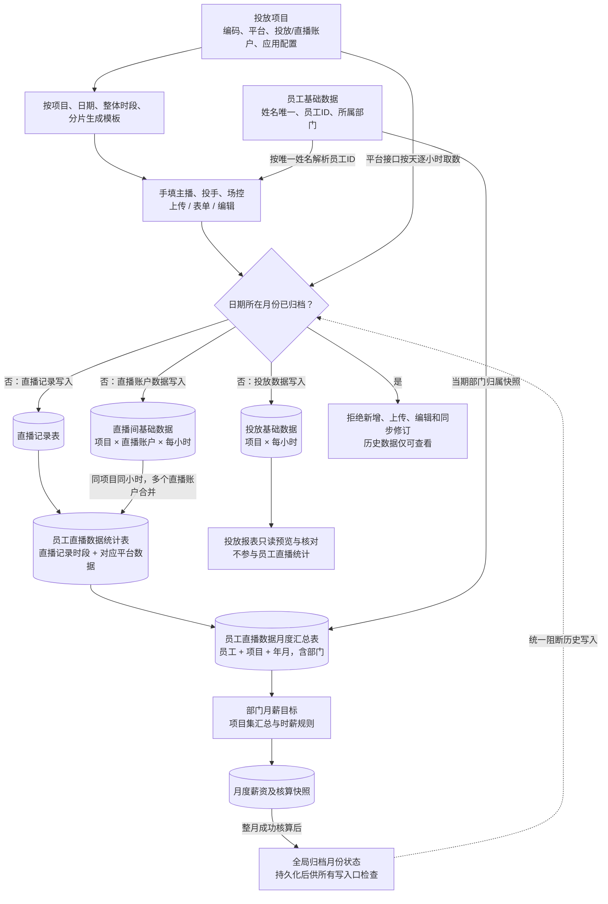

# 美魅网员工工作台规格

状态：本轮业务口径已确认；前端 DEMO 已按新流程更新  
更新日期：2026 年 10 月 13 日  
需求依据：[美魅网员工工作台设计](page://page_07f5d8225a3c819192ad5a4c1239bcaf)及本轮业务沟通。  
变更说明：[直播业务调整规格](./2026-10-13-staffhub-business-flow-revision.md)；[上一轮规格存档](./archive/2026-10-13-before-hourly-live.md)。

## 一 范围与业务主线

### 1.1 范围

本阶段聚焦单公司内部员工管理与薪酬核算，采用 MySQL。员工当前任职、部门和岗位保存在 employees，不建设 organizations、employment_periods 或 employee_assignments。部门管理、账号密码主入口、三平台辅助 SSO、管理员环境变量密码、角色权限和本人薪资条继续沿用。

项目不关联员工；直播记录填写主播、投手、场控，以唯一员工姓名解析稳定 ID。三类来源先落物理表，固定直播明细和月度统计按平台小时数据计算。部门月薪目标从固定月度汇总核算，成功完成全月后归档并冻结来源。

### 1.2 本轮替换

- 项目改为项目编码/名称、巨量引擎或磁力引擎或腾讯 ADQ、投放账户 ID、状态、多直播账户 ID、应用 ID/密钥/授权码；取消员工关联。
- 录入仅保留直播记录表、投放基础数据、直播间基础数据；废弃新流程中的保费、主播排班和绩效评估模型。
- 运营数据集变为固定员工直播数据统计表和员工直播数据月度汇总表，取消可配置表字段及旧员工工作统计数据集。
- 统计只采用直播间基础数据，保费=营销成交金额；三岗位分别汇总、兼岗不重复，岗位贡献不叠加为项目总额。
- 整小时直播记录，连续相同人员组合合并场次；夜班02–06、早班06–08，同项目同月ROI排名。
- 成功核算后全局月份归档，禁止所有入口更改归档月来源；工资确认和发布继续独立。

本阶段不建设真实银行付款、公开注册、多租户、任意运营公式配置或员工自助平台绑定申请。DEMO 不连接真实接口或认证；模拟小时样例与原真实月度资料分开保留。

### 1.3 整体数据流

员工统计仅采用直播间基础数据，投放基础数据独立保留供查询核对，不将两类消耗相加。所有统计仅读取已落表来源，不在清洗或工资计算时调用平台接口。

## 二 管理员账号与权限

### 2.1 内置系统管理员

系统启动时自动保证存在一个内置管理员，用于配置平台应用、创建角色、部门和员工。该账号独立于员工，与员工共用登录页的账号密码主入口，由后端按账号类型选择密码校验方式，不建设初始化向导或管理员注册页面。

| 环境变量 | 约定 |
| --- | --- |
| `STAFFHUB_ADMIN_USERNAME` | 管理员登录名，可选，未设置时使用 `admin` |
| `STAFFHUB_ADMIN_PASSWORD` | 管理员密码，必填且不能为空，始终是密码的唯一来源 |

环境配置在应用启动时加载。内置管理员登录始终校验当前进程加载的环境变量密码，不使用数据库密码作为回退，也不把它视为仅首次创建时使用的初始密码。缺少或为空的密码阻止应用启动，错误信息只说明配置项名称，不包含密码值。

数据库仅保存管理员账号标识、登录名、状态和角色关联，不保存管理员密码或密码哈希。首次启动在事务中创建内置账号与必要角色；后续按唯一内置标识定位同一账号，不重复创建、不覆盖已有业务授权。用户名配置变化更新同一账号的登录名，遇到名称冲突时启动失败。

内置管理员不要求首次登录修改密码，不提供应用内管理员改密或重置密码功能。更换管理员密码通过更新环境变量并重启应用完成；每次启动撤销内置管理员的已有会话，员工账号密码及 SSO 会话不因此撤销。多实例部署时必须使用一致配置，更换密码时同步重启各实例。

登录页没有注册入口，员工以用户名和密码为主登录，不开放手机验证码或邮箱登录。员工密码使用独立的凭据记录，与始终取自环境变量的内置管理员密码区分。真实密码及其配置值不写入日志、审计前后值、页面或导出文件。

内置管理员具有系统配置和授权能力。工资数据权限通过角色明确授权；启动配置不自动发布或发放任何工资。

### 2.2 角色和功能权限

系统内置管理员、HR、数据运营、薪酬核算、薪酬确认、普通员工角色，管理员可新增或修改业务角色。内置管理员角色受保护，不能删除最后一个有效管理员。

权限点使用明确的资源与动作，例如员工查看、员工编辑、身份绑定、运营数据预览、模板下载、表格上传、表单录入、数据确认、运营数据集配置与发布、项目配置、薪酬规则发布、任务执行、工资确认、工资发布及工资导出。不存在底层模型新增或模型字段编辑权限；运营数据集的字段编辑由数据集配置权限控制。

| 角色 | 默认功能 |
| --- | --- |
| 系统管理员 | 登录配置、角色授权和员工管理 |
| HR | 部门和员工维护、联系方式维护、平台身份绑定 |
| 数据运营 | 投放项目维护、数据录入中的预览和业务录入、数据确认、运营数据集配置及发布 |
| 薪酬核算 | 引用已发布运营数据集字段配置薪酬规则、试算、发布规则、查看任务及结果 |
| 薪酬确认 | 工资复核、锁定、发布及授权导出 |
| 普通员工 | 查看本人资料和已发布薪资条 |

功能权限决定菜单、按钮和接口是否可用；后端必须再次校验。普通员工只能访问本人资料和已发布薪资条，不能通过猜测编号访问其他员工。管理角色按授权查看项目或工资范围，首期仅支持预设的本人、指定部门、指定项目或全公司范围。

已发布历史工资按结果快照中的部门判断范围，不因员工当前调岗而自动扩大访问权限。权限变更立即使相关会话权限版本失效。

## 三 员工与部门管理

### 3.1 部门

部门列表支持查询、筛选、新增、编辑、停用和删除。首期采用平级部门，初始可配置投放、素材、直播等业务部门，不强制这些名称为固定枚举。

存在员工、项目分配、薪酬绑定或历史工资引用的部门只能停用，不能物理删除。部门改名不改变部门 ID；历史工资显示核算时的部门名称快照。

### 3.2 员工

员工列表支持查询、筛选、导入、新增、编辑和在职状态维护。员工姓名规范化后全局唯一，离职员工也不释放重名约束；直播记录按唯一姓名解析并保存稳定员工 ID。详情包括基础信息、当前任职、联系方式、登录账号、员工密码设置或重置状态、平台身份、角色、薪酬绑定和授权范围内的历史工资。

`employees` 保存员工编号、姓名、当前部门 ID、当前岗位名称、当前任职开始日期、离职日期和在职状态。员工编号唯一且不可复用，姓名不是身份键。

手机和邮箱由 HR 或管理员直接绑定到员工资料，允许校验格式、变更和移除。本阶段用途为联系方式和辅助核对，不作为 SSO 身份键，也不自动触发短信、邮件验证或账号合并。

### 3.3 任职变更

员工状态为待入职、在职、已离职。离职日期表示最后任职日，不能早于入职日期。实际离职后停用员工账号并撤销会话；未来离职日期到期后执行停用，请求鉴权同时检查日期。

返聘沿用员工编号，更新当前入职日期并清空当前离职日期，由管理员确认账号恢复。员工表只保存当前或最近任职，不自动重建过去任职历史。

调岗、调薪和返聘记录前后值与操作原因。跨月追溯、当月多次任职等情况由核算人员确认当期区间，保存于核算输入快照。员工资料和角色修改不改变已锁定工资。

## 四 账号密码与辅助单点登录

### 4.1 登录入口与账号开通

登录页默认展示用户名、密码和主要的「登录」按钮；企业微信、钉钉、飞书位于表单下方的「其他登录方式」，作为辅助入口。员工与管理员使用同一登录表单，登录身份和权限由后端确定，不通过浏览器选择管理员身份授予权限。

HR 创建员工时同步创建唯一内部账号，配置唯一用户名及初始员工密码；可默认以员工编号作为用户名，但姓名、手机号和邮箱不自动作为登录名。登录名与员工编号为不同字段，修改登录名不改变员工 ID 或历史工资归属。登录名做统一大小写规范化并建立唯一索引，与内置管理员登录名共享唯一命名空间。

账号密码登录不依赖平台绑定，未绑定任何第三方平台的在职员工也可以登录。不提供自助注册。员工账号必须关联员工，内置管理员允许不关联员工。

### 4.2 账号密码登录流程（主入口）

1. 用户输入用户名与密码，提交主登录表单；用户名规范化，密码原样校验，不裁剪密码内容。
2. 后端查找内部账号、检查账号状态，并按账号类型选择凭据：内置管理员仅校验当前进程加载的 `STAFFHUB_ADMIN_PASSWORD`；员工校验员工密码哈希。
3. 员工同时检查在职状态及任职日期，待入职、已离职或停用账号拒绝登录。
4. 不存在账号、密码错误或账号不可用使用统一失败提示；按账号和请求来源限制尝试频率，连续失败临时限制登录。
5. 校验成功后建立可撤销会话，轮换会话标识；普通员工进入本人资料，管理员进入管理工作台，菜单由服务端授权决定。

用户名和密码只经 HTTPS 提交给后端。密码、密码哈希及环境变量不由前端下发或持久化。前端角色选项、员工编号或浏览器本地状态不能作为正式授权依据。

### 4.3 员工密码维护

员工初始密码由授权 HR 或管理员设置，后端只保存带独立随机盐的 Argon2id 密码哈希与算法参数，不保存明文或可还原密码。实现按 [OWASP 密码存储指南](https://cheatsheetseries.owasp.org/cheatsheets/Password_Storage_Cheat_Sheet.html)校验算法和成本配置。

首次使用员工初始密码或 HR 重置后的密码登录时，进入改密步骤，完成前不开放业务页面。员工修改密码需校验原密码；忘记密码联系 HR，由授权人员重置，不增加短信、邮件找回或公开重置入口。首次改密标记只约束账号密码登录，已验证 SSO 仍可作为辅助认证方式，不因未绑定 SSO 阻止账号密码登录。

员工密码修改或重置递增凭据版本并撤销该员工的所有会话，包括密码和 SSO 会话。审核日志只记录操作人、账号、时间和原因，不记录密码或哈希。此员工密码流程不适用于内置管理员；管理员继续仅通过环境变量改密，不生成数据库密码凭据或应用内重置入口。

### 4.4 平台预绑定与辅助登录

HR 在企业微信、钉钉、飞书开通员工账号后，可在员工新增或编辑页绑定任意组合的平台身份，不要求三种平台全部开通。多个平台身份关联同一内部账号，与账号密码登录访问相同的员工资料和工资归属。

绑定使用平台返回的稳定用户标识及所属企业、应用连接，不能只填写显示名称。暂时无法核实的绑定为未验证，验证通过后才可用于 SSO；外部身份在同一连接范围内唯一，不允许绑定给不同员工。

1. 用户点击辅助平台入口，或从平台客户端打开工作台。
2. 后端创建短期单次登录状态并完成平台授权响应验证，获取可信平台身份。
3. 按配置的企业和应用范围匹配已验证的预绑定身份，检查账号及员工状态，建立同一体系的会话。
4. 普通员工进入本人资料，按功能权限展示菜单。

未绑定、未验证、已停用或不匹配的身份仅拒绝该次 SSO，并提示使用账号密码或联系 HR；不生成账号、注册申请或自助绑定。姓名、手机号、邮箱和浏览器直接提交的用户 ID 不能替代平台身份验证。SSO 失败不改写员工密码或注销其正常的账号密码登录能力。

### 4.5 会话与解绑

两种登录方式使用统一的服务器端可撤销会话及安全 Cookie，记录登录方式与凭据或连接版本。退出登录、账号停用、员工实际离职或密码重置时撤销相关会话，后续请求同时检查账号和任职状态。

身份解绑、重绑定或连接停用时撤销使用该身份或连接建立的 SSO 会话；正常的账号密码会话不因此失效。历史工资始终关联内部员工编号。

平台密钥和令牌保存在私有密钥或加密缓存中，不进入员工资料或普通日志。

### 4.6 DEMO 交互范围

未登录时显示独立登录页，以用户名密码表单为主，三个平台按钮为辅；支持密码显隐、失败提示、登录后的身份切换与退出。演示账号使用明确标注的公开演示口令，不代表员工真实密码，也不读取或下发正式管理员环境变量。员工演示登录名为临时员工编号，成功后查看该员工本人资料。

DEMO 不实现真实后端认证、初始密码发放、密码哈希或首次改密，不把浏览器模拟状态描述为正式安全验证。正式实现遵循前述账号、凭据和会话设计。

## 五 页面与交互

左侧导航不显示「工作空间」「个人与管理」分组标签。管理员依次显示：本人资料、角色管理、部门管理、员工管理、运营工作台、薪酬规则、薪酬核算；实际入口仍按账号权限过滤，普通员工只显示本人资料。

| 页面 | 核心交互 |
| --- | --- |
| 登录页 | 用户名密码主表单、密码显隐和失败提示；表单下方提供三平台辅助登录；无注册 |
| 本人资料 | 默认首页，查看资料及已发布工资月份、工资条明细 |
| 角色管理 | 仅管理员创建角色、配置功能权限和范围 |
| 部门列表 | 搜索、筛选、新增、编辑、停用、受限删除 |
| 员工列表及详情 | 人员维护、联系方式与身份绑定、角色、薪酬归属 |
| 运营工作台 | 投放项目、三个固定录入模型、两个固定统计表；维护直播记录和查看小时数据及全岗位汇总 |
| 薪酬规则 | 时薪枚举规则、项目集绩效提成规则、月薪目标规则、固定月度统计快照绑定、部门应用、试算及发布 |
| 薪酬核算 | 核算任务列表、执行进度、工资结果、异常及日志、工资确认发布和导出 |

规则页展示草稿与已发布版本，已发布版本不可原地修改。任务详情可查看输入覆盖情况、运营数据集计算结果、逐人工资、命中规则和错误原因。

工资计算成功不自动对员工展示，只有经过确认并发布的工资条进入本人首页。

### 5.1 运营工作台

固定为投放项目、数据录入、运营数据集三分区。投放项目取消员工关联，配置三类平台及账户、应用访问和授权；数据录入只保留直播记录表、投放基础数据、直播间基础数据。运营数据集展示员工直播数据统计表、员工直播数据月度汇总表，表字段及关联公式固定只读，不提供新建表或字段配置。

直播记录支持参数化模板下载、上传、表单录入、条件预览和编辑。两类平台基础数据只读查询，后台按项目及账户逐小时取数落表。页面展示归档月份和来源小时缺口，已归档历史数据只能查看、过滤及导出。

### 5.2 薪酬核算页

薪酬规则从固定员工直播月度汇总的确认快照读取数据。成功完成整月核算并保存结果后立即归档月份；确认锁定和工资发布继续独立处理。核算失败不归档，归档后不再更改来源或覆盖原工资。

员工档案录入仍在员工管理。人工工资调整沿用独立原因和审批，不作为直播时段或平台业务数据录入。

## 六 投放项目

| 字段 | 约定 |
| --- | --- |
| 项目编码 | 唯一、必填；模板及统计关联使用编码解析内部项目 ID，引用后不随意改码 |
| 项目名称 | 必填；模板预填并按项目编码核对，名称不作为关联主键 |
| 关联平台 | 巨量引擎、磁力引擎、腾讯 ADQ；选择一个平台 |
| 投放账户 ID | 文本标识，避免数字精度损失；与应用 ID 区分 |
| 项目状态 | 启用或停用；正式取数仅针对启用且授权有效的项目 |
| 直播账户 ID | 多个文本标识，项目内去重；分别取数，再按明确口径关联 |
| 应用 ID | 对应所选平台的应用标识，不套用所有平台为同一种数字格式 |
| 应用密钥 | 首次配置输入，后续不回显；后端加密保管，留空保留已有密钥 |
| 授权码 | 平台授权流程取得的临时输入；后端完成交换后不将其作为长期访问令牌使用 |

DEMO 中已有来源记录的项目禁止直接更换平台、投放账户或直播账户集合，避免旧来源失去解释依据；名称、状态和应用凭据仍可修改，账户顺序可调整。新账户需以新项目承接。正式系统若需同项目账户迁移，应另行实现按日期生效的绑定和历史解释，不覆盖已有来源。

项目不保存员工列表、主播、投手、场控或项目员工有效期。人员归属由具体直播记录保存。取消当前 DEMO 中 `Project.employeeIds` 及所有依赖该列表的筛选与导入校验。

应用配置、账户授权及取数就绪状态分开展示。各平台由对应适配器处理，不因为填写应用 ID、密钥和授权码就假称真实授权成功。授权方式、有效期与字段可用性依接入平台权限确认。

正式系统不在列表、导出、工资快照或日志中显示原密钥、授权码及令牌。DEMO 仅使用虚构值，保存是否配置的标记，不持久化输入密钥或授权码。

## 七 数据录入的三张物理表

第 6 项不再单独设置，以第 7、8 项为准，数据录入固定为以下三张表。

三张数据录入模型均保留「查看表结构」入口，展示固定业务字段、演示字段标识、类型/单位、来源和系统辅助字段，仅可读。归档月份也可查看结构，不允许新增、删除或配置字段。

### 7.1 直播记录表

业务字段固定为：**投放项目编码、投放项目名称、投放日期、开始时间、结束时间、主播、投手、场控**。

存储同时保存内部记录 ID、项目 ID、三类人员的员工 ID 及姓名快照、版本、来源批次、创建/修改人和时间。员工 ID 是写入时解析得到的稳定关联，不要求用户在模板中填写额外员工 ID 列。

每条记录表示项目在该日期上的一段实际直播时段及人员安排。时间使用北京时间和半开区间 `[开始时间, 结束时间)`，起止必须整小时对齐，结束必须晚于开始；不接受 06:30 等非整点边界。24:00 表示次日 00:00；跨日记录按日期拆分后保存，每一天均校验归档状态。

重复上传不能默默累加时长。系统识别项目、日期、开始及结束时间的重复和交叠，展示冲突；编辑通过内部记录 ID 更新有效版本。同项目时间区间不能重叠。同项目、同主播/投手/场控组合的连续区间合并为一场，包含午夜相连的区间；人员任一岗位变化或时间中断开始新场次。

### 7.2 直播记录模板

| 参数 | 默认值与行为 |
| --- | --- |
| 投放项目 | 支持单选、多选；至少选一个，预填编码与名称 |
| 日期 | 北京时间当天；生成该日期的模板行 |
| 整体时段 | 00:00–24:00，即全天 |
| 时段分片 | 默认 60 分钟；分片只能是正的整小时倍数，整体时段也必须整点对齐，最后一段到整体结束时间为止 |

每个选中项目分别生成分片行，不能把多个项目放进一行。例如选择两个项目、全天、按小时切分，生成 48 行；开始和结束时间连续，不重叠，也不漏掉最后一段。

主播、投手、场控三列留空，由用户手填。模板附员工姓名参考页和字段说明，不能默认填写首位员工或虚构人员。模板中未填写人员的行只是待填写行，不直接成为核算事实；DEMO 写入时要求三类人员都填写且匹配已有员工；同一员工兼岗允许，但个人统计不重复该记录。

### 7.3 员工姓名唯一与写入校验

- 员工姓名按统一规则规范化后全局唯一，不按部门分别唯一，离职员工也不自动释放名称。
- 新增、修改和导入员工时都检查重名；已有重名先人工确认，不自动加后缀或合并员工。
- 每个已填写姓名必须精确匹配唯一员工；去除首尾空白并统一文本规范，不做模糊匹配或拼音猜测。
- 上传、表单和编辑使用相同校验。项目编码须存在，项目名称须与编码一致；姓名不匹配、时间冲突或归档日期阻止提交。
- 写入后保存员工 ID 和姓名快照，之后的统计按 ID 关联。员工改名不重写已归档直播记录或工资。
- 项目不关联员工，因此不再校验“员工是否在项目员工名单内”；新录入或编辑记录的三岗位员工均须在职，明确入职日期不能晚于直播日期；日期格式及真实日历合法性统一检查。DEMO 档案入职日期为空时明确显示待维护并允许录入，已冻结历史统计仍按当时快照展示。

上传采用整批校验、整批写入。任何行涉及已归档月份或其他阻断错误，本批不部分写入。失败反馈行号、字段和原因。

### 7.4 投放基础数据

字段固定为：**投放项目、开始时间、结束时间、消耗、总支付金额、展示数、点击数、转化数、转化成本、转化率、支付订单数**。

内部存储平台、项目 ID、投放账户 ID、小时区间、平台响应依据、批次、有效版本及覆盖状态。投放项目是展示字段，内部关联使用稳定 ID。

### 7.5 直播间基础数据

字段固定为：**投放项目、直播账户 ID、开始时间、结束时间、消耗、营销成交金额、营销点击次数、营销点击率、营销点击单价、转化率、转化数、转化成本、营销 ROI、营销下单数、直播间观看人次、新增粉丝数、直播间打赏次数**。

每个直播账户分别保存小时记录。账户数量不固定，不能把多个账户的累计报表重复算入同一小时。

### 7.6 全天逐小时取数

按所有启用项目的所选平台、投放账户和直播账户，将指定日期划分为 24 个小时区间，逐区间请求并写入对应物理表。当前日期只处理已经结束的小时，未结束小时显示等待，不伪造全天完整数据。

业务键分别采用项目/投放账户/小时区间，以及项目/直播账户/小时区间；必要时加入平台接口维度。相同小时响应更新有效版本，不把重复请求累加。请求失败的小时保留缺口，不能标记该日完整。

后端请求与写入都检查归档月份。小时任务在核算归档前启动、归档后返回时，写入阶段仍需拒绝更新。平台不支持所需小时范围或必要字段时展示不支持/缺失，不按日值除以 24，不自动以其他指标填补。

## 八 两张固定运营统计表

页面可切换表、按项目/日期/员工/部门筛选，查看结果及更新状态。两张表的字段、来源选择、关联逻辑和公式由系统固定，不提供字段映射配置、自由公式编辑或新增数据集。保留内部结构版本和计算版本用于追溯，结构升级通过应用版本完成。

### 8.1 员工直播数据统计表

字段固定为：**投放项目编码、投放项目名称、投放日期、开始时间、结束时间、主播、投手、场控、消耗、成交金额、点击次数、点击率、点击单价、转化率、转化数、转化成本、ROI、下单数、观看人次**。

每行对应一条有效直播记录，带内部直播记录 ID 及三类人员 ID。先按项目和时间范围汇总平台数据，再关联直播记录，不能把小时数据与所有人员或直播账户直接做多对多连接后求和。

统计仅使用直播间基础数据，按项目、日期和小时汇总所有已配置直播账户，再归属同一时段的直播记录。投放基础数据不参与员工直播统计。记录只能整小时对齐，因此不分摊小时数据；同项目直播记录不得时间重叠，缺少任何必要账户小时来源时阻止统计，不默认为零。

金额和数量按来源与归属口径聚合；率、单价和 ROI 不直接求和，也不简单平均。ROI 为营销成交金额÷消耗，点击单价为消耗÷营销点击次数，转化成本为消耗÷转化数；点击率、转化率按平台对应分母在相同范围重算，缺少必要分母时保留未定义状态。平台缺少字段不能显示为真实零值。平台点击率、转化率的必要分母由适配器明确提供；聚合多小时或多账户时缺少分母返回未定义，不能把观看人次自动当成营销点击率分母。单一来源可保留其原始平台率，点击单价或转化成本分母为零时同样未定义。模拟样例提供明确的虚构分母，用于验证聚合，不声称适用于所有平台。

### 8.2 员工直播数据月度汇总表

字段固定为：**员工 ID、员工名称、所属部门、投放项目编码、投放项目名称、年份、月份、主播、总直播时长、夜班直播时长、早班直播时长、总消耗、总保费、夜班消耗、早班消耗、ROI、时耗、ROI 排名、直播场次、夜班直播场次、早班直播场次**。

基础粒度为员工 + 项目 + 年月。主播、投手、场控分别按参与记录汇总；内部保留员工担任的角色集合，页面在员工名称下标识岗位。“主播”列展示该员工参与记录中的主播姓名集合。同一人兼任多个岗位时同一记录只累计一次。每个岗位获得其参与时段的完整业务贡献，非三人均分；各岗位的贡献不能合计为项目或公司总额，项目总额从去重后的直播统计明细计算。

所属部门沿用当期核算的确认部门及快照，不因当前部门变动增加重复月度行。月度金额、时长先汇总基础值，再计算 ROI 和时耗，薪酬匹配使用未舍入数值。

已确认的固定统计口径：

| 字段 | 固定定义 |
| --- | --- |
| 总保费 | 等于参与直播记录的营销成交金额合计，不采用投放基础数据总支付金额，不额外施加早班保费系数 |
| 总时长 / 总消耗 | 参与记录的小时合计 / 同范围直播间消耗合计 |
| 夜班 | 北京时间每天 [02:00,06:00)，按小时相交累计时长及消耗 |
| 早班 | 北京时间每天 [06:00,08:00)，按小时相交累计时长及消耗 |
| ROI | 总保费 ÷ 总消耗；使用未舍入值 |
| 时耗 | 总消耗 ÷ 总直播时长；使用未舍入值 |
| ROI 排名 | 同项目同年月全部参与员工排名，三类岗位均参与；采用并列竞争排名（1、1、3），无效 ROI 不取得有效排名 |
| 直播场次 | 连续同项目同人员组合合并；每位参与员工每场只计一次 |
| 早班 / 夜班场次 | 合并场次与对应班次有正时长交集计一次；同一场可同时计入早班及夜班，二者不要求相加等于总场次 |

跨日连续场次保留同一标识；跨月场次在其涉及的每个月按参与部分计一场，各月只归属本月时长及金额。

### 8.3 表结构查询与字段分类

两张运营数据集表均在当前表标题栏提供「查询表结构」入口。弹窗展示字段名称、演示字段标识、字段分类、指标子类型、数据类型、单位、来源及计算说明。数据录入的三张表也使用相同分类展示。查询为只读操作，归档后仍可使用，不改变源记录、计算结果、固定字段或工资快照。

| 字段分类 | 指标子类型 | 示例 | 含义 |
| --- | --- | --- | --- |
| 维度 | 不适用 | 员工 ID、员工名称、角色、部门、项目、日期、年份、月份、开始/结束时间 | 描述身份、归属和期间；数字年份月份仍是维度，不因数值类型变为指标 |
| 指标 | 时长指标 | 总直播时长、夜班直播时长、早班直播时长 | 表示时间跨度，统一以小时展示；起止时间本身不属于时长指标 |
| 指标 | 常规指标 | 消耗、保费、成交金额、点击/转化/订单/观看数量、比率、单价、ROI、时耗、排名、场次 | 表示金额、数量、比值或计算结果；时耗单位为元/小时，归为常规指标 |

时长指标与常规指标是固定指标字段的描述性分类，不建立独立可配置的维度或指标管理分区。比率、排名和单价不能因归为常规指标就直接相加或平均，继续采用各字段已明确的聚合方法；本次分类不自动启用新的薪酬规则或特殊奖励。

结构元数据记录 `field_kind`（dimension / metric）、`metric_type`（duration / regular，仅指标有值）、类型、单位、来源和口径，跟随系统固定结构版本维护；维度的 `metric_type` 为 NULL。指标类型必须与语义及单位一致，运营人员不能自行改分类。DEMO 将这些固定元数据保存在应用代码中，正式实现由固定结构元数据管理，不改变既有业务事实表字段。

## 九 薪酬规则

### 9.1 规则层级与数据集绑定

主播薪酬方案由三层规则组成：多个可复用的时薪计算规则、一个绩效提成计算规则、一个月薪计算目标规则。“单个”约束针对一份员工薪酬方案，不限制系统为不同部门维护多份方案。

| 规则层级 | 数量与职责 | 输入及输出 |
| --- | --- | --- |
| 时薪计算规则 | 可创建多个，为不同项目集提供不同枚举和组合方式 | 数据集数值字段 → 时薪 |
| 绩效提成计算规则 | 每份主播方案引用一个；包含若干互斥项目集及其时薪绑定 | 项目集时薪 × 项目集直播时长，再汇总 → 月度绩效提成 |
| 月薪计算目标规则 | 每份主播方案一个，是应用员工并生成核算任务的目标 | 固定薪资 + 引用的绩效提成 → 月薪金额 |

配置顺序为选择固定员工直播月度汇总的确认快照及字段 → 创建时薪规则 → 创建项目集绩效规则 → 创建月薪目标规则 → 应用部门与实际员工 → 试算并发布目标规则。

规则图引用同一固定统计结构及确认快照版本及稳定字段编号，明确员工、部门、项目、年份、月份和直播时长字段。员工 ID 和部门 ID 字段缺失时月薪目标不能发布。不能按显示名称匹配，也不能读取源接口或未确认统计快照。

主播的月薪目标仅包含固定薪资和绩效提成，不自动额外加岗位津贴或项目奖金。经确认的人工收入调整和扣款属于核算后续汇总，不混入时薪或绩效规则。

### 9.2 时薪计算规则

时薪规则可创建、编辑草稿、试算、发布版本、停用及受限删除。每个规则定义名称、固定统计快照版本、参与计算的数值字段及计算方式。

每个选中字段维护自己的枚举项：

| 配置 | 定义 |
| --- | --- |
| 指标选择 | 从已绑定数据集中选择 ROI、时耗、消耗等数值字段 |
| 枚举 key | 一个精确数值或数值范围；范围明确上下限和端点是否包含 |
| 枚举 value | 命中该 key 后返回的时薪值，单位元每小时，可显式为零 |
| 未命中处理 | 阻止计算，或明确配置默认时薪；不能自动默认为零 |

一个字段的枚举内，重复数值、范围重叠、精确值落入已有范围等多重命中情况阻止发布。范围上下限顺序必须有效；相邻区间共享端点时不能同时包含该端点。无界范围需有至少一个有效边界；时薪值必须为非负精确数值。比较使用未作展示舍入的计算值。

计算方式只支持以下两种：

- 单指标：选择一个字段，用其命中枚举 value 作为最终时薪。
- 多指标相加：选择两个或更多字段，分别匹配各自枚举，再将所有命中 value 相加。字段不能重复选择，任一必需字段缺失或未命中且无默认处理时整个规则失败。

这里不单独划分基础档位和附加档位，所有选中字段都采用相同的 key 到时薪 value 映射机制。

例如 ROI 为 1.6 时映射 60 元每小时，时耗为 4000 时映射 10 元每小时；选择二者相加，时薪为 70 元每小时。另一个规则可将同一 ROI 映射 50，时耗 2000 至 3000 映射 10，组合为 60。示例仅说明能力，生产范围及边界仍须完整配置。

### 9.3 绩效提成规则与项目集

一份主播方案使用一个绩效提成规则，规则内按已有项目创建多个分类项目集。每个项目集可单选一个项目或多选多个项目，并且只能绑定一个已发布时薪规则版本；多个项目集可复用同一时薪规则。

同一绩效规则版本内，一个项目最多归入一个项目集。重叠分类阻止发布。数据集中存在待计薪但未分类的项目时阻止核算，除非授权人员明确排除并记录原因，不能静默遗漏。

对同一员工、年份和月份，取项目集包含的所有项目行，先汇总：

绩效规则明确绑定直播时长、消耗、保费及 ROI、时耗对应的稳定字段编号。比值的项目集聚合表达式明确引用分子和分母字段，不根据字段显示名称猜测计算方式。

> 项目集直播时长 = 各项目的员工直播小时合计  
> 项目集消耗 = 各项目消耗合计  
> 项目集保费 = 各项目保费合计  
> 项目集 ROI = 项目集保费 ÷ 项目集消耗  
> 项目集时耗 = 项目集消耗 ÷ 项目集直播时长

这是已确认的多项目口径：先汇总基础数值，再重新计算 ROI、时耗；不求各项目 ROI 或时耗的简单平均，也不逐项目匹配时薪。

选择消耗时，时薪枚举输入为项目集消耗；选择 ROI 或时耗时，输入为上述重新计算值。其他数值字段要明确项目集聚合方式，不能对比值、排名等字段默认求和。

用汇总结果执行所绑定的时薪规则，得到统一项目集时薪：

> 项目集绩效提成 = 项目集时薪 × 项目集直播时长  
> 员工月度绩效提成 = 所有项目集绩效提成之和

输入记录重复、期间混用、字段缺失或分母为零时先核对，不伪造零值。来源完整且确认未参与项目集、所有基础量为零时，该集贡献为零且不必匹配时薪；零时长但消耗或保费非零时提示异常并阻止未确认计算。

### 9.4 月薪目标规则

月薪目标规则保存名称、固定薪资、唯一绩效提成版本、固定统计快照版本及部门员工字段引用、明确的适用部门、有效期间和员工覆盖设置：

> 员工目标月薪 = 员工固定薪资 + 员工月度绩效提成

固定薪资为明确金额，可为员工设置授权覆盖值。主播目标规则只有一个绩效引用，不重复选择同一绩效规则或多个中间规则后再次相加。

适用部门为必填，选择一个或多个具体部门 ID，不能留空后默认为全公司。发布前显示所选部门和实际员工名单，只有这些员工可以生成该目标的核算结果。员工同一有效期间只能绑定一个主月薪目标，跨规则的重叠绑定必须先解决。

执行顺序为：确定目标部门及当期员工 → 过滤数据集行 → 按员工项目集汇总 → 时薪枚举匹配 → 绩效提成 → 月薪目标。正式条件为数据行的 `employee_id` 在任务确认名单中、当期 `department_id` 属于所选部门，且年份月份匹配。

其他部门或未被目标绑定的员工行在工资汇总前排除，不影响该目标的时薪、绩效及工资结果；固定统计中的 ROI 排名仍按同项目同月全部参与员工计算，不因目标部门过滤改写排名。不能只在最终工资表隐藏无关员工。名单中的员工缺数据属于异常，不能因过滤没有匹配行就静默跳过。

任务保存部门和员工快照；员工后续调岗或新入职不会自动加入、移出或改写已发布任务。执行时发现影响当期归属的变化要提示复核，确认新范围需更新绑定并重算。月中调岗或换规则按确认期间分段，完整月度任务不重复加固定薪资。

工资核算将目标月薪与已确认的人工收入调整、扣款分开展示，形成应发、扣款和实发。工资条可展开项目集、统一时薪、直播时长和提成，不只给出总金额。绩效合计和目标月薪是汇总值，不能再次作为收入明细累加到各项目集及固定薪资之上。

### 9.5 多项目试算

以下是用于验证规则的示例数据，不代表实际工资：

| 项目 | 直播小时 | 消耗 | 保费 |
| --- | --- | --- | --- |
| 项目 A | 40 | 100000 | 100000 |
| 项目 B | 60 | 300000 | 540000 |

把 A、B 归入同一项目集并绑定 ROI 与时耗相加的时薪规则：总时长 100 小时，消耗 400000，保费 640000，ROI 为 1.6，时耗为 4000。若命中 60 和 10，统一时薪为 70，项目集提成为 7000。

两个项目各自 ROI 为 1 和 1.8，时耗为 2500 和 5000；简单平均会得到错误的 1.4 和 3750，不能用于项目集时薪匹配。

该员工另一个项目集如产生 6000 提成，单个绩效规则汇总为 13000；固定薪资为 5000 时，月薪目标为 18000。两个项目集必须互斥，固定薪资不按项目集重复发放。

### 9.6 投手及其他岗位

此前投手提成公式保留为其他岗位绩效策略：项目计提消耗 × 0.001 × 分成比例 × 绩效系数，只在该岗位目标另行提供全部所需参数时启用。本轮已取消绩效评估录入和项目员工分成配置，不能把缺失系数默认为1或强制套用主播规则。投手不被强制套用主播时薪乘时长公式，分成比例不得重复乘。

其他岗位同样通过主目标规则绑定员工，绩效策略及所需字段明确配置。素材实际公式未提供，不自动套用主播或投手规则。岗位津贴等其他组成项只有在该岗位目标规则明确配置时参与，不自动加入主播月薪目标。

### 9.7 发布与复用

时薪、绩效提成和月薪规则都有草稿、已发布、停用状态。中间规则发布只冻结自身版本，不绑定员工、不生成工资任务；月薪目标发布才创建员工绑定和核算任务。

发布月薪目标前展示固定统计快照版本、员工和部门字段映射、时薪枚举及组合、项目集绑定、绩效引用、固定薪资及覆盖、明确适用部门和确认员工名单、过滤后行数、月份、运行时间和试算结果。

整个引用链必须已发布、类型匹配、无循环且使用同一固定统计快照版本。适用部门必须存在且有效，员工归属与部门字段需可确认，员工绑定及项目集不能重叠。参数不完整、未命中处理未指定或部门范围内试算失败时不能发布。

目标发布在同一事务中保存不可变目标版本、依赖版本清单、员工绑定和任务，并创建或复用当月正常工资批次。之后新入职或调岗人员不静默加入已发布任务。

修改任一已发布时薪枚举、项目分类或绩效规则需创建新版本。旧月薪目标继续引用原版本，不自动升级；采用新版本需明确发布新的目标并处理有效区间，不按“最后发布”覆盖历史。

## 十 薪酬核算与月份归档

薪酬规则引用新的固定月度汇总表及稳定字段编号，月薪目标继续显式应用具体部门。项目集汇总基础消耗、保费和时长后重算比值，再匹配时薪规则；不能对多个项目 ROI 或时耗求平均。

本轮增加班次和排名字段，不等于已自动启用此前待配置的夜班、早班、排名或保薪条款；规则本身的变更需要单独确认。原六套明确 ROI + 时耗规则可在来源和人员口径明确后重新绑定。

### 10.1 全局归档状态

全局状态拟采用 `archivedMonths`，保存 `YYYY-MM` 月份集合和对应归档记录。按照已归档月份集合判断目标日期，不自行把所有更早月份当成已经核算；若业务要求连续截止月份，则改为归档截止日期，不能混用两种语义。

DEMO 在 Zustand 全局状态保存并持久化归档月份。正式系统以 MySQL 归档记录为依据，全局状态作为统一查询结果；应用重启、刷新或多实例不能使历史写入限制丢失。页面状态不能替代后端写入校验。

归档发生在该月整体工资核算成功后：所有目标员工结果及排除依据完整、无阻断异常，保存核算快照并在同一提交中登记月份归档。失败或仅部分成功不归档。工资确认、锁定和发布是后续结果管理，不能把“未发布”当作还可修改归档来源。

### 10.2 所有入口一致拦截

| 操作 | 归档限制 |
| --- | --- |
| 查看、筛选、导出历史记录 | 允许，不能改变数据 |
| 上传直播记录表格 | 任何行涉及归档月份则整批拒绝 |
| 表单新增 | 日期所在月份已归档则拒绝 |
| 编辑直播记录 | 原日期或修改后日期所在月份已归档均拒绝，防止移出历史月份绕过 |
| 跨日时段 | 涉及的每一天均检查，有归档日则拒绝 |
| 接口同步和自动回补 | 跳过归档月份；提交时再次检查，不能覆盖归档有效数据 |
| 来源确认、更正和其他记录写入口 | 执行相同归档约束，不能仅禁用界面编辑按钮 |
| 再次计算归档月份 | 可以读取原冻结依据查看/复核，不能解冻来源或覆盖原核算快照 |

本轮不新增自助取消归档。后续发现历史差错，继续保留原数据和工资，以补发补扣或另行批准的纠错流程处理。归档与数据写入按月份协调，避免同时发生时出现归档后的来源变更。

### 10.3 任务、冻结依据与工资发布

月薪目标发布生成任务，保存规则版本、固定统计结构和快照版本、工资月份、目标部门及确认员工名单。领取任务设置租约和执行令牌；失败保留错误及原快照，未归档月份可修正后重试。重复领取或保存不能重复生成工资，过期执行不能覆盖新结果。

同月不同部门任务可以分别计算，但只有全部本月目标完成或明确排除、无阻断异常，才能在同一事务中保存全月结果并归档。本 DEMO 为单目标全月任务，成功时一次保存工资与归档集合。

归档时冻结三类来源有效版本、两张统计结果、人员和部门快照、规则和工资。后续更改其他月份或当前档案，不影响归档月的锁定和发布。归档与来源写入按同一月份协调事务锁，先发起的接口请求也必须在实际提交时再次检查。

工资批次核算后可确认锁定、再发布；发布后普通员工只能查看本人薪资条。原工资不被重算覆盖，差错通过补发补扣的独立调整记录处理。导出工资汇总、明细和发放清单继续检查权限，实际付款不在本阶段。

## 十一 MySQL 存储设计

### 11.1 通用约定

以 MySQL 8.4 和 InnoDB 为规格基线。内部主键使用 UUID，保存为 `BINARY(16)`；平台标识使用精确比较的字符串，外部 ID 不转为浮点数。

金额为 `DECIMAL(18,2)`，比例、系数、单价和展示前的指标计算至少使用 `DECIMAL(24,8)`，时间跨度保存整数秒。计算采用精确十进制，按规则明确舍入，JSON 内精确值使用字符串。

业务日期使用 `DATE`，月份保存当月第一天，操作及计划时间使用 `DATETIME(6)` 并约定 UTC。有效期间统一为开始包含、结束不包含。

可编辑业务记录有并发版本，固定统计结构与执行快照、项目规则和薪酬规则有不可变版本。固定模型结构版本由系统随应用升级维护，运营人员只读。核心关联使用外键和限制删除，工资及源依据不级联删除。

### 11.2 账号和员工

| 表 | 核心字段和约束 |
| --- | --- |
| `users` | 员工引用可空、管理员或员工账号类型、规范化用户名（全局唯一）、唯一内置账号标识、状态、权限版本；员工引用唯一，不保存明文密码 |
| `user_password_credentials` | 员工账号 `user_id` 为主键及外键、`password_hash`（含盐及算法参数）、`credential_version`、`must_change_password`、`password_changed_at`、初始化或重置操作人；仅员工账号允许一条凭据，内置管理员禁止创建凭据行 |
| `roles` | 唯一角色编号、名称、内置标记、状态 |
| `permissions` | 内置唯一权限编号、资源、动作；角色只从权限目录选择 |
| `role_permissions` | 角色与权限，组合唯一 |
| `user_roles` | 用户与角色，组合唯一 |
| `role_data_scopes` | 角色、资源、预设范围类型及部门或项目列表 |
| `departments` | 唯一编号、名称、状态、并发版本 |
| `employees` | 唯一员工编号、全局唯一规范化姓名、当前部门 ID、岗位名称、任职起止日期、状态、并发版本 |
| `employee_contacts` | 员工、手机或邮箱、值、状态；同一员工同类型同值唯一 |
| `auth_connections` | 平台、外部企业标识、应用标识、Agent 标识、密钥引用、状态 |
| `external_identities` | 连接、内部账号、平台标识类型和值、验证状态、绑定人；连接和标识组合唯一 |
| `sessions` | 令牌摘要、用户、登录方式（密码 / SSO）、密码凭据版本或连接及身份引用、内置管理员标记、权限版本、过期及撤销时间 |
| `login_states` | 单次状态摘要、浏览器绑定摘要、连接、过期及消费时间 |
| `employee_payment_accounts` | 员工、账户密文、银行、尾号、有效期间、状态 |

创建员工及其内部账号、员工密码凭据在同一事务中提交。`user_password_credentials` 的账号类型限制由服务层与存储约束共同校验；内置管理员仍仅从环境变量校验，不能使用员工凭据表作为回退。登录名变更不改写员工关联。

不创建 `identity_binding_requests`。联系方式不用于自动绑定或身份匹配，员工任职和岗位不另建历史实体。

### 11.3 项目、来源和固定统计

| 表或状态 | 新设计 |
| --- | --- |
| `employees` | 保留原字段；增加规范化姓名唯一约束；与用户名唯一约束分别处理 |
| `projects` | 内部 ID、项目编码/名称、关联平台、投放账户 ID、状态；移除员工关系 |
| `project_live_accounts` | 项目、直播账户 ID、状态，支持一个项目多个账户，项目内唯一 |
| `data_source_connections` | 项目、平台、应用 ID、密文凭据/引用、授权状态、令牌引用、凭据版本和修改信息；授权码作为交换输入处理 |
| 原项目员工关系 | 新流程不再写入或引用；旧工资依据中的关联快照保留，不直接删除历史 |
| `live_records` | 项目、业务日期、起止时间、主播/投手/场控员工 ID 及姓名快照、记录版本、批次、有效状态及审计 |
| `ad_delivery_hourly_records` | 投放基础数据的所有固定字段及项目/账户/小时区间、采集批次和有效版本 |
| `live_room_hourly_records` | 直播间基础数据的所有固定字段及项目/直播账户/小时区间、采集批次和有效版本 |
| `employee_live_statistics` | 固定员工直播明细字段、对应直播记录、来源小时版本及统计执行版本 |
| `employee_live_monthly_summaries` | 固定月度字段、员工/项目/年月业务键、部门快照、统计版本及归档引用 |
| `payroll_month_archives` | 唯一工资月份、成功批次、统计快照版本、归档人或任务、归档时间；作为全局归档状态的持久依据 |
| 旧保费、排班、绩效和可配置数据集表 | 新流程不再使用；已锁定/已发布历史工资的来源与版本保留，不直接抹除 |

金钱使用 DECIMAL，时间统一北京时间业务含义，账户和应用 ID 按平台要求以文本保存。统计表内部字段可包含稳定关联、版本及审计信息，但不向运营用户开放字段结构配置。

### 11.4 核算及审计

保留不可变时薪规则、互斥项目集绩效规则、部门月薪目标、目标员工绑定、核算任务和尝试、月度工资批次及员工结果、人工调整、导出记录和审计表。规则按稳定字段编号引用固定月度统计，不能保存任意 SQL 或可执行脚本。

`payroll_month_archives.month` 全局唯一，关联完整正常工资批次、固定统计版本和归档时间。直播记录的项目、日期、整点起止与并发版本有索引；平台小时表按项目、账户、完整维度和小时区间建立唯一业务键。统计明细关联直播记录 ID，月度汇总按 `(employee_id, project_id, year, month)` 唯一。

授权码仅作为平台交换输入；必要的异步短期保存使用受保护存储并及时清除，不作为长期鉴权值。应用密钥、访问和刷新令牌由后端加密保护，密钥管理与管理员环境变量密码独立。

## 十二 数据质量与安全

上传、表单、编辑和同步使用同一归档校验。原日期和目标日期都检查，整批失败不部分写入；归档与写入事务协调，重启后仍保留归档状态。项目及员工关联按稳定 ID 保存，姓名、项目名称仅在录入时校验和展示。

平台小时数据检查每个必需账户、时段和字段的覆盖，不把未采集、字段缺失或未知人员当成零。同项目直播记录不能重叠，多个账户先按项目小时汇总，再关联人员，投放消耗不与直播间消耗混加。金额比值采用未舍入值触发薪酬枚举，展示精度不改写来源。

普通员工只能查看本人资料和已发布工资。密钥、授权码、令牌、真实密码和银行账号不出现在普通日志或工资条。模板、源文件和导出只由授权人员访问。应用凭据与员工 SSO 独立，应用配置成功不代表账户授权通过。

## 十三 验收场景

| 场景 | 验收结果 |
| --- | --- |
| 账号密码与管理员环境变量 | 同一主表单；管理员正式密码唯一来源为环境变量；员工密码独立哈希存储 |
| 辅助 SSO | 预绑定身份匹配已有员工账号，未绑定身份可改用账号密码 |
| 员工唯一姓名 | 新增、编辑及导入统一拒绝重名，离职员工名字也不重复 |
| 项目配置 | 全部新字段和多直播账户可维护，无员工列表或员工关联 |
| 模板 | 两项目、当天全天、一小时切分=48行；人员列留空，员工参考页；整点及整数小时分片 |
| 上传及表单 | 唯一姓名解析三人员ID，项目编码名称一致；未知人员、非整点、重叠时段或归档月阻断 |
| 两类基础数据 | 完整固定字段和小时区间，重复响应不累加，缺口可见；归档月不被自动回补覆盖 |
| 固定明细 | 只使用直播间来源，多账户先聚合；投放消耗不参与；完整时段金额关联到三类人员 |
| 固定月度汇总 | 三岗位各自成行、兼岗不重复；部门快照、营销成交金额作为保费；ROI/时耗重算 |
| 班次与场次 | 夜[02,06)、早[06,08)；连续同项目同组合合并场次，班次场次按正交集计数 |
| ROI排名 | 同项目同月全体参与员工竞争排名，目标部门过滤不改变榜单 |
| 薪酬规则 | 项目集互斥、先汇总基础值再算比值、固定薪资只计一次、显式部门和员工名单 |
| 核算归档 | 全月成功与归档一次提交；失败不归档；已归档不覆盖原结果 |
| 所有入口拦截 | 混合历史月份上传整批拒绝；改旧日期到新月仍拒绝；后台请求返回时再次检查归档 |
| 历史快照 | 改其他月份或员工当前档案不影响归档月工资的确认、锁定、发布和本人查看 |

## 十四 数据来源及 DEMO 约定

原飞书薪资标准保留六套明确 ROI+时耗基础规则和其他待配置条款。原绩效资料只有月度汇总，无法还原整小时来源及投手、场控，因此新流程使用明确标注的2026年10月模拟小时数据；原2026年9月实际资料、旧浏览器命名空间和旧规则依据保留，不伪造成新流程真实明细。

本轮三岗位均有工作统计，但正式岗位工资仍由目标规则分别绑定。默认DEMO只将示例主播绑定既有主播基础方案；投手、场控不因已有统计就自动获得主播工资。原标准的早夜班、排名、保薪等特殊奖励尚未自动启用；固定薪资缺正式金额仍暂设0，可在规则中演示调整。

使用并列竞争排名（1、1、3），主播列显示参与记录中的主播姓名集合；DEMO写入要求三角色都填写，兼岗按同一员工去重。这些实施约定在页面和变更说明中可审阅。

正式平台接入须核对各平台小时报表能力、对应字段、授权范围及账户有效期；缺少所需小时数据时不能以日累计平均替代。原参考：[巨量引擎官方OAuth示例](https://github.com/oceanengine/ad_open_sdk_go/blob/master/examples/oauth2_access_token_example.go)、[MySQL精确数值](https://dev.mysql.com/doc/refman/8.4/en/fixed-point-types.html)、[唯一索引](https://dev.mysql.com/doc/refman/8.4/en/create-index.html)、[事务锁定读取](https://dev.mysql.com/doc/refman/8.4/en/innodb-locking-reads.html)。
