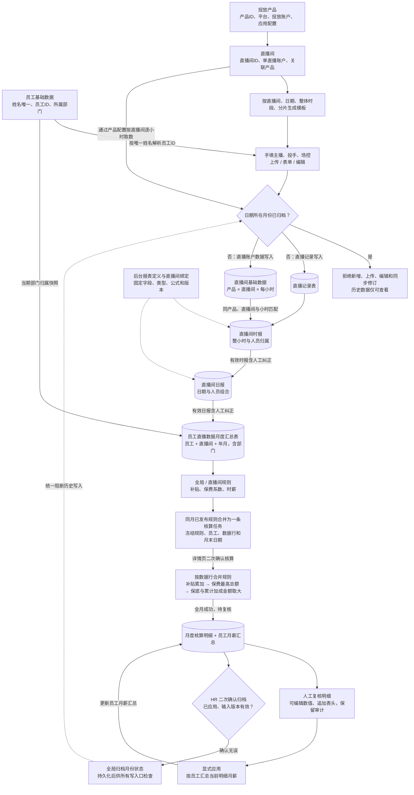

# 美魅网员工工作台规格

状态：本轮业务口径已确认；前端 DEMO 已按新流程更新  
更新日期：2026 年 10 月 16 日

需求依据：[美魅网员工工作台设计](page://page_07f5d8225a3c819192ad5a4c1239bcaf)及本轮业务沟通。  
历史变更说明：[直播业务调整规格](./2026-10-13-staffhub-business-flow-revision.md)；[上一轮规格存档](./archive/2026-10-13-before-hourly-live.md)。薪酬分类、计算及归档的最新口径以本文件第九至十一章和[月度任务与复核规格](./2026-10-16-payroll-review-workflow.md)为准。

## 一 范围与业务主线

### 1.1 范围

本阶段聚焦单公司内部员工管理与薪酬核算，采用 MySQL。员工当前任职、部门和岗位保存在 employees，不建设 organizations、employment_periods 或 employee_assignments。部门管理、账号密码主入口、三平台辅助 SSO、管理员环境变量密码、角色权限和本人薪资条继续沿用。

产品与直播间不关联员工；直播记录填写主播、投手、场控，以唯一员工姓名解析稳定 ID。直播记录与直播间来源先落物理表，按直播间生成后台定义的时报、日报，再统一生成员工月度汇总。全局、直播间两类已发布规则从统一月度汇总核算，同月输入合并为一条任务。核算结果经人工复核、显式应用明细修正后，由 HR 手动归档并冻结来源。

### 1.2 本轮替换

- 投放产品维护平台、投放账户及应用访问，直播间维护单直播账户并关联一个产品，二者都不关联员工。
- 录入仅保留直播记录表、直播间基础数据；废弃新流程中的保费、主播排班和绩效评估模型。
- 运营工作台改为六个左侧二级入口：投放产品、直播间、直播原始统计数据、时报、日报、员工月度汇总。
- 时报、日报按直播间管理，允许不同直播间共用或使用不同固定表头；表头、计算逻辑与绑定关系由后台开发维护，员工不可配置。
- 删除统一直播统计明细表的页面入口；员工月度汇总只保留一张统一表，汇总所有员工与直播间。
- 时报 → 日报 → 员工月度汇总逐层计算，支持基础数据人工纠正与审计，派生指标自动重算，归档后只读。
- 统计只采用直播间基础数据，保费=营销成交金额；三岗位分别汇总、兼岗不重复，岗位贡献不叠加为直播间总额。
- 整小时直播记录，连续相同人员组合合并场次；夜班02–06、早班06–08，同直播间同月ROI排名。
- 取消员工规则分类和员工范围条件，旧当前员工规则迁移为适用全部有效主播的全局草稿，冻结历史不改写。
- 薪酬任务按月聚合，列表仅筛选与只读摘要；详情页核算后进入复核，明细可修正和追加表头，显式应用后更新只读员工汇总。
- HR 复核无误后手动归档，禁止所有入口更改归档月来源及结果；核算成功不自动归档。

本阶段不建设真实银行付款、公开注册、多租户、任意运营公式配置或员工自助平台绑定申请。DEMO 不连接真实接口或认证；模拟小时样例与原真实月度资料分开保留。

### 1.3 整体数据流

员工统计仅采用直播间基础数据。旧投放来源仅保留历史及审计依据，不在当前录入工作台开放，也不继续通过同步入口采集。所有统计仅读取已落表来源，不在清洗或工资计算时调用平台接口。

## 二 管理员账号与权限

### 2.1 内置系统管理员

系统启动时自动保证存在一个内置管理员，用于配置平台应用、创建角色、部门和员工。该账号独立于员工，与员工共用登录页的账号密码主入口，由后端按账号类型选择密码校验方式，不建设初始化向导或管理员注册页面。

| 环境变量 | 约定 |
| --- | --- |
| `STAFFHUB_ADMIN_USERNAME` | 管理员登录名，可选，未设置时使用 `admin` |
| `STAFFHUB_ADMIN_PASSWORD` | 管理员密码，必填且不能为空，始终是密码的唯一来源 |

环境配置在应用启动时加载。内置管理员登录始终校验当前进程加载的环境变量密码，不使用数据库密码作为回退，也不把它视为仅首次创建时使用的初始密码。缺少或为空的密码阻止应用启动，错误信息只说明配置项名称，不包含密码值。

数据库仅保存管理员账号标识、登录名、状态和角色关联，不保存管理员密码或密码哈希。首次启动在事务中创建内置账号与必要角色；后续按唯一内置标识定位同一账号，不重复创建、不覆盖已有业务授权。用户名配置变化更新同一账号的登录名，遇到名称冲突时启动失败。

内置管理员不要求首次登录修改密码，不提供应用内管理员改密或重置密码功能。更换管理员密码通过更新环境变量并重启应用完成；每次启动撤销内置管理员的已有会话，员工账号密码及 SSO 会话不因此撤销。多实例部署时必须使用一致配置，更换密码时同步重启各实例。

登录页没有注册入口，员工以用户名和密码为主登录，不开放手机验证码或邮箱登录。员工密码使用独立的凭据记录，与始终取自环境变量的内置管理员密码区分。真实密码及其配置值不写入日志、审计前后值、页面或导出文件。

内置管理员具有系统配置和授权能力。工资数据权限通过角色明确授权；启动配置不自动发布或发放任何工资。

### 2.2 角色和功能权限

系统内置管理员、HR、数据运营、薪酬核算、薪酬确认、普通员工角色，管理员可新增或修改业务角色。内置管理员角色受保护，不能删除最后一个有效管理员。

权限点使用明确的资源与动作，例如员工查看、员工编辑、身份绑定、运营数据预览、模板下载、表格上传、表单录入、数据确认、运营数据集统计与查询、产品与直播间配置、薪酬规则发布、任务执行、工资结果编辑、工资结果应用、薪酬归档、工资发布及工资导出。不存在底层模型新增或模型字段编辑权限；固定数据集字段结构不允许业务用户配置；具备权限的运营人员可编辑统计行数据。

| 角色 | 默认功能 |
| --- | --- |
| 系统管理员 | 登录配置、角色授权和员工管理 |
| HR | 部门和员工维护、联系方式维护、平台身份绑定、复核无误后手动薪酬归档 |
| 数据运营 | 投放产品与直播间维护、数据录入中的预览和业务录入、数据确认、运营数据集统计、人工纠正与修订查询 |
| 薪酬核算 | 引用已发布运营数据集字段配置薪酬规则、试算、发布规则、查看任务及结果 |
| 薪酬确认 | 工资明细复核、编辑及应用、发布与授权导出；归档另需薪酬归档权限 |
| 普通员工 | 查看本人资料和已发布薪资条 |

功能权限决定菜单、按钮和接口是否可用；后端必须再次校验。普通员工只能访问本人资料和已发布薪资条，不能通过猜测编号访问其他员工。管理角色按授权查看直播间或工资范围，首期仅支持预设的本人、指定部门、指定直播间或全公司范围。

已发布历史工资按结果快照中的部门判断范围，不因员工当前调岗而自动扩大访问权限。权限变更立即使相关会话权限版本失效。

员工档案新增 `non_compete_signed BOOLEAN NOT NULL DEFAULT FALSE`；员工管理可维护是否签约竞业协议，历史缺省按False补齐，新核算快照保留该值，旧归档快照不回写。

## 三 员工与部门管理

### 3.1 部门

部门列表支持查询、筛选、新增、编辑、停用和删除。首期采用平级部门，初始可配置投放、素材、直播等业务部门，不强制这些名称为固定枚举。

存在员工、直播间统计、薪酬绑定或历史工资引用的部门只能停用，不能物理删除。部门改名不改变部门 ID；历史工资显示核算时的部门名称快照。

### 3.2 员工

员工列表支持查询、筛选、导入、新增、编辑和在职状态维护。员工姓名规范化后全局唯一，离职员工也不释放重名约束；直播记录按唯一姓名解析并保存稳定员工 ID。详情包括基础信息、当前任职、联系方式、登录账号、员工密码设置或重置状态、平台身份、角色、薪酬绑定和授权范围内的历史工资。

`employees` 保存员工编号、姓名、当前部门 ID、当前岗位名称、当前任职开始日期、离职日期和在职状态。员工编号唯一且不可复用，姓名不是身份键。

手机和邮箱由 HR 或管理员直接绑定到员工资料，允许校验格式、变更和移除。本阶段用途为联系方式和辅助核对，不作为 SSO 身份键，也不自动触发短信、邮件验证或账号合并。

### 3.3 任职变更

员工状态为待入职、在职、已离职。离职日期表示最后任职日，不能早于入职日期。实际离职后停用员工账号并撤销会话；未来离职日期到期后执行停用，请求鉴权同时检查日期。

返聘沿用员工编号，更新当前入职日期并清空当前离职日期，由管理员确认账号恢复。员工表只保存当前或最近任职，不自动重建过去任职历史。

调岗、调薪和返聘记录前后值与操作原因。跨月追溯、当月多次任职等情况由核算人员确认当期区间，保存于核算输入快照。员工资料和角色修改不改变已锁定工资。

## 四 账号密码与辅助单点登录

### 4.1 登录入口与账号开通

登录页默认展示用户名、密码和主要的「登录」按钮；企业微信、钉钉、飞书位于表单下方的「其他登录方式」，作为辅助入口。员工与管理员使用同一登录表单，登录身份和权限由后端确定，不通过浏览器选择管理员身份授予权限。

HR 创建员工时同步创建唯一内部账号，配置唯一用户名及初始员工密码；可默认以员工编号作为用户名，但姓名、手机号和邮箱不自动作为登录名。登录名与员工编号为不同字段，修改登录名不改变员工 ID 或历史工资归属。登录名做统一大小写规范化并建立唯一索引，与内置管理员登录名共享唯一命名空间。

账号密码登录不依赖平台绑定，未绑定任何第三方平台的在职员工也可以登录。不提供自助注册。员工账号必须关联员工，内置管理员允许不关联员工。

### 4.2 账号密码登录流程（主入口）

1. 用户输入用户名与密码，提交主登录表单；用户名规范化，密码原样校验，不裁剪密码内容。
2. 后端查找内部账号、检查账号状态，并按账号类型选择凭据：内置管理员仅校验当前进程加载的 `STAFFHUB_ADMIN_PASSWORD`；员工校验员工密码哈希。
3. 员工同时检查在职状态及任职日期，待入职、已离职或停用账号拒绝登录。
4. 不存在账号、密码错误或账号不可用使用统一失败提示；按账号和请求来源限制尝试频率，连续失败临时限制登录。
5. 校验成功后建立可撤销会话，轮换会话标识；普通员工进入本人资料，管理员进入管理工作台，菜单由服务端授权决定。

用户名和密码只经 HTTPS 提交给后端。密码、密码哈希及环境变量不由前端下发或持久化。前端角色选项、员工编号或浏览器本地状态不能作为正式授权依据。

### 4.3 员工密码维护

员工初始密码由授权 HR 或管理员设置，后端只保存带独立随机盐的 Argon2id 密码哈希与算法参数，不保存明文或可还原密码。实现按 [OWASP 密码存储指南](https://cheatsheetseries.owasp.org/cheatsheets/Password_Storage_Cheat_Sheet.html)校验算法和成本配置。

首次使用员工初始密码或 HR 重置后的密码登录时，进入改密步骤，完成前不开放业务页面。员工修改密码需校验原密码；忘记密码联系 HR，由授权人员重置，不增加短信、邮件找回或公开重置入口。首次改密标记只约束账号密码登录，已验证 SSO 仍可作为辅助认证方式，不因未绑定 SSO 阻止账号密码登录。

员工密码修改或重置递增凭据版本并撤销该员工的所有会话，包括密码和 SSO 会话。审核日志只记录操作人、账号、时间和原因，不记录密码或哈希。此员工密码流程不适用于内置管理员；管理员继续仅通过环境变量改密，不生成数据库密码凭据或应用内重置入口。

### 4.4 平台预绑定与辅助登录

HR 在企业微信、钉钉、飞书开通员工账号后，可在员工新增或编辑页绑定任意组合的平台身份，不要求三种平台全部开通。多个平台身份关联同一内部账号，与账号密码登录访问相同的员工资料和工资归属。

绑定使用平台返回的稳定用户标识及所属企业、应用连接，不能只填写显示名称。暂时无法核实的绑定为未验证，验证通过后才可用于 SSO；外部身份在同一连接范围内唯一，不允许绑定给不同员工。

1. 用户点击辅助平台入口，或从平台客户端打开工作台。
2. 后端创建短期单次登录状态并完成平台授权响应验证，获取可信平台身份。
3. 按配置的企业和应用范围匹配已验证的预绑定身份，检查账号及员工状态，建立同一体系的会话。
4. 普通员工进入本人资料，按功能权限展示菜单。

未绑定、未验证、已停用或不匹配的身份仅拒绝该次 SSO，并提示使用账号密码或联系 HR；不生成账号、注册申请或自助绑定。姓名、手机号、邮箱和浏览器直接提交的用户 ID 不能替代平台身份验证。SSO 失败不改写员工密码或注销其正常的账号密码登录能力。

### 4.5 会话与解绑

两种登录方式使用统一的服务器端可撤销会话及安全 Cookie，记录登录方式与凭据或连接版本。退出登录、账号停用、员工实际离职或密码重置时撤销相关会话，后续请求同时检查账号和任职状态。

身份解绑、重绑定或连接停用时撤销使用该身份或连接建立的 SSO 会话；正常的账号密码会话不因此失效。历史工资始终关联内部员工编号。

平台密钥和令牌保存在私有密钥或加密缓存中，不进入员工资料或普通日志。

### 4.6 DEMO 交互范围

未登录时显示独立登录页，以用户名密码表单为主，三个平台按钮为辅；支持密码显隐、失败提示、登录后的身份切换与退出。演示账号使用明确标注的公开演示口令，不代表员工真实密码，也不读取或下发正式管理员环境变量。员工演示登录名为临时员工编号，成功后查看该员工本人资料。

DEMO 不实现真实后端认证、初始密码发放、密码哈希或首次改密，不把浏览器模拟状态描述为正式安全验证。正式实现遵循前述账号、凭据和会话设计。

## 五 页面与交互

左侧导航不显示「工作空间」「个人与管理」分组标签。管理员依次显示：本人资料、角色管理、部门管理、员工管理、运营工作台、薪酬规则、薪酬核算；实际入口仍按账号权限过滤，普通员工只显示本人资料。

| 页面 | 核心交互 |
| --- | --- |
| 登录页 | 用户名密码主表单、密码显隐和失败提示；表单下方提供三平台辅助登录；无注册 |
| 本人资料 | 默认首页，查看资料及已发布工资月份、工资条明细 |
| 角色管理 | 仅管理员创建角色、配置功能权限和范围 |
| 部门列表 | 搜索、筛选、新增、编辑、停用、受限删除 |
| 员工列表及详情 | 人员维护、联系方式与身份绑定、角色、薪酬归属 |
| 运营工作台 | 左侧六个二级入口；维护原始数据，按直播间查看、修正时报与日报，再查询统一员工月度汇总 |
| 薪酬规则 | 全局/直播间两分类、补贴/保费系数/时薪模板、草稿保存、发布及任务生成、删除；条件保薪仍支持表达式 |
| 薪酬核算 | 列表仅筛选与只读月度任务摘要；当前页详情、二次确认核算、明细/员工汇总双页签、显式应用修正、HR手动归档 |

规则页展示草稿与已发布版本，已发布版本不可原地修改。任务详情可查看输入覆盖情况、运营数据集计算结果、逐人工资、命中规则和错误原因。

工资计算成功不自动对员工展示，只有经过确认并发布的工资条进入本人首页。

### 5.1 运营工作台

运营工作台在左侧展开六个二级导航，顺序固定为：投放产品、直播间、直播原始统计数据、时报、日报、员工月度汇总。取消页面顶部对应的分区 tab；子入口具有独立选中态、标题和面包屑。移动端可滚动并选择所有入口，普通员工不显示管理导航。旧 input/datasets/projects 跳转分别兼容到原始数据/月度汇总/直播间。

直播原始统计数据采用水平 tab 切换直播记录表和直播间基础数据，取消左侧模型卡片、重复标题及静态说明。各表保留必要操作、月份及业务筛选和数据表；模板、上传、表单、编辑、结构查询及小时模拟同步入口保持可用。时报与日报顶部仅保留导出、刷新及月份/直播间/日期/人员搜索筛选，取消重复页标题、介绍、版本卡片与定义说明。表格按所选直播间显示实际表头；报表定义和版本收纳到结构弹窗，结构查询和修订记录放在表格操作区；可查询结构、修改数据、恢复自动、查看修订历史和导出，不提供表头或公式编辑、报表新建及绑定配置。

员工月度汇总仅一张表，默认覆盖全部员工和直播间，按员工＋直播间＋年月分别列行；可按部门、员工、产品和直播间筛选。删除直播统计明细 tab 和全局明细入口。月度页面仅保留导出、刷新、查看表结构、月份及业务筛选和表数据；取消统计卡片、说明区、全局修订记录和核算跳转按钮。行内编辑、恢复及修订记录继续可用，结构查询收纳口径及兼容来源信息。归档月份只读，查询显示冻结依据。

### 5.2 薪酬核算页

薪酬规则从固定员工直播月度汇总的确认快照读取数据。同月全部发布输入显示为一条任务，列表仅保留筛选和只读摘要。点击进入当前页详情，二次确认执行核算后进入待复核；明细修正显式应用后才更新只读员工汇总。HR复核无误并再次确认后手动归档，核算成功不自动归档。归档后来源与结果均只读。

员工档案录入仍在员工管理。归档前人工结果修正保留独立理由和审计，经显式应用后供HR复核归档；归档后工资调整另走批准流程，不作为直播时段或平台业务数据录入。

## 六 投放产品与直播间

### 6.1 投放产品

产品支持新增、只读查看、关键词/平台/状态筛选与配置。

| 字段 | 约束 |
| --- | --- |
| 产品 ID | 稳定且全局唯一，必填；引用后不改 ID |
| 产品名称 | 必填，用于展示及模板一致性核对 |
| 关联平台 | 巨量引擎、磁力引擎或腾讯 ADQ |
| 投放账户 ID | 对应产品在该平台的投放账户，文本保存 |
| 产品状态 | 启用/停用 |
| 应用配置 | 应用 ID、应用密钥、授权码；配置与账户是否真实授权分开显示 |

产品不配置员工或直播账户列表。DEMO仅持久化应用ID及密钥/授权码是否配置，输入凭据不进入本地状态。正式授权码用于交换令牌，不作为长期鉴权值。

### 6.2 直播间

直播间支持新增、只读查看、关键词/产品/状态筛选与配置。

| 字段 | 约束 |
| --- | --- |
| 直播间 ID | 稳定且全局唯一，必填；引用后不改 ID |
| 直播间名称 | 必填，模板及导出预填 |
| 平台账户 ID | 一个直播间只绑定一个直播账户 ID，不是产品的投放账户 |
| 直播间状态 | 启用/停用 |
| 关联产品 | 一个明确产品 ID，为直播间提供平台及应用配置 |

一个产品可以关联多个直播间。产品及直播间分别维护稳定ID；直播记录、统计、排名与薪酬规则关联直播间，产品信息通过直播间关系获得。同平台同直播账户不能在多个直播间重复绑定，避免重复取数与归属。

已有来源历史后，不允许直接修改产品平台、投放账户，或直播间的账户及产品归属；新绑定使用新产品/直播间承接。名称、状态和应用凭据配置可以维护，归档快照保留当时名称。新增直播记录、模拟同步及规则发布要求对应直播间和产品启用；已有历史不因当前停用而被删除。

## 七 直播原始统计数据的两张物理表

当前直播原始统计数据保留直播记录表、直播间基础数据两张表；移除投放基础数据的模型入口及相关预览、导出和表结构入口。

两张数据录入模型均保留「查看表结构」入口，展示固定业务字段、演示字段标识、类型/单位、来源和系统辅助字段，仅可读。归档月份也可查看结构，不允许新增、删除或配置字段。

### 7.1 直播记录表

业务字段固定为：**产品 ID、产品名称、直播间 ID、直播间名称、投放日期、开始时间、结束时间、主播、投手、场控**。

存储同时保存内部记录 ID、直播间 ID、三类人员的员工 ID 及姓名快照、版本、来源批次、创建/修改人和时间。员工 ID 是写入时解析得到的稳定关联，不要求用户在模板中填写额外员工 ID 列。

每条记录表示直播间在该日期上的一段实际直播时段及人员安排。时间使用北京时间和半开区间 `[开始时间, 结束时间)`，起止必须整小时对齐，结束必须晚于开始；不接受 06:30 等非整点边界。24:00 表示次日 00:00；跨日记录按日期拆分后保存，每一天均校验归档状态。

重复上传不能默默累加时长。系统识别直播间、日期、开始及结束时间的重复和交叠，展示冲突；编辑通过内部记录 ID 更新有效版本。同直播间时间区间不能重叠。同直播间、同主播/投手/场控组合的连续区间合并为一场，包含午夜相连的区间；人员任一岗位变化或时间中断开始新场次。

### 7.2 直播记录模板

| 参数 | 默认值与行为 |
| --- | --- |
| 直播间 | 支持单选、多选；至少选一个，预填关联产品与直播间的四个字段 |
| 日期 | 北京时间当天；生成该日期的模板行 |
| 整体时段 | 00:00–24:00，即全天 |
| 时段分片 | 默认 60 分钟；分片只能是正的整小时倍数，整体时段也必须整点对齐，最后一段到整体结束时间为止 |

每个选中直播间分别生成分片行，不能把多个直播间放进一行。例如选择两个直播间、全天、按小时切分，生成 48 行；开始和结束时间连续，不重叠，也不漏掉最后一段。

主播、投手、场控三列留空，由用户手填。模板附员工姓名参考页和字段说明，不能默认填写首位员工或虚构人员。模板中未填写人员的行只是待填写行，不直接成为核算事实；DEMO 写入时要求三类人员都填写且匹配已有员工；同一员工兼岗允许，但个人统计不重复该记录。

### 7.3 员工姓名唯一与写入校验

- 员工姓名按统一规则规范化后全局唯一，不按部门分别唯一，离职员工也不自动释放名称。
- 新增、修改和导入员工时都检查重名；已有重名先人工确认，不自动加后缀或合并员工。
- 每个已填写姓名必须精确匹配唯一员工；去除首尾空白并统一文本规范，不做模糊匹配或拼音猜测。
- 上传、表单和编辑使用相同校验。产品和直播间 ID 须存在，名称须分别与 ID 一致，直播间须属于所填产品；姓名不匹配、时间冲突或归档日期阻止提交。
- 写入后保存员工 ID 和姓名快照，之后的统计按 ID 关联。员工改名不重写已归档直播记录或工资。
- 产品与直播间不关联员工，因此不再校验“员工是否在项目员工名单内”；新录入或编辑记录的三岗位员工均须在职，明确入职日期不能晚于直播日期；日期格式及真实日历合法性统一检查。DEMO 档案入职日期为空时明确显示待维护并允许录入，已冻结历史统计仍按当时快照展示。

上传采用整批校验、整批写入。任何行涉及已归档月份或其他阻断错误，本批不部分写入。失败反馈行号、字段和原因。

### 7.4 直播间基础数据

字段固定为：**产品 ID、产品名称、直播间 ID、直播间名称、直播账户 ID、开始时间、结束时间、消耗、营销成交金额、营销点击次数、营销点击率、营销点击单价、转化率、转化数、转化成本、营销 ROI、营销下单数、直播间观看人次、新增粉丝数、直播间打赏次数**。

每个直播间只使用其绑定的单个直播账户保存小时记录。多个直播间分别取数，不能将某账户累计报表复制到其他直播间。

### 7.5 全天逐小时取数

按所有启用直播间及关联启用产品的所选平台和直播账户，将指定日期划分为 24 个小时区间，逐区间请求并写入对应物理表。当前日期只处理已经结束的小时，未结束小时显示等待，不伪造全天完整数据。

直播间来源的业务键采用产品/直播间/业务日期/小时区间，并保存对应直播账户；必要时加入平台接口维度。相同小时响应更新有效版本，不把重复请求累加。请求失败的小时保留缺口，不能标记该日完整。

后端请求与写入都检查归档月份。小时任务在核算归档前启动、归档后返回时，写入阶段仍需拒绝更新。平台不支持所需小时范围或必要字段时展示不支持/缺失，不按日值除以 24，不自动以其他指标填补。

## 八 直播间时报、日报与统一员工月度汇总

### 8.1 固定定义与直播间关联

时报与日报不再假设所有直播间具有同一表头。后台开发分别实现报表定义、字段元数据、计算逻辑和直播间关联；多个直播间可以关联同一定义，也可以各自关联不同定义。定义包含稳定 ID、版本、周期、名称、字段顺序、类型、单位、维度/指标分类、计算/可编辑性及统一月度输入的映射契约。员工只能查看定义及编辑业务数据，不能配置表头、公式、字段映射或绑定。

正式实现将展示字段与标准化统计字段区分：不同直播间的不同字段名称、组合与计算先由后台适配为统一月度输入，再按相同月度口径汇总，不能按表头文字拼接或猜测公式。表结构和计算版本一并记录，历史工资不受后续定义升级影响。

DEMO 内置两套固定样例，展示共用表头与不同表头，均明确标识为演示定义，不代表尚未提供的真实直播间表头。新建但未被后台样例绑定的直播间显示“未关联报表定义”，不能自动借用其他直播间的表头。为保留已有浏览器数据及历史演示，未绑定直播间的原有统计采用明确标注的兼容来源；月度表结构查询中列出这些直播间，不宣称该部分已经通过专属时报、日报。正式接入应补齐后台定义与关联后再进入标准报表链。

### 8.2 时报与日报

时报按直播间和整小时展示，关联该时段主播、投手、场控；直播记录可覆盖多个整小时，按来源小时形成时报，不把整段平均分摊成真实小时数据。缺少必要小时来源时拒绝统计，不自动补零。日报按直播间、日期和三岗人员组合汇总有效时报，保留人员及时段贡献，供月度分别归属员工。

报表列表按选中直播间定义显示列。结构弹窗展示字段类型、分类、时长/常规指标、来源、计算口径和可编辑性；岗位人员及基础金额、数量可以人工纠正；时报、日报的直播间、日期、时段固定只读，跨直播间表头不直接迁移。自动计算字段始终只读。率、ROI、单价使用同范围基础值及明确分母重算，不平均小时比率。单小时在没有可选分母时可以保留平台原始点击率/转化率；对应分子修改后缺少分母则该比率未定义，多小时汇总缺完整分母也未定义。分母为零显示未定义，不把观看人次猜作点击率分母。新日报覆盖优先于其时报自动汇总，独立月度覆盖最后生效；界面应提示上层人工覆盖可能使下层修改暂不反映在对应上层行。

旧版整段直播明细人工覆盖保留原键、原期间及修订历史，不把其修正金额伪造成小时来源。该段覆盖作为明确标记的历史人工依据参与下游；对应小时的再次修改受兼容保护，应先恢复旧段自动统计后再使用新时报修正。

### 8.3 员工月度汇总（单表）

字段固定为以下33列，页面、表结构和导出采用相同顺序：**员工ID、员工名称、部门ID、部门名称、入职日期、是否签约竞业协议、产品ID、产品名称、直播间ID、直播间名称、直播间开播时间、年份、月份、总直播时长、夜班直播时长、早班直播时长、正常直播时长、夜班场次、早班场次、总消耗、夜班消耗、早班消耗、正常消耗、总保费、夜班保费、早班保费、正常保费、ROI、时耗、AD成本、保单成本、ROI排名、消耗排名**。

基础粒度为员工 + 直播间 + 年月。主播、投手、场控分别按参与记录汇总；内部保留员工岗位集合、参与主播名单和总场次供来源追溯与历史规则兼容，不再作为本表业务列。入职日期、竞业协议和直播间开播时间在刷新时形成资料快照；关联员工或直播间更正后重新带出对应资料，不允许在本表独立篡改基础档案。开播时间沿用直播间配置当前的日期精度，未维护时显示未定义。同一人兼任多个岗位时同一记录只累计一次。每个岗位获得其参与时段的完整业务贡献，非三人均分；各岗位的贡献不能合计为直播间或公司总额，直播间总额从去重后的有效团队日报贡献计算。

所属部门沿用当期核算的确认部门及快照，不因当前部门变动增加重复月度行。月度金额、时长先汇总基础值，再计算 ROI 和时耗，薪酬匹配使用未舍入数值。

已确认的固定统计口径：

| 字段 | 固定定义 |
| --- | --- |
| 总保费 | 等于参与直播记录的营销成交金额合计，不采用投放基础数据总支付金额，不额外施加早班保费系数 |
| 总时长 / 总消耗 | 参与记录的小时合计 / 同范围直播间消耗合计 |
| 夜班 | 北京时间每天 [02:00,06:00)，按小时相交累计时长及消耗 |
| 早班 | 北京时间每天 [06:00,08:00)，按小时相交累计时长及消耗 |
| 正常直播时长 / 正常消耗 | 分别为总量减夜班及早班对应总量，自动派生 |
| 夜班 / 早班保费 | 对应班次实际小时营销成交贡献逐层汇总，不能按时长猜分；未知贡献保持未定义 |
| 正常保费 | 总保费−夜班保费−早班保费；任一班次保费未知则未定义 |
| AD成本 / 保单成本 | 预留字段，来源及计算口径推迟梳理；当前待定义，不计算、不手填、不以0替代 |
| 消耗排名 | 同直播间同年月全部参与员工按总消耗降序竞争排名（1、1、3），包含零消耗；筛选不改变排名 |
| ROI | 总保费 ÷ 总消耗；使用未舍入值 |
| 时耗 | 总消耗 ÷ 总直播时长；使用未舍入值 |
| ROI 排名 | 同直播间同年月全部参与员工排名，三类岗位均参与；采用并列竞争排名（1、1、3），无效 ROI 不取得有效排名 |
| 直播场次 | 连续同直播间同人员组合合并；每位参与员工每场只计一次 |
| 早班 / 夜班场次 | 合并场次与对应班次有正时长交集计一次；同一场可同时计入早班及夜班，二者不要求相加等于总场次 |

跨日连续场次保留同一标识；跨月场次在其涉及的每个月按参与部分计一场，各月只归属本月时长及金额。

### 8.4 查询结构与人工纠正

直播原始统计数据、选中直播间的时报/日报和员工月度汇总均保留结构查询。字段分类继续采用：维度描述身份、归属和期间；时长指标表示时间跨度，以小时计；常规指标表示金额、数量、比率、单价、时耗、排名与场次。年份及月份属于维度，时耗为元/小时的常规指标。定义只读，不因可以编辑行数据而开放结构配置。

每次人工纠正必填原因，保存前后值、原行及原期间、目标归属、操作人、时间、定义版本和数据版本。名称由已有目录带出，员工/产品/直播间一致，时段合法，基础指标有限非负且计数为整数。派生指标不接受人工提交；月度班次时长/消耗/保费不能超总量，班次场次各自不能超过总场次。移动到已有业务键拒绝，不能覆盖另一行。

数据链为原始数据 → 时报自动值 → 时报人工值 → 日报自动值 → 日报人工值 → 统一员工月度自动值 → 月度人工值 → ROI/时耗/排名 → 薪酬任务。月度当期部门按有效行用于工资过滤，不修改员工基础档案。人工关联造成已发布任务名单变化时阻断核算，撤回待核算任务后重新发布。

### 8.5 覆盖、恢复与归档

人工覆盖与原始直播记录、平台小时来源独立保存。刷新统计、切换月份和重载保留有效人工覆盖。恢复自动必填原因，只移除本层本行覆盖，不删除历史审计，也不隐含删除其他层的独立人工确认。日报覆盖及月度覆盖继续具有优先级。

已有时报或日报人工覆盖的原始记录，在改变其产品、直播间、日期、三岗或时段前，先恢复关联报表修订；原始写入口提前拒绝可能破坏修订身份的修改，避免来源已变而无法刷新或恢复。其他未关联修订的新增原始记录仍可先录入再补齐小时来源。

保存检查打开弹窗时的数据集版本及来源修订；陈旧版本、失败或没有实际变更均不写部分统计、工资或归档状态。原月份、当前月份和目标月份均执行归档校验，不允许移动归档历史规避限制。

核算成功先保存结果并进入待复核；HR 手动归档时冻结相关时报、日报、月度结果、报表定义与直播间绑定、人工覆盖及审计，并保存最终工资与归档记录。归档之后历史结果使用快照，不按当前定义重新生成。旧归档缺少新报表快照时，时报/日报明确展示“无报表快照”，工资和旧月度冻结依据继续只读，不能冒充重建的新报表。

## 九 两分类、三类型薪酬规则

详细配置见[薪酬规则重构规格](./2026-10-15-compensation-rule-rebuild.md)，计算公式见[分层核算规格](./2026-10-16-layered-payroll-settlement.md)，任务复核见[月度任务与复核规格](./2026-10-16-payroll-review-workflow.md)。旧部门引擎仅用于已有任务和历史工资。

### 9.1 分类与定义

规则仅分全局、直播间两类。分类由新增入口决定，之后只读。全局无员工筛选条件，适用全部符合结算资格的在职主播行；直播间先下拉多选一个或多个房间，再创建规则集。两类共用定义组件，先选计算类型，再定义名称与配置。

旧当前员工规则保留名称和计算配置，移除员工范围条件，生成版本加一的全局草稿；扩大范围后必须重新发布。旧发布任务和已归档快照保留原员工条件及分类。条件保薪中的员工、直播间和月度指标条件继续可用，不能把取消员工范围条件误解为取消保薪条件。

直播间规则集共享适用直播间，补贴、时薪、保费系数每类至多一条、合计至少一条。子规则默认摘要，新增或编辑时展开。其他当前规则集占用的直播间禁选，草稿与已发布均占用；编辑排除本组成员。保存和发布检查归属唯一，历史归档不占用当前绑定。同月旧待核算快照仍占用时，先整组撤回再发布。

### 9.2 模板和合并计算

| 类型 | 模板 | 合并与结果 |
| --- | --- | --- |
| 补贴规则 | 月度计数指标（夜班/早班场次）×补贴金额 | 所有命中补贴金额累加 |
| 保费系数规则 | 可增删系数项：名称、保费字段×系数；公式自动相加 | 每条规则独立算总额，再取最高总额；无候选才沿用原始总保费 |
| 时薪规则 | 选择时长，单选统计指标加成/特殊时段加成/条件保薪 | 各条时薪先乘自身时长；保底金额取最大、加成金额求和，二者取大 |

时长可选总、夜班、早班、正常直播时长。正常保费=总保费−夜班保费−早班保费，正常时长=总时长−夜班−早班。夜班、早班保费来自实际小时成交贡献，不能猜填。系数项可选总/夜班/早班/正常保费，独立读取同一原始行，不逐字段拼接、不叠加候选、不补入未选字段。默认正常＋早班公式排除夜班。系数结果只更新核算工作副本中的有效保费、ROI与同直播间同月合格主播排名，不回写运营数据，也不直接加进工资。

统计指标加成提供可增删改列表，配置弹窗包含名称、指标和档位，公式只读自动显示全部项目名称相加。档位仅支持数值范围和关联指标范围，新增按钮在列表底部；已有档位默认单行摘要，新增/编辑时展开。历史精确数值编辑时等价转换为单点闭区间，原快照保留。特殊时段直接设加成时薪；条件保薪直接设条件与保薪时薪。

每行月薪=max(所有命中保底金额的最大值,所有加成金额之和)+全部补贴；同员工各直播间行月薪相加。比较在金额层完成，不再按时长字段分别取高后相加。例如总时长保底50×100=5000与夜班保底200×20=4000，采用5000。核算只采用当月实际含主播角色、员工在职且归属有效的行；投手与场控仍保留运营统计。

### 9.3 条件、日期和发布

全局范围无员工条件；条件保薪仍支持类型受控的嵌套 AND/OR、员工/直播间/月度指标。新保费系数规则不配置早班场次条件。判断基准为核算月末并冻结；最近N个月按日历月含边界判断，未来日期不命中，必要日期缺失提示维护。

保存草稿后发布，冻结规则版本、月份、月末日期、员工名单、数据行键、数据版本及来源修订。直播间规则集原子保存和发布，底层每个成员形成一份发布输入并冻结组ID、成员ID和共同版本，同月统一归属一条月度核算任务。撤回任一成员须撤回同组同月全部待输入，拒绝成员缺失或版本混用。删除成员撤回该组待输入后重新发布完整组。新旧部门模型不能混算。

### 9.4 历史与展示

规则页仅显示全局、直播间分类及分类内新增按钮和列表。直播间规则集展示房间和成员摘要，统一编辑、发布、删除。移除页面说明、核算月份、数量概览和历史来源入口；月份在发布弹窗中选择。历史来源与冻结依据继续保留。

规则删除经确认后逻辑删除、释放当前绑定并原子撤回待输入，已核算工资与归档保留；归档月相关输入不得改写。已删除规则不能保存或发布。新模板采用 `definitionVersion=2`；除员工范围合并外，旧模板只在编辑确认后升级，原系数条件、加成触发条件或混合类型的差异须提示，冻结任务不改写。

## 十 薪酬核算、结果复核与月份归档

### 10.1 月度任务列表与详情

一个月份显示一条任务，包含该月全部有效已发布规则输入。列表只有筛选栏和只读任务摘要，支持月份、状态和文本筛选；摘要包括月份、规则数量、人员数量与状态。去掉标题说明、独立核算月份区域和列表级“开始月度核算”。点击任务在当前页进入详情，返回保留列表筛选，不使用详情 dialog。

详情展示核算/重新核算操作、基础信息及结果。基础信息包含月份、状态、数据集版本、规则输入、员工范围、核算和归档时间。执行核算必须二次弹框确认；重新核算明确提示人工修正的处理。全月校验完成后一次保存完整结果并进入“待复核”，失败不保存部分工资，不自动归档。旧部门任务作为历史兼容输入，不与新任务混算。

### 10.2 两张结果表与显式应用

详情采用“月度核算明细”“员工月薪汇总”两个水平页签，两张均可检索和导出。新明细按员工×直播间×月份列行，固定44列分为直播数据统计33列、基础核算4列、直播间核算4列、结果3列；历史三范围48列按原快照只读展示。

仅月度核算明细可追加文本/数字/金额表头、编辑统计数值和结果，包括计算所得数值。员工、部门、产品、直播间、日期等固定关联信息保持只读。直接编辑不重算其他字段，不回写运营统计，也不即时修改员工汇总；这与运营表仍自动派生 ROI/时耗/排名的纠正逻辑相互独立。

修改立即保存为待应用草稿并要求理由，记录操作者、时间、前后值及版本。追加列名称非空、不与固定或追加字段重名，值按类型校验；追加字段仅补充资料，不自动加工资。未知字段、无效数值、负数最终工资、过期版本整次拒绝。

只有明确点击“应用”，才按员工ID汇总明细当前“总计月薪”更新只读员工月薪汇总；其他结果列与追加列不自动相加为工资。应用前汇总保留上次应用结果，待应用状态禁止归档。原始自动核算依据单独保存，人工修正不能覆盖它。

### 10.3 HR 手动归档与全局状态

HR 复核无误后，使用“薪酬归档”权限手动归档并二次确认；管理员演示身份可执行。要求计算结果完整、无待应用修改，并核验来源及任务在核算后未变化；已变化时要求刷新来源、重新发布或重新核算。核算成功本身不写入归档月份。

归档事务冻结最终两表、追加表头与单元格、修改/应用审计、规则版本、人员部门快照、原始直播记录及平台数据、时报/日报/月度统计、报表定义和绑定，保存归档人、时间及复核版本，再登记全局 `archivedMonths`。后续当前档案或其他月份变化不能修改归档依据。

页面头部只读显示最近“薪酬归档月份”，无归档显示“暂无归档”。按归档月份集合精确拦截，不把所有更早月份自动视为归档。DEMO 使用 Zustand 持久化状态，正式系统以 MySQL 归档记录为依据；刷新、重启、多实例不能使锁定丢失。

### 10.4 所有入口一致拦截

| 操作 | 归档限制 |
| --- | --- |
| 查看、筛选、导出历史 | 允许，不能改变数据 |
| 上传直播记录 | 任一行涉及归档月则整批拒绝 |
| 表单新增和编辑 | 校验原日期及目标日期，不能移出历史月份绕过 |
| 跨日记录 | 涉及的每一天均检查 |
| 平台同步、自动回补、来源确认与运营修正 | 请求与提交均校验归档，不能覆盖冻结有效数据 |
| 结果编辑、追加表头、应用、重新核算 | 归档后拒绝，只读原冻结结果 |

归档与来源及结果写入按同月份协调事务锁，归档前发起、归档后返回的请求提交时再次拒绝。本轮不增加自助取消归档，历史差错走另行批准的调整流程。旧归档维持原锁定，不自动解锁或按新公式重算。

工资条确认与发布独立于核算，只有授权发布后普通员工才能查看本人。导出继续检查权限，实际工资付款不在本阶段。

## 十一 MySQL 存储设计

### 11.1 通用约定

以 MySQL 8.4 和 InnoDB 为规格基线。内部主键使用 UUID，保存为 `BINARY(16)`；平台标识使用精确比较的字符串，外部 ID 不转为浮点数。

金额为 `DECIMAL(18,2)`，比例、系数、单价和展示前的指标计算至少使用 `DECIMAL(24,8)`，时间跨度保存整数秒。计算采用精确十进制，按规则明确舍入，JSON 内精确值使用字符串。

业务日期使用 `DATE`，月份保存当月第一天，操作及计划时间使用 `DATETIME(6)` 并约定 UTC。有效期间统一为开始包含、结束不包含。

可编辑业务记录有并发版本，固定统计结构与执行快照、直播间绑定和薪酬规则有不可变版本。固定模型结构版本由系统随应用升级维护，运营人员只读。核心关联使用外键和限制删除，工资及源依据不级联删除。

### 11.2 账号和员工

| 表 | 核心字段和约束 |
| --- | --- |
| `users` | 员工引用可空、管理员或员工账号类型、规范化用户名（全局唯一）、唯一内置账号标识、状态、权限版本；员工引用唯一，不保存明文密码 |
| `user_password_credentials` | 员工账号 `user_id` 为主键及外键、`password_hash`（含盐及算法参数）、`credential_version`、`must_change_password`、`password_changed_at`、初始化或重置操作人；仅员工账号允许一条凭据，内置管理员禁止创建凭据行 |
| `roles` | 唯一角色编号、名称、内置标记、状态 |
| `permissions` | 内置唯一权限编号、资源、动作；角色只从权限目录选择 |
| `role_permissions` | 角色与权限，组合唯一 |
| `user_roles` | 用户与角色，组合唯一 |
| `role_data_scopes` | 角色、资源、预设范围类型及部门或直播间列表 |
| `departments` | 唯一编号、名称、状态、并发版本 |
| `employees` | 唯一员工编号、全局唯一规范化姓名、当前部门 ID、岗位名称、任职起止日期、状态、并发版本 |
| `employee_contacts` | 员工、手机或邮箱、值、状态；同一员工同类型同值唯一 |
| `auth_connections` | 平台、外部企业标识、应用标识、Agent 标识、密钥引用、状态 |
| `external_identities` | 连接、内部账号、平台标识类型和值、验证状态、绑定人；连接和标识组合唯一 |
| `sessions` | 令牌摘要、用户、登录方式（密码 / SSO）、密码凭据版本或连接及身份引用、内置管理员标记、权限版本、过期及撤销时间 |
| `login_states` | 单次状态摘要、浏览器绑定摘要、连接、过期及消费时间 |
| `employee_payment_accounts` | 员工、账户密文、银行、尾号、有效期间、状态 |

创建员工及其内部账号、员工密码凭据在同一事务中提交。`user_password_credentials` 的账号类型限制由服务层与存储约束共同校验；内置管理员仍仅从环境变量校验，不能使用员工凭据表作为回退。登录名变更不改写员工关联。

不创建 `identity_binding_requests`。联系方式不用于自动绑定或身份匹配，员工任职和岗位不另建历史实体。

### 11.3 产品、直播间、来源和固定统计

| 表或状态 | 新设计 |
| --- | --- |
| `employees` | 保留原字段及默认False的竞业协议字段；增加规范化姓名唯一约束；与用户名唯一约束分别处理 |
| `advertising_products` | 产品 ID/名称、关联平台、投放账户 ID、状态、并发版本 |
| `live_rooms` | 直播间 ID/名称、单个直播账户 ID、产品外键、状态、可空开播日期opened_on、并发版本 |
| 原 `project_live_accounts` | 不作为新业务关系使用；一个直播间直接保存单账户，历史版本可保留只读 |
| `data_source_connections` | 产品、平台、应用 ID、密文凭据/引用、授权状态、令牌引用、凭据版本和修改信息；授权码作为交换输入处理 |
| 原项目员工关系 | 新流程不再写入或引用；旧工资依据中的关联快照保留，不直接删除历史 |
| `live_records` | 产品、直播间、业务日期、起止时间、主播/投手/场控员工 ID 及姓名快照、记录版本、批次、有效状态及审计 |
| 历史 `ad_delivery_hourly_records` | 仅保留旧投放记录及历史冻结依据，当前录入、查询、导出和同步不使用，不删除原始记录 |
| `live_room_hourly_records` | 直播间基础数据的所有固定字段及产品/直播间/直播账户/小时区间、采集批次和有效版本 |
| 历史 `employee_live_statistics` | 旧明细不再作为页面入口；保留原始追溯、人工覆盖及历史工资依据 |
| `room_report_definitions` | 后台固定定义 ID、时报/日报周期、结构及计算版本、标准化月度映射契约；无员工编辑入口 |
| `room_report_fields` | 定义版本、列序、字段标识、类型、单位、分类、来源、公式说明及可编辑性，由开发版本维护 |
| `room_report_bindings` | 直播间、周期、定义版本、生效区间；允许多直播间共享定义，归档引用确定版本 |
| `live_room_hourly_reports` | 直播间＋日期＋小时、三岗归属、来源键/版本、定义版本、标准值及定义扩展值 |
| `live_room_daily_reports` | 直播间＋日期＋三岗组合、基础值、人员及时段贡献、来源时报版本、定义版本 |
| `room_report_row_overrides` / `room_report_correction_audits` | 周期、原键、期间、定义版本、完整覆盖与前后值、原因、操作者、时间及并发版本 |
| `employee_live_monthly_summaries` | 33个固定业务字段、员工/直播间/年月唯一键、部门及人员/直播间资料快照、来源日报版本、统计版本及归档引用；AD/保单成本为可空预留列，不写默认0 |
| `dataset_row_overrides` | 表类型、原关联键、原/目标月份、完整有效行覆盖、基础统计版本、并发版本、有效/已恢复状态及操作人；同表原键仅一条有效覆盖 |
| `dataset_correction_audits` | 纠正/恢复动作、原键、原/目标月份、前后快照、原因、操作者及时间；审计不可覆盖，归档快照关联相应版本 |
| `payroll_month_archives` | 唯一工资月份、成功批次、统计快照版本、HR归档人、归档时间、已应用复核版本；作为全局归档状态的持久依据 |
| 旧保费、排班、绩效和可配置数据集表 | 新流程不再使用；已锁定/已发布历史工资的来源与版本保留，不直接抹除 |

月度新增 `employee_joined_on DATE NULL`、`non_compete_signed BOOLEAN`快照、`room_opened_on DATE NULL`、夜班/早班/正常保费、正常消耗、`spend_rank INT`；未归档新统计的协议默认false，历史冻结行缺失值不从当前档案补写。正常值及排名由基础值派生；成本预留列为 `DECIMAL NULL`，明确记录待定义状态。

金钱使用 DECIMAL，时间统一北京时间业务含义，账户和应用 ID 按平台要求以文本保存。统计表内部字段可包含稳定关联、版本及审计信息，但不向运营用户开放字段结构配置。

新增 `compensation_rule_sets` 和 `compensation_rule_set_rooms` 保存组版本和当前直播间绑定（room_id唯一）；`compensation_rules.rule_set_id`用于子规则归组，以可空的有效类型生成列建立同组同类型唯一约束，已逻辑删除成员不参与唯一约束。组成员和绑定在事务中锁定并同步更新，任务冻结组ID/版本/成员ID。全局规则不归组。新增 `compensation_rules`/`compensation_rule_versions` 保存global/rooms两分类、三类型模板、定义版本及条件保薪所需的类型受控条件AST；员工范围条件仅保留于旧冻结版本。规则用 `deleted_at` 逻辑删除。模板配置保存补贴计数字段、系数项数组和时薪子类型。`compensation_tasks` 保存规则/员工/行键/数据版本和月末基准，`payroll_row_calculations` 保存合并轨迹（含各候选保费公式及采用结果）；条件JSON不得执行为SQL或脚本。删除、释放当前绑定与撤回待任务须同一事务完成，冻结版本不删除。旧部门规则表保留历史，不用于新版范围分类。

### 11.4 核算及审计

新版使用两范围、三类型规则存储；旧部门规则及历史已用版本保留只读，不物理删除工资依据。下表中 department_salary_*、salary_rule_*、payroll_tasks 为旧模型历史表；新版通过 compensation_* 表实现，不要求部门外键。

| 表 | 核心字段与约束 |
| --- | --- |
| `department_salary_rules` | 部门 ID、规则名称、类型（直播时薪/未来月薪）、草稿版本、状态、并发版本；部门外键必填 |
| `department_salary_rule_versions` | 规则 ID、版本号、发布配置快照、创建人及时间；规则/版本组合唯一，发布后不可原地修改 |
| `salary_rule_metrics` | 规则版本、指标项 ID、固定字段 ID、常规/时长类型、绑定时长字段 ID、直接时薪；时长项不能同时配置档位 |
| `salary_rule_bands` | 指标项、Key 类型、精确值/上下限、包含边界标记、关联字段 ID、时薪及顺序；至少一个范围边界，关联仅允许常规指标 |
| `salary_rule_expression_items` | 规则版本、表达式顺序、指标项 ID；仅加法，引用和顺序唯一 |
| `salary_rule_rooms` | 规则版本、直播间 ID；组合唯一，不新增直播间员工关系 |
| `payroll_tasks` | 工资月份、规则 ID 和不可变版本、部门、确认统计版本、任务状态、发布数据集版本与来源修订号、执行令牌、撤回时间；规则/月仅一个有效任务，撤回历史保留 |
| `payroll_task_employees` | 任务、员工、部门与参与直播间确认快照；任务/员工唯一 |
| `payroll_task_runs` | 任务、尝试编号、输入统计版本、状态、错误及执行日志 |
| `payroll_monthly_jobs` | 唯一月份、输入修订、待核算/待复核/待应用/已归档状态、核算时间、HR归档人及时间、并发版本；规则发布输入通过关联表归属月份 |
| `payroll_batches` | 月份、正常/调整类型、状态、不可变原始计算结果、当前复核/应用版本、数据及规则版本清单；正常批次月份唯一 |
| `payroll_review_edits` | 任务、表、稳定行键、字段覆盖、前后值、原因、操作人及时间、并发版本和应用版本 |
| `payroll_custom_columns` | 任务、明细目标表、字段ID、唯一名称、文本/数字/金额类型及列序；不参与自动工资公式 |
| `payroll_custom_cells` | 任务、明细表、行键、字段ID及受控值；组合唯一，归档冻结 |
| `payroll_employee_results` | 批次、员工、部门快照、金额；批次/员工唯一 |
| `payroll_result_lines` | 员工结果、任务及规则版本、指标项、匹配字段与值、档位、时薪、时长字段与值、金额、直播间集合及来源依据 |
| 调整、导出及审计表 | 保存人工补发补扣、导出人及范围、规则发布和工资锁定/发布日志 |

规则按稳定字段编号引用固定月度统计，不保存任意 SQL 或可执行脚本。指标参数采用高精度 DECIMAL；开放边界以 NULL 表示，不能用0表示无边界。

`payroll_month_archives.month` 全局唯一，关联完整正常工资批次、已应用复核版本、固定统计版本、HR归档人和归档时间。直播记录的产品、直播间、日期、整点起止与并发版本有索引；平台小时表按产品、直播间、账户、完整维度和小时区间建立唯一业务键。统计明细关联直播记录 ID，月度汇总按 `(employee_id, room_id, year, month)` 唯一。

授权码仅作为平台交换输入；必要的异步短期保存使用受保护存储并及时清除，不作为长期鉴权值。应用密钥、访问和刷新令牌由后端加密保护，密钥管理与管理员环境变量密码独立。

## 十二 数据质量与安全

上传、表单、编辑和同步使用同一归档校验。原日期和目标日期都检查，整批失败不部分写入；归档与写入事务协调，重启后仍保留归档状态。产品、直播间及员工关联按稳定 ID 保存，姓名、直播间名称仅在录入时校验和展示。

平台小时数据检查每个必需账户、时段和字段的覆盖，不把未采集、字段缺失或未知人员当成零。同直播间直播记录不能重叠，按直播间单账户小时汇总，再关联人员，投放消耗不与直播间消耗混加。金额比值采用未舍入值触发薪酬枚举，展示精度不改写来源。

普通员工只能查看本人资料和已发布工资。密钥、授权码、令牌、真实密码和银行账号不出现在普通日志或工资条。模板、源文件和导出只由授权人员访问。应用凭据与员工 SSO 独立，应用配置成功不代表账户授权通过。

## 十三 验收场景

| 场景 | 验收结果 |
| --- | --- |
| 账号密码与管理员环境变量 | 同一主表单；管理员正式密码唯一来源为环境变量；员工密码独立哈希存储 |
| 辅助 SSO | 预绑定身份匹配已有员工账号，未绑定身份可改用账号密码 |
| 员工唯一姓名 | 新增、编辑及导入统一拒绝重名，离职员工名字也不重复 |
| 产品及直播间配置 | 产品与直播间字段齐全，一个直播间一个账户，产品外键有效，无员工关联 |
| 模板 | 两直播间、当天全天、一小时切分=48行；人员列留空，员工参考页；整点及整数小时分片 |
| 上传及表单 | 唯一姓名解析三人员ID，直播间 ID名称一致；未知人员、非整点、重叠时段或归档月阻断 |
| 两类基础数据 | 完整固定字段和小时区间，重复响应不累加，缺口可见；归档月不被自动回补覆盖 |
| 固定明细 | 只使用对应直播间单账户小时来源；投放消耗不参与；完整时段金额关联到三类人员 |
| 固定月度汇总 | 三岗位各自成行、兼岗不重复；部门快照、营销成交金额作为保费；ROI/时耗重算 |
| 报表定义 | 不同直播间可共用或使用不同固定表头；后台维护定义、逻辑和绑定，员工无配置入口 |
| 逐层计算 | 时报修正进入日报、日报修正进入月度，月度独立覆盖最后生效；不回写或伪造原始小时值 |
| 人工纠正 | 报表固定直播间和期间，岗位和基础值可修正；月度可改关联及基础指标。原因与前后值可追溯，刷新保留，恢复保留审计，归档原子拒绝 |
| 班次与场次 | 夜[02,06)、早[06,08)；连续同直播间同组合合并场次，班次场次按正交集计数 |
| ROI排名 | 同直播间同月全体参与员工竞争排名，规则范围过滤不改变同直播间榜单 |
| 薪酬规则 | 全局/直播间两范围，员工旧规则转全局草稿且移除范围条件；开放/关联档位唯一命中；保底金额最大与加成金额总和取高后加补贴；发布冻结名单和行键 |
| 月度任务 | 同月一条只读摘要；当前页详情及返回，核算须二次确认，成功仅待复核 |
| 结果复核 | 两页签，仅明细可编辑/追加列；编辑不自动重算，显式应用按总计月薪更新只读员工汇总，待应用阻止归档 |
| 核算归档 | HR手动二次确认，核验输入版本并冻结两表/自定义列/审计；失败或未应用不归档，归档后全部入口只读 |
| 所有入口拦截 | 混合历史月份上传整批拒绝；改旧日期到新月仍拒绝；后台请求返回时再次检查归档 |
| 历史快照 | 改其他月份或员工当前档案不影响归档月工资的确认、锁定、发布和本人查看 |

## 十四 数据来源及 DEMO 约定

原飞书薪资标准保留六套明确 ROI+时耗基础规则和其他待配置条款。原绩效资料只有月度汇总，无法还原整小时来源及投手、场控，因此新流程使用明确标注的2026年10月模拟小时数据；原2026年9月实际资料、旧浏览器命名空间和旧规则依据保留，不伪造成新流程真实明细。

三岗位均有工作统计，新任务按规则范围筛选实际参与的数据行，发布时展示实际名单。员工新增竞业协议布尔字段，历史缺省为false。当前薪酬重构不清空员工、来源、工资和归档，持久化命名空间与版本保持不变。此前产品/直播间升级曾执行一次迁移，清空当时的核算任务、工资批次/结果及归档月份，保留员工、来源和规则配置；该历史迁移不重复执行。旧多账户项目拆成多个直播间，原直播记录只关联主直播间，不复制人员时长；其余账户的小时来源保留在对应直播间，人员记录须明确录入后才统计。迁移后运营统计按新关系生成；后续刷新不反复清空新核算任务。初始种子规则为草稿，不自动发布任务。工资按最大保底与累计加成取高后加补贴，复核修改经显式应用后形成最终员工汇总，未实际发放。

使用并列竞争排名（1、1、3），主播列显示参与记录中的主播姓名集合；DEMO写入要求三角色都填写，兼岗按同一员工去重。这些实施约定在页面和变更说明中可审阅。

正式平台接入须核对各平台小时报表能力、对应字段、授权范围及账户有效期；缺少所需小时数据时不能以日累计平均替代。原参考：[巨量引擎官方OAuth示例](https://github.com/oceanengine/ad_open_sdk_go/blob/master/examples/oauth2_access_token_example.go)、[MySQL精确数值](https://dev.mysql.com/doc/refman/8.4/en/fixed-point-types.html)、[唯一索引](https://dev.mysql.com/doc/refman/8.4/en/create-index.html)、[事务锁定读取](https://dev.mysql.com/doc/refman/8.4/en/innodb-locking-reads.html)。
