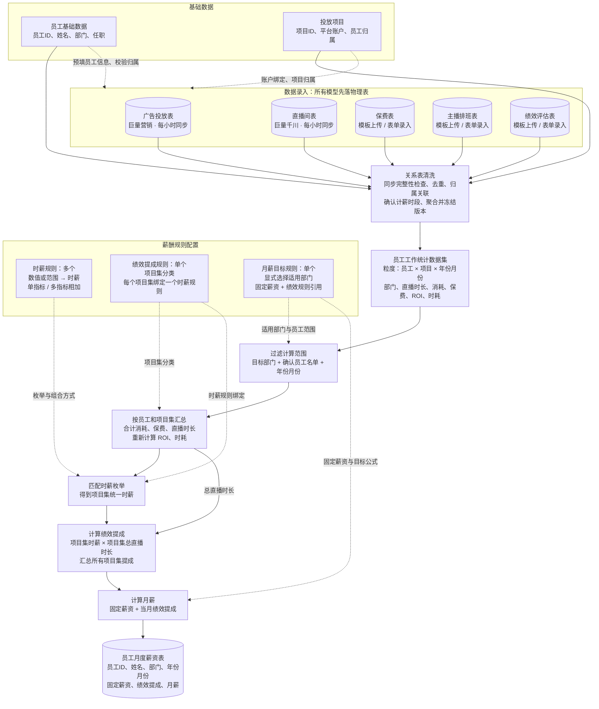

# 美魅网员工工作台规格

状态：待用户审阅  
更新日期：2026 年 10 月 12 日  
需求依据：[美魅网员工工作台设计](page://page_07f5d8225a3c819192ad5a4c1239bcaf)

美魅网员工主要从事保险广告投放业务。本阶段建设员工工作台，将员工身份、保险商投放项目、运营数据、部门薪酬规则和工资核算连接起来，减少人工采集、拼接报表、核对归属和计算工资的工作。

业务主线为：启动时加载管理员环境配置 → 管理员创建角色和部门 → HR 录入员工并绑定平台账号 → 配置投放项目与平台账户 → 手工数据录入落表及广告直播每小时同步落表 → 运营数据集读取物理表并关联清洗 → 发布薪酬规则并生成定时任务 → 核算和确认 → 发布员工薪资条。

## 一 范围及本次变更

### 1.1 建设范围

包括内置系统管理员、角色及功能权限、部门管理、员工管理、三平台单点登录、本人资料及薪资条、运营工作台中的投放项目、数据录入和运营数据集、薪酬规则、定时核算任务、任务结果和日志。

数据库采用 MySQL，系统供单公司内部使用，不建设多租户。员工当前任职、当前部门和岗位信息保存在 `employees`，不建设独立任职历史表。

### 1.2 与此前规格的关系

| 此前设计 | 本次规格 |
| --- | --- |
| 登录时申请绑定 | HR 或管理员录入员工时预先绑定，登录只匹配已绑定身份 |
| 所有账号必须对应员工 | 内置管理员可不关联员工；业务员工账号必须关联员工 |
| 仅预设角色 | 内置基础角色，同时允许管理员创建角色、配置功能权限 |
| 部门只是员工字符串 | 恢复部门列表和 `departments`，员工保存当前 `department_id` |
| 员工首页仅有资料 | 首页包含本人资料和已发布薪资条 |
| 月度工资以金额导入为主 | 外部业务数据驱动指标和部门薪酬计算 |
| 手动发起工资计算 | 发布规则时生成有运行时间的核算任务，支持重试与重算 |
| 可配置模型和独立维度指标 | 固定模型结构只读，运营数据集统一配置表字段映射和公式 |
| 分散的数据管理分区 | 运营工作台仅保留投放项目、数据录入和运营数据集 |

仍不建立 `organizations`、`employment_periods` 或 `employee_assignments`，业务表不使用 `org_id`。部门表恢复是本次页面中部门管理、部门规则绑定的要求；岗位仍直接存入员工表，不建立岗位表。

### 1.3 不包含的能力

不建设广告投放操作、自动修改预算、保险订单交易、银行付款、个税申报、招聘培训、考勤请假、通用审批、完整绩效评估流程或直播排班执行系统。

五类运营模型均为系统内置只读结构，不支持新增模型、配置表头或修改模型字段。绩效评估及主播排班使用固定模型录入数据。项目奖金按需求暂不实现。素材部门可配置固薪、津贴及引用运营数据集字段的薪酬公式，不预设未经提供的素材提成制度。

### 1.4 整体数据流图

实线表示数据处理，虚线表示基础资料或规则配置依赖。

部门过滤在项目集汇总前完成；工资结果保留所用数据、员工部门及规则版本快照。正式薪酬执行时，目标部门及员工范围还会预先用于限定清洗读取范围，避免引入不相关员工数据。

## 二 管理员账号与权限

### 2.1 内置系统管理员

系统启动时自动保证存在一个内置管理员，用于配置平台应用、创建角色、部门和员工。该账号独立于员工，使用仅面向管理员的本地账号密码入口，不建设初始化向导或管理员注册页面。

| 环境变量 | 约定 |
| --- | --- |
| `STAFFHUB_ADMIN_USERNAME` | 管理员登录名，可选，未设置时使用 `admin` |
| `STAFFHUB_ADMIN_PASSWORD` | 管理员密码，必填且不能为空，始终是密码的唯一来源 |

环境配置在应用启动时加载。内置管理员登录始终校验当前进程加载的环境变量密码，不使用数据库密码作为回退，也不把它视为仅首次创建时使用的初始密码。缺少或为空的密码阻止应用启动，错误信息只说明配置项名称，不包含密码值。

数据库仅保存管理员账号标识、登录名、状态和角色关联，不保存管理员密码或密码哈希。首次启动在事务中创建内置账号与必要角色；后续按唯一内置标识定位同一账号，不重复创建、不覆盖已有业务授权。用户名配置变化更新同一账号的登录名，遇到名称冲突时启动失败。

不要求首次登录修改密码，不提供应用内改密或重置密码功能。更换密码通过更新环境变量并重启应用完成；每次启动撤销内置管理员的已有会话，员工 SSO 会话不因此撤销。多实例部署时必须使用一致配置，更换密码时同步重启各实例。

员工登录页没有注册入口，普通员工不开放本地密码、手机验证码或邮箱登录。密码及其配置值不写入日志、审计前后值、页面或导出文件。

内置管理员具有系统配置和授权能力。工资数据权限通过角色明确授权；启动配置不自动发布或发放任何工资。

### 2.2 角色和功能权限

系统内置管理员、HR、数据运营、薪酬核算、薪酬确认、普通员工角色，管理员可新增或修改业务角色。内置管理员角色受保护，不能删除最后一个有效管理员。

权限点使用明确的资源与动作，例如员工查看、员工编辑、身份绑定、运营数据预览、模板下载、表格上传、表单录入、数据确认、运营数据集配置与发布、项目配置、薪酬规则发布、任务执行、工资确认、工资发布及工资导出。不存在底层模型新增或模型字段编辑权限；运营数据集的字段编辑由数据集配置权限控制。

| 角色 | 默认功能 |
| --- | --- |
| 系统管理员 | 登录配置、角色授权和员工管理 |
| HR | 部门和员工维护、联系方式维护、平台身份绑定 |
| 数据运营 | 投放项目维护、数据录入中的预览和业务录入、数据确认、运营数据集配置及发布 |
| 薪酬核算 | 引用已发布运营数据集字段配置薪酬规则、试算、发布规则、查看任务及结果 |
| 薪酬确认 | 工资复核、锁定、发布及授权导出 |
| 普通员工 | 查看本人资料和已发布薪资条 |

功能权限决定菜单、按钮和接口是否可用；后端必须再次校验。普通员工只能访问本人资料和已发布薪资条，不能通过猜测编号访问其他员工。管理角色按授权查看项目或工资范围，首期仅支持预设的本人、指定部门、指定项目或全公司范围。

已发布历史工资按结果快照中的部门判断范围，不因员工当前调岗而自动扩大访问权限。权限变更立即使相关会话权限版本失效。

## 三 员工与部门管理

### 3.1 部门

部门列表支持查询、筛选、新增、编辑、停用和删除。首期采用平级部门，初始可配置投放、素材、直播等业务部门，不强制这些名称为固定枚举。

存在员工、项目分配、薪酬绑定或历史工资引用的部门只能停用，不能物理删除。部门改名不改变部门 ID；历史工资显示核算时的部门名称快照。

### 3.2 员工

员工列表支持查询、筛选、导入、新增、编辑和在职状态维护。详情包括基础信息、当前任职、联系方式、平台身份、角色、薪酬绑定和授权范围内的历史工资。

`employees` 保存员工编号、姓名、当前部门 ID、当前岗位名称、当前任职开始日期、离职日期和在职状态。员工编号唯一且不可复用，姓名不是身份键。

手机和邮箱由 HR 或管理员直接绑定到员工资料，允许校验格式、变更和移除。本阶段用途为联系方式和辅助核对，不作为 SSO 身份键，也不自动触发短信、邮件验证或账号合并。

### 3.3 任职变更

员工状态为待入职、在职、已离职。离职日期表示最后任职日，不能早于入职日期。实际离职后停用员工账号并撤销会话；未来离职日期到期后执行停用，请求鉴权同时检查日期。

返聘沿用员工编号，更新当前入职日期并清空当前离职日期，由管理员确认账号恢复。员工表只保存当前或最近任职，不自动重建过去任职历史。

调岗、调薪和返聘记录前后值与操作原因。跨月追溯、当月多次任职等情况由核算人员确认当期区间，保存于核算输入快照。员工资料和角色修改不改变已锁定工资。

## 四 平台身份绑定与登录

### 4.1 预先绑定

HR 在企业微信、钉钉、飞书开通员工账号后，可在员工新增或编辑页绑定任意组合的平台身份，不要求三种平台全部开通。

绑定内容是平台返回的稳定用户标识及所属企业、应用连接，不能只填写显示名称。能通过平台接口核实时使用查询或选择结果；暂时不能验证的绑定保存为未验证，验证通过后才可用于登录。

HR 创建员工时同步创建一个内部员工账号；多个平台身份关联同一账号，再关联同一员工。外部身份在同一连接范围内唯一，不允许绑定给不同员工。

### 4.2 登录流程

1. 用户选择平台或从平台客户端打开工作台。
2. 后端创建短期单次登录状态，用户完成平台授权。
3. 后端验证授权响应，从对应平台获取可信身份。
4. 将该身份在配置的企业及应用范围内规范化，查找已验证的绑定。
5. 匹配成功后检查账号和员工状态，建立本系统会话。
6. 默认进入本人资料页，菜单随功能权限展示。

未绑定、未验证、已停用或不匹配的身份直接拒绝登录，并提示联系 HR；不生成注册账号、待绑定申请或自助绑定流程。登录匹配不使用手机号、邮箱或姓名替代平台身份。

“仅检查已绑定账号”指完成平台身份验证后只匹配预绑定记录，不再申请绑定；不能信任浏览器直接提交的用户 ID。

### 4.3 会话和解绑

会话使用服务器端可撤销的令牌，浏览器使用安全 Cookie。身份解绑、重绑定、员工离职、账号停用和连接停用时撤销受影响会话，历史工资仍关联内部员工编号。

应用密钥和访问令牌保存在私有密钥或加密缓存中，不进入员工资料或普通日志。平台适配器处理不同平台的身份范围，内部业务不依赖某个平台的用户 ID。

## 五 页面与交互

| 页面 | 核心交互 |
| --- | --- |
| 登录页 | 三平台登录、管理员入口，无注册 |
| 本人资料 | 默认首页，查看资料及已发布工资月份、工资条明细 |
| 角色管理 | 仅管理员创建角色、配置功能权限和范围 |
| 部门列表 | 搜索、筛选、新增、编辑、停用、受限删除 |
| 员工列表及详情 | 人员维护、联系方式与身份绑定、角色、薪酬归属 |
| 运营工作台 | 投放项目、数据录入、运营数据集三个分区，统一处理项目维护、运营数据接入及表字段和公式配置 |
| 薪酬规则 | 时薪枚举规则、项目集绩效提成规则、月薪目标规则、数据集绑定、部门应用、试算及发布 |
| 薪酬核算 | 核算任务列表、执行进度、工资结果、异常及日志、工资确认发布和导出 |

规则页展示草稿与已发布版本，已发布版本不可原地修改。任务详情可查看输入覆盖情况、运营数据集计算结果、逐人工资、命中规则和错误原因。

工资计算成功不自动对员工展示，只有经过确认并发布的工资条进入本人首页。

### 5.1 运营工作台

主导航只设置运营工作台入口，其内部固定为投放项目、数据录入、运营数据集三个分区。原数据模型分区更名为数据录入；原数据源、数据采集与导入、数据明细与核对、维度与指标分区不再设置。

| 分区 | 交互与职责 |
| --- | --- |
| 投放项目 | 按保险商维护项目，在详情中配置平台授权账户、直播间归属及项目规则，执行受限删除或归档 |
| 数据录入 | 按固定模型预览已落地物理表；广告直播显示每小时同步状态，其他模型提供模板下载、上传和表单录入 |
| 运营数据集 | 配置业务表及其字段，从固定模型选择字段映射，设置关联、汇总和公式，预览并发布版本 |

数据录入中列出广告投放、直播间、保费、主播排班、绩效评估五类模型。模型名称、字段、类型、单位、业务键及模板表头均由系统固定，只读查看；可编辑的是支持录入的业务记录，不是模型结构。

广告数据由后台每小时从巨量营销同步，直播间数据每小时从巨量千川同步，先写入对应物理表。页面按项目、账户、直播间及日期等条件查询本地表，不实时查询接口，不提供手工修改接口事实。

保费、主播排班和绩效评估提供固定版本模板下载、表格上传、表单新增及更正、条件预览。上传进度、错误、重复记录和确认状态在当前模型页面内展示，不另设导入或核对分区。

项目详情配置平台授权及账户绑定，按项目切换到数据录入或数据集时保留筛选。凭证不设独立页面；小时同步及文件处理状态和日志在对应模型中展示，不增加运营分区。

运营数据集以表及字段作为唯一配置入口，不把字段分类为维度或指标，也不设独立维度定义或指标定义页面。项目维护、数据预览、业务录入和数据集配置分别检查功能权限和数据范围。

### 5.2 薪酬核算页

薪酬核算页处理工资任务和结果，展示采用的运营数据集版本、数据范围、字段计算值及工资依据，不提供运营数据录入或数据集编辑操作。

数据缺失、接口失败或归属错误时，跳转到运营工作台的数据录入并带上项目、月份和模型筛选；字段映射、汇总或公式错误时，跳转到对应运营数据集。跳转仍检查目标权限，修正后按版本规则重新核算。

仅用于工资的人工金额和扣款仍在薪酬核算中录入并保留原因。保费、排班和绩效评估在数据录入中处理；员工档案导入仍在员工管理中完成。

## 六 投放项目与数据来源

### 6.1 项目

项目的新增、编辑、状态维护和详情查看均在运营工作台的投放项目分区完成。

每个保险商对应一个投放项目，保存保险商编号或名称、项目编号、展示名称、状态和项目规则。源页面中的产品名称可作为项目展示标签，不额外建立保险产品交易模型。

一个项目可关联多个广告或直播账户。账号、直播间等对象与项目的对应关系带生效时间；同一平台对象在同一期间不能同时完整归属多个项目。需要拆分的来源必须定义分配比例并核对合计，不能重复计入。

有数据、规则、任务或结果引用的项目只能停用或归档，不能删除历史依据。

### 6.2 所有模型先落物理表

数据录入负责把五类来源统一保存到 MySQL 物理表。运营数据集预览、清洗和薪酬计算只读取已落表的数据，不在执行期间调用外部数据接口。

| 固定模型 | 落表方式 | 物理表 | 允许的页面操作 |
| --- | --- | --- | --- |
| 广告投放 | 每小时从巨量营销接口同步 | `ad_cost_records` | 条件预览、同步状态查看；无手工上传或表单 |
| 直播间 | 每小时从巨量千川接口同步 | `live_session_records` | 条件预览、同步状态查看；无手工上传或表单 |
| 保费 | 表格上传或表单提交后落表 | `premium_order_records` | 模板下载、上传、表单及更正、条件预览 |
| 主播排班 | 表格上传或表单提交后落表 | `employee_live_segments` | 模板下载、上传、表单及更正、条件预览 |
| 绩效评估 | 表格上传或表单提交后落表 | `performance_inputs` | 模板下载、上传、表单及更正、条件预览 |

来源记录统一保留模型结构版本、业务键、有效记录版本、录入或同步批次和时间。物理表保存标准字段，原始文件或响应私有保存作为核对依据。

平台授权独立于员工 SSO。投放项目管理巨量营销及千川账户、直播间与有效期间，小时同步任务读取这些绑定。权限不足或必要字段缺失时同步失败，不回退为手工填写接口事实。

### 6.3 条件预览

五类模型都支持按固定字段筛选、分页及查看物理表明细。查询本地数据库，不因预览自动触发接口采集；不允许用户执行任意 SQL。

广告和直播同时显示最后成功同步时间、实际统计粒度、覆盖区间及失败提示。所有模型区分完整空结果、明确零值、未录入和同步未完成，不把尚未入库视为没有业务。

预览不修改源记录，不确认整月完整性，不自动发布工资。数据的新鲜程度取决于上传和小时同步的成功状态。

### 6.4 模板上传与表单录入

保费、排班和绩效模板由固定模型生成，采用 `.xlsx`，包含固定表头、字段说明和版本。列顺序可调整，但不能自定义模型或任意表头映射。

上传流程为选择模型 → 下载并填写模板 → 上传 → 格式、ID、业务键及归属校验 → 预览 → 确认写入物理表。阻断错误使整批提交失败，进度和错误清单在当前模型页显示。

表单执行相同校验。更正保存新记录版本和原因，重复业务键明确选择忽略或修订，不默认累计。广告直播的源记录只有同步写入通道。

### 6.5 项目与员工依赖

数据录入将固定模型与业务对象关联。数据集使用这些模型的受控关系表读取，不直接提供平台 URL、凭证或任意数据库表名。

| 操作 | 前置依赖 | 处理 |
| --- | --- | --- |
| 广告直播小时同步 | 项目、有效授权账户、直播间及期间 | 后端解析账户并采集，不能信任前端自行提交的账户归属 |
| 模板下载 | 固定模型、项目月份、授权员工名单 | 固定表头，数据行预填员工 ID、姓名、项目及期间 |
| 上传和表单 | 真实员工项目、有效归属、期间和权限 | 按 ID 校验后写入标准物理表 |

模板员工 ID 使用 `employees.id`，不是姓名或 SSO 标识。表头固定，预填的是数据行；ID 以文本保存。名称只辅助阅读，修改名称不能关联另一个员工。

排班和绩效可生成员工候选行，业务值留空，不预置零时长或系数。保费按订单粒度填写，不虚构员工订单行。参考工作表可列出可选员工和项目。

上传重新校验 ID 和期间。名称变更提示并显示后端名称，未知 ID、越权员工或归属冲突阻止提交。历史员工有效区间仍由核算人员按此前约定确认，不能从当前在职状态猜测。

### 6.6 广告和直播每小时同步

后台调度器按北京时间每个整点为有效项目账户触发同步，两类模型分别记录任务和结果。首次接入可用同一同步流程回补指定起始期间，失败任务在数据录入页查看和重试，不设置独立采集分区。

每小时是采集频率，不保证平台数据一定是小时粒度。平台支持小时报表时采集已结束小时并回查近期区间；返回日级或场次累计数据时，以实际业务键和区间更新，不伪造小时事实或擅自均分。

同步覆盖范围包含上次未完成区间和可配置的近期回查窗口，修正延迟上报及历史调整。首次回补期间、回查窗口与结算前回补范围在项目接入配置中明确，默认不能视为已有完整历史数据。

同步流程：解析项目账户 → 分页请求 → 标准化字段、单位、时间 → 业务键去重及版本比对 → 全部必要页校验 → 在事务中写入当前有效版本及同步水位。

平台日累计或场次累计值按唯一业务键修订。例如当天累计消耗从 10000 变为 15000，本地当前有效金额为 15000，不累计成 25000。相同响应忽略重复，变化保存新版本，旧版本用于追溯。

只有全部页获取并校验成功后，该来源批次才对后续查询可用；失败不能发布半批当前数据，也不能推进完整覆盖水位。已有成功数据保留，缺失区间明确显示。

按项目账户、模型及同步范围防止重复任务；使用租约与执行令牌，过期执行器不能覆盖新结果。重试不重复写入，同步成功后再供数据集读取。

月度数据集可查询同步水位和任务记录，核对期间覆盖、缺口及最后成功时间。小时任务是否成功与平台业务数据是否最终结算是两件事，结算前需确认数据截止及必要回补。

## 七 数据模型与归属

### 7.1 只读模型结构

五类模型由系统预定义。只读结构包含字段编号、名称、类型、单位、必需性、业务键、时间含义、关联标识及来源说明。用户不能新增模型、修改字段、设置模型级转换公式或自行发布模型版本。

固定结构可随应用升级调整，系统记录结构版本并保留旧数据的解释依据；升级不是运营人员配置流程。模板版本及接口适配器版本与对应结构一致，旧模板不符合当前输入约定时提示重新下载。

可配置的字段映射、关联和计算只发生在运营数据集层，不改变底层模型或原始记录。

### 7.2 员工与项目归属

员工、部门、项目、账户、直播间、场次、统计期间、分成比例和绩效系数作为固定模型字段或受控关联信息使用，不单独注册为维度。

员工项目关系保存角色、有效期、分成比例和依据，通过投放项目维护；主播计薪时段和绩效系数在各自数据录入页面确认。共享项目比例不得超过分配池，要求全额分配时合计必须为 1。缺失系数阻止计算，不默认为 1。

### 7.3 数据粒度

| 数据模型 | 标准业务粒度与防重键 |
| --- | --- |
| 广告消耗 | 平台、账户、所选报表维度及统计区间形成一个事实键 |
| 保费 | 项目、保险商订单编号及明确的订单明细键形成一个业务事件 |
| 直播间 | 平台、直播间、场次形成一个场次，修订保留版本 |
| 主播计薪时段 | 场次、员工、确认区间形成一段，允许多人同场但分别校验个人重复时段 |
| 绩效输入 | 员工、项目或全月、月份及指标项形成一条有效输入 |

同一账户的汇总报表与明细报表不能同时叠加。项目和运营数据集配置明确各来源字段的采用范围及粒度；重叠报表只选一份用于汇总，其余可在条件预览中核对。

运营数据集将广告、保费和直播分别聚合到相同项目及统计区间后再关联和计算公式，不直接将明细多对多连接求和，避免金额被复制放大。

### 7.4 主播时段和投手归属

排班用于识别员工与直播时段，计划排班不直接视为实际计薪时长。以平台数据及核对结果确认计薪区间；平台无法给出个人时长时由授权人员确认并说明原因。

跨日、跨月场次按北京时间切分。个人时段需属于对应场次，重复或冲突需先核对。多人同时直播时各自计薪时长可以存在，但项目直播间时长按场次只计算一次。

需要按直播时段关联广告消耗的规则，只能使用可覆盖相应时段的报表。只有日级消耗时，不擅自按小时或主播时长均分，需更细数据或明确批准的分配方法。

## 八 运营数据集

### 8.1 表配置

运营数据集是可配置的业务表，例如员工绩效分析表。用户可创建、编辑、预览、发布、停用或受限删除数据集，不能借此修改固定模型。

每张表定义名称、用途、来源模型、关联条件、每行代表的业务对象、统计期间、筛选条件和字段。员工相关数据集必须体现部门 ID 和名称，支持部门筛选。部门仍作为统一字段配置，不恢复独立维度或指标管理。

字段来源支持映射固定模型字段并聚合，或引用本表字段计算公式。所有模型读取都映射到已落地的物理表，员工及项目通过受控关系关联。数据集配置不直接输入物理表名、任意 SQL、接口 URL 或凭证，清洗和计算不访问外部接口。

跨模型关联必须选择系统允许的稳定键，如员工编号、项目、场次和统计期间，不能按姓名模糊匹配。多对多来源先分别聚合再关联；发布前检查结果行唯一性、重复金额、单位、时间范围和字段依赖。

### 8.2 直播员工工作数据集

主播薪酬使用已发布的直播员工工作数据集，基础粒度为员工、项目、月份。月份必须包含年份，唯一业务行键为 `(employee_id, project_id, year, month)`，不能把不同年份的同月合并。

部门是该业务行的归属及筛选字段，不自动加入唯一键。一个员工项目月份行不能因为当前部门改名或变动重复生成。月中跨部门计薪需显式确认当月计薪部门或生效区间分段，不能只按员工当前部门反推历史。

| 字段 | 编号示例 | 定义 |
| --- | --- | --- |
| 员工 ID | `employee_id` | 关联内部员工，作为员工匹配键 |
| 员工名称 | `employee_name` | 展示名称，不参与关联或防重 |
| 部门 ID | `department_id` | 当期确认的计薪部门，关联内部部门，参与范围过滤 |
| 部门名称 | `department_name` | 部门名称快照，仅展示，不作为匹配键 |
| 项目 | `project_id` | 关联已维护的投放项目，展示时可带名称 |
| 年份 | `year` | 工资所属年份 |
| 月份 | `month` | 1 至 12，与年份共同确定期间 |
| 直播时长 | `live_hours` | 该员工在该项目的确认计薪直播小时 |
| 消耗 | `ad_spend` | 按已确认归属与口径得到的当期消耗 |
| 保费 | `premium` | 按已确认归属与状态口径得到的当期下单保费 |
| ROI | `roi` | 同一业务行的保费除以消耗 |
| 时耗 | `hourly_spend` | 同一业务行的消耗除以直播小时 |

直播时长来自已确认时段，不直接用计划排班。消耗和保费是项目共享值还是已分配的员工值，必须在数据集字段定义中说明，核算不能再次隐式分摊。员工名称、项目名称可以更改，工资始终引用稳定 ID 及版本快照。

运营数据集可有其他表和字段。字段统一映射或计算，不因薪酬配置中称其为“指标”就新增指标实体；时薪选择器中的指标即已发布数据集的数值字段。

同一员工在项目集中的消耗、保费和时长按每个项目的一行汇总。项目值在多个员工行中展示时，不能跨员工把重复的项目金额当成公司总额；项目总直播间时长与员工计薪时长也不能混用。

### 8.3 公式与口径

支持字段聚合、四则运算、本表字段引用、条件比较和排名。使用受限表达式树，不执行 SQL、Python 或任意脚本。发布检查不存在字段缺失、循环依赖、类型或单位错误、关联重复及时间范围不一致。

每个字段保存来源模型和字段编号、聚合或表达式、时间口径、精度及空值处理。ROI 和时耗采用同范围汇总后相除，不对每日比值简单平均，薪酬档位不使用展示舍入值触发。

直播员工工作数据集的 ROI 为保费除以消耗，时耗为消耗除以该员工对应范围的确认直播小时。其他运营表可以采用不同字段口径，但必须独立命名和配置，不把项目直播间时长替代主播计薪时长。保费按下单时间归属，取消、退保和迟到修订的处理记录在项目及数据集口径中。

分母为零或必要字段缺失时字段为未定义或计算错误，不能变为无穷大、零或有效排名。依赖该字段的薪酬项阻止执行，除非规则显式配置且试算验证了该情形。排名的对象、期间和并列规则保存在表版本中。

### 8.4 预览、发布与薪酬引用

草稿可按部门、项目、员工和月份预览，显示字段来源、公式、缺失值和关联校验。普通运营预览默认关联当前部门；正式核算使用任务确认的当期部门快照，不能直接复用可能已变化的预览归属。预览不覆盖源记录，不作为已确认工资输入。

发布后冻结表结构、来源关系、字段映射、公式和口径，产生不可变数据集版本。结构变更另建版本；被工资引用的版本和结果不能删除。

薪酬规则按数据集版本和稳定字段编号引用，不按可修改的显示名称引用。核算同时冻结本次源记录版本、查询条件及计算结果；数据集发布是配置发布，不表示每个月业务数据已经完整。

数据集用于工资时，每个员工、项目和期间必须可确定唯一适用行，或配置明确聚合。重复匹配、缺失行及无法解释的聚合阻止核算。

### 8.5 项目规则

项目详情保留服务费和计提消耗的业务口径，例如总消耗或总消耗减赠款。数据集字段显式引用对应项目规则版本；需要的赠款字段缺失时不能默认零。

服务费、ROI、时耗和提成各自引用明确字段，服务费扣赠款不自动改变其他公式。项目规则变更与数据集版本分别保留，不新增独立指标实体。

### 8.6 关系表数据准备与清洗

所有模型先写入物理表，运营数据集仅通过受控关系表执行读取、清洗、关联、聚合和公式。接口采集与数据集执行解耦，预览及工资计算不会触发广告直播查询。

#### 执行上下文

任务确定数据集版本、用途、适用部门 ID、确认员工名单及当期部门快照、项目范围、期间、模型结构版本、来源表映射、字段及关联分配规则、截止和新鲜度要求。

读取前冻结员工项目参考信息和账户归属，检查物理表数据是否已录入、小时同步是否覆盖期间及存在缺口。来源未准备好时提示等待同步或补录，不在清洗中调用接口补采。

用一致性读取取得该截止点可见的有效记录版本和同步水位，保存不可变记录清单。同步或人工更正在执行中产生的新版本不混入本次结果，也不让各字段分别读取不同版本。

正式薪酬的部门与员工范围先确定，再读取和清洗员工相关物理数据。项目级广告、直播及保费按涉及项目读取，保持已定义口径；不能将部门过滤误用为缩小项目总消耗，也不能对剩余员工重新归一分成比例。员工数据之外的项目共享事实仍须完整。

#### 处理阶段

| 阶段 | 处理内容 | 输出及控制 |
| --- | --- | --- |
| 就绪检查 | 校验上传确认状态、接口模型同步水位、覆盖、新鲜度及参考关系 | 缺数据或未同步区间阻断正式核算 |
| 关系表读取 | 按任务部门、员工 ID、相关项目及期间读取有效物理记录 | 冻结清单，排除不相关员工，不调用接口 |
| 清洗与去重 | 校验已标准化数据，选择有效修订、业务键和范围 | 不累加历史版本或重复记录 |
| 归属处理 | 通过账户项目、场次排班和员工关系确定归属，切分有效区间 | 无法关联及粒度不足时阻断，不按姓名猜测 |
| 质量校验 | 检查缺失、重复时段、分成、金额范围和对账、关联行数 | 定位到表记录、项目、员工及字段 |
| 聚合和关联 | 各来源先按目标粒度聚合，再按稳定键关联 | 防止明细多对多放大消耗与保费 |
| 公式与快照 | 计算字段，验证行唯一，保存来源版本和结果 | 完整通过后才可用于工资 |

ID、单位和基础类型在录入或同步落表时标准化；数据集清洗重点处理当期范围、版本、关联及业务口径。固定模型不开放编辑，数据集字段映射、筛选、聚合和公式继续可配置。

广告通过账户映射项目，直播场次通过确认排班关联员工，保费通过订单归属或确认项目关系关联。数据库中只有日级事实时，不能因为每小时同步就推定存在主播小时级消耗。

主播仍先生成员工项目月份行，再按项目集汇总消耗、保费和时长，重新计算 ROI、时耗后确定统一时薪，不平均项目比值。

### 8.7 清洗任务状态与页面

清洗是运营数据集执行的阶段，不新增运营分区。数据集详情显示就绪检查、表读取、清洗与关联、公式阶段、错误及快照；数据录入页显示本模型上传或小时同步状态。

任务状态为等待、就绪检查中、读取中、清洗中、成功、失败、取消。失败如因数据未到齐，先完成同步或补录再重试；不自动跨入采集流程。

未知 ID、未覆盖期间、同步过旧、必需字段缺失、归属冲突、多对多放大及时段错误阻断正式计算。名称变化等非阻断提示需记录处理结果，不能静默过滤异常行后发工资。

预览可展示标为不完整的中间结果，正式薪酬须全部必需表及校验通过。清洗不反向修改输入表，错误回到录入或同步流程修正，或修改项目关联并产生新版本。

取消和失效租约不能提交结果。输入版本、关联及数据集配置变化时创建新的准备尝试，原结果保留。

### 8.8 同步水位、快照与重复执行

同步水位描述该模型账户的已完成统计区间、缺口、最后成功时间、当前有效批次和实际粒度；不只保存“最后跑过任务”的时间。一次整点同步成功不代表整月数据完整。

预览使用当前有效物理数据并显示同步信息；新鲜度不足时提示，正式核算按已配置的数据截止和新鲜度要求阻断。清洗从表中读取，不用 API 缓存或最新响应替代未落表事实。

工资冻结物理记录版本、同步批次水位、员工项目关系、清洗逻辑版本和数据集版本。原始接口响应仅作为同步批次证据，计算不重新查询它。

同一尝试的重试复用冻结清单；输入修正后重新准备并重算。平台迟到数据经后续小时同步或回补落表，未锁定工资提示复核，已锁定工资通过调整处理。

数据集结果按执行和业务行键防重。后续员工或账户变更不修改原工资快照，过期执行不能覆盖当前有效结果。

## 九 薪酬规则

### 9.1 规则层级与数据集绑定

主播薪酬方案由三层规则组成：多个可复用的时薪计算规则、一个绩效提成计算规则、一个月薪计算目标规则。“单个”约束针对一份员工薪酬方案，不限制系统为不同部门维护多份方案。

| 规则层级 | 数量与职责 | 输入及输出 |
| --- | --- | --- |
| 时薪计算规则 | 可创建多个，为不同项目集提供不同枚举和组合方式 | 数据集数值字段 → 时薪 |
| 绩效提成计算规则 | 每份主播方案引用一个；包含若干互斥项目集及其时薪绑定 | 项目集时薪 × 项目集直播时长，再汇总 → 月度绩效提成 |
| 月薪计算目标规则 | 每份主播方案一个，是应用员工并生成核算任务的目标 | 固定薪资 + 引用的绩效提成 → 月薪金额 |

配置顺序为选择已发布运营数据集及字段 → 创建时薪规则 → 创建项目集绩效规则 → 创建月薪目标规则 → 应用部门与实际员工 → 试算并发布目标规则。

规则图引用同一已发布数据集版本及稳定字段编号，明确员工、部门、项目、年份、月份和直播时长字段。员工 ID 和部门 ID 字段缺失时月薪目标不能发布。不能按显示名称匹配，也不能读取源接口或未发布数据集。

主播的月薪目标仅包含固定薪资和绩效提成，不自动额外加岗位津贴或项目奖金。经确认的人工收入调整和扣款属于核算后续汇总，不混入时薪或绩效规则。

### 9.2 时薪计算规则

时薪规则可创建、编辑草稿、试算、发布版本、停用及受限删除。每个规则定义名称、数据集版本、参与计算的数值字段及计算方式。

每个选中字段维护自己的枚举项：

| 配置 | 定义 |
| --- | --- |
| 指标选择 | 从已绑定数据集中选择 ROI、时耗、消耗等数值字段 |
| 枚举 key | 一个精确数值或数值范围；范围明确上下限和端点是否包含 |
| 枚举 value | 命中该 key 后返回的时薪值，单位元每小时，可显式为零 |
| 未命中处理 | 阻止计算，或明确配置默认时薪；不能自动默认为零 |

一个字段的枚举内，重复数值、范围重叠、精确值落入已有范围等多重命中情况阻止发布。范围上下限顺序必须有效；相邻区间共享端点时不能同时包含该端点。无界范围需有至少一个有效边界；时薪值必须为非负精确数值。比较使用未作展示舍入的计算值。

计算方式只支持以下两种：

- 单指标：选择一个字段，用其命中枚举 value 作为最终时薪。
- 多指标相加：选择两个或更多字段，分别匹配各自枚举，再将所有命中 value 相加。字段不能重复选择，任一必需字段缺失或未命中且无默认处理时整个规则失败。

这里不单独划分基础档位和附加档位，所有选中字段都采用相同的 key 到时薪 value 映射机制。

例如 ROI 为 1.6 时映射 60 元每小时，时耗为 4000 时映射 10 元每小时；选择二者相加，时薪为 70 元每小时。另一个规则可将同一 ROI 映射 50，时耗 2000 至 3000 映射 10，组合为 60。示例仅说明能力，生产范围及边界仍须完整配置。

### 9.3 绩效提成规则与项目集

一份主播方案使用一个绩效提成规则，规则内按已有项目创建多个分类项目集。每个项目集可单选一个项目或多选多个项目，并且只能绑定一个已发布时薪规则版本；多个项目集可复用同一时薪规则。

同一绩效规则版本内，一个项目最多归入一个项目集。重叠分类阻止发布。数据集中存在待计薪但未分类的项目时阻止核算，除非授权人员明确排除并记录原因，不能静默遗漏。

对同一员工、年份和月份，取项目集包含的所有项目行，先汇总：

绩效规则明确绑定直播时长、消耗、保费及 ROI、时耗对应的稳定字段编号。比值的项目集聚合表达式明确引用分子和分母字段，不根据字段显示名称猜测计算方式。

> 项目集直播时长 = 各项目的员工直播小时合计  
> 项目集消耗 = 各项目消耗合计  
> 项目集保费 = 各项目保费合计  
> 项目集 ROI = 项目集保费 ÷ 项目集消耗  
> 项目集时耗 = 项目集消耗 ÷ 项目集直播时长

这是已确认的多项目口径：先汇总基础数值，再重新计算 ROI、时耗；不求各项目 ROI 或时耗的简单平均，也不逐项目匹配时薪。

选择消耗时，时薪枚举输入为项目集消耗；选择 ROI 或时耗时，输入为上述重新计算值。其他数值字段要明确项目集聚合方式，不能对比值、排名等字段默认求和。

用汇总结果执行所绑定的时薪规则，得到统一项目集时薪：

> 项目集绩效提成 = 项目集时薪 × 项目集直播时长  
> 员工月度绩效提成 = 所有项目集绩效提成之和

输入记录重复、期间混用、字段缺失或分母为零时先核对，不伪造零值。来源完整且确认未参与项目集、所有基础量为零时，该集贡献为零且不必匹配时薪；零时长但消耗或保费非零时提示异常并阻止未确认计算。

### 9.4 月薪目标规则

月薪目标规则保存名称、固定薪资、唯一绩效提成版本、数据集版本及部门员工字段引用、明确的适用部门、有效期间和员工覆盖设置：

> 员工目标月薪 = 员工固定薪资 + 员工月度绩效提成

固定薪资为明确金额，可为员工设置授权覆盖值。主播目标规则只有一个绩效引用，不重复选择同一绩效规则或多个中间规则后再次相加。

适用部门为必填，选择一个或多个具体部门 ID，不能留空后默认为全公司。发布前显示所选部门和实际员工名单，只有这些员工可以生成该目标的核算结果。员工同一有效期间只能绑定一个主月薪目标，跨规则的重叠绑定必须先解决。

执行顺序为：确定目标部门及当期员工 → 过滤数据集行 → 按员工项目集汇总 → 时薪枚举匹配 → 绩效提成 → 月薪目标。正式条件为数据行的 `employee_id` 在任务确认名单中、当期 `department_id` 属于所选部门，且年份月份匹配。

其他部门或未被目标绑定的员工行在汇总前排除，不影响该目标的时薪、员工排名、绩效及工资结果。不能只在最终工资表隐藏无关员工。名单中的员工缺数据属于异常，不能因过滤没有匹配行就静默跳过。

任务保存部门和员工快照；员工后续调岗或新入职不会自动加入、移出或改写已发布任务。执行时发现影响当期归属的变化要提示复核，确认新范围需更新绑定并重算。月中调岗或换规则按确认期间分段，完整月度任务不重复加固定薪资。

工资核算将目标月薪与已确认的人工收入调整、扣款分开展示，形成应发、扣款和实发。工资条可展开项目集、统一时薪、直播时长和提成，不只给出总金额。绩效合计和目标月薪是汇总值，不能再次作为收入明细累加到各项目集及固定薪资之上。

### 9.5 多项目试算

以下是用于验证规则的示例数据，不代表实际工资：

| 项目 | 直播小时 | 消耗 | 保费 |
| --- | --- | --- | --- |
| 项目 A | 40 | 100000 | 100000 |
| 项目 B | 60 | 300000 | 540000 |

把 A、B 归入同一项目集并绑定 ROI 与时耗相加的时薪规则：总时长 100 小时，消耗 400000，保费 640000，ROI 为 1.6，时耗为 4000。若命中 60 和 10，统一时薪为 70，项目集提成为 7000。

两个项目各自 ROI 为 1 和 1.8，时耗为 2500 和 5000；简单平均会得到错误的 1.4 和 3750，不能用于项目集时薪匹配。

该员工另一个项目集如产生 6000 提成，单个绩效规则汇总为 13000；固定薪资为 5000 时，月薪目标为 18000。两个项目集必须互斥，固定薪资不按项目集重复发放。

### 9.6 投手及其他岗位

此前投手提成公式保留为其他岗位绩效策略：项目计提消耗 × 0.001 × 分成比例 × 绩效系数，仍从已发布运营数据集读取输入。投手不被强制套用主播时薪乘时长公式，分成比例不得重复乘。

其他岗位同样通过主目标规则绑定员工，绩效策略及所需字段明确配置。素材实际公式未提供，不自动套用主播或投手规则。岗位津贴等其他组成项只有在该岗位目标规则明确配置时参与，不自动加入主播月薪目标。

### 9.7 发布与复用

时薪、绩效提成和月薪规则都有草稿、已发布、停用状态。中间规则发布只冻结自身版本，不绑定员工、不生成工资任务；月薪目标发布才创建员工绑定和核算任务。

发布月薪目标前展示数据集版本、员工和部门字段映射、时薪枚举及组合、项目集绑定、绩效引用、固定薪资及覆盖、明确适用部门和确认员工名单、过滤后行数、月份、运行时间和试算结果。

整个引用链必须已发布、类型匹配、无循环且使用同一数据集版本。适用部门必须存在且有效，员工归属与部门字段需可确认，员工绑定及项目集不能重叠。参数不完整、未命中处理未指定或部门范围内试算失败时不能发布。

目标发布在同一事务中保存不可变目标版本、依赖版本清单、员工绑定和任务，并创建或复用当月正常工资批次。之后新入职或调岗人员不静默加入已发布任务。

修改任一已发布时薪枚举、项目分类或绩效规则需创建新版本。旧月薪目标继续引用原版本，不自动升级；采用新版本需明确发布新的目标并处理有效区间，不按“最后发布”覆盖历史。

## 十 核算任务与工资条

### 10.1 任务创建和调度

月薪目标发布生成一条任务，保存目标及依赖版本、数据集版本、工资月份、适用部门 ID、确认员工名单及计薪部门快照、项目集、运行时间和发布人。中间时薪及绩效规则不生成任务。运行时间按北京时间录入，以 UTC 存储，到期由调度器领取。

任务状态为待执行、执行中、成功、失败、取消；成功任务显示工资结果，失败任务显示步骤及错误，历史任务可查询。

任务分为物理表就绪检查与清洗、运营数据集计算、工资计算及结果保存。全部必需表的录入或同步覆盖校验通过后，再读取冻结关系表版本并计算，流程中不调用巨量接口。数据未就绪时链接到数据录入同步或补录，关联和公式错误链接到项目或数据集详情，不发布部分工资。

### 10.2 重试和重算

调度器通过事务领取任务并设置执行租约，避免两个执行器同时运行。运行中断、租约过期和外部临时错误采用有限重试，超过次数标记失败。

自动重试沿用同一任务及已确定的输入快照；需要重新采集、换规则、改员工或修正输入时创建新计算尝试或重算任务，明确采用的新版本，旧任务及结果保留。

创建和结果写入使用幂等标识，重复领取、回调或保存不能重复计入工资。每次尝试保存步骤日志和错误摘要，不记录凭证或令牌。任务领取生成递增执行令牌，提交结果必须持有当前租约和令牌，租约过期的旧执行器不能覆盖新执行结果。取消任务需撤销其执行资格，运行中的任务在阶段边界检查取消状态，最终结果写入再次检查。

### 10.3 月度工资汇总

每个月只有一个正常工资批次，同月不同部门或规则可以产生多个核算任务，它们更新各自员工的月度记录，不各自生成重复的正式工资。

员工月度记录唯一关联正常批次，保存当月月薪目标及全部依赖版本、当前结果和输入版本。主播固定薪资只计一次，绩效按互斥项目集汇总；其他岗位按其目标规则保存组成项。月中换方案按有效区间分段，任务计算完整月份而非追加新规则金额。

每次任务冻结员工、规则、来源数据、运营数据集版本及字段引用；发布结果时检查员工月度输入版本未变。明确重算时递增计算代次，旧代次不能发布为当前结果。其他任务已更新、来源被修正或规则绑定改变时，旧计算不能覆盖新结果。

月度名单初始包含当期候选员工；缺少规则或尚未计算的人员必须可见。锁定前必须全部完成，或由授权人员记录不纳入原因，不因某部门没有发布规则就遗漏员工。

### 10.4 确认与发布

工资批次状态为草稿、已计算、已锁定、已发布。任务状态与批次状态分别管理。

核算结果展示应发、扣款、实发、项目明细、数据集字段值、命中档位和来源。阻断问题或待复核事项未处理时不能锁定。确认人检查有效结果和来源后锁定，且不同于提交确认的核算人员。

锁定后保存来源输入、数据集版本及字段结果、规则、分配关系、员工资料和工资快照，禁止直接修改金额。锁定不等于发布，授权人员显式发布后员工才能看到工资条。

主播工资条展示固定薪资、各项目集时薪及总时长、项目集提成、绩效合计、目标月薪和人工调整及扣款、应发实发。其他岗位展示对应规则组成项；不暴露他人员工、完整保费订单或平台凭证。

### 10.5 补发补扣与导出

锁定后发现数据或规则错误，通过关联原工资的调整记录处理，生成调整批次，不覆盖原工资。每条调整只执行一次。员工可看到独立调整条目及其归属月份。

导出支持工资汇总、逐项明细和发放清单。发放清单仅使用已锁定结果，正常和调整批次分别标记。实际银行付款不在本阶段内。

## 十一 MySQL 存储设计

### 11.1 通用约定

以 MySQL 8.4 和 InnoDB 为规格基线。内部主键使用 UUID，保存为 `BINARY(16)`；平台标识使用精确比较的字符串，外部 ID 不转为浮点数。

金额为 `DECIMAL(18,2)`，比例、系数、单价和展示前的指标计算至少使用 `DECIMAL(24,8)`，时间跨度保存整数秒。计算采用精确十进制，按规则明确舍入，JSON 内精确值使用字符串。

业务日期使用 `DATE`，月份保存当月第一天，操作及计划时间使用 `DATETIME(6)` 并约定 UTC。有效期间统一为开始包含、结束不包含。

可编辑业务记录有并发版本，运营数据集、项目规则和薪酬规则有不可变版本。固定模型结构版本由系统随应用升级维护，运营人员只读。核心关联使用外键和限制删除，工资及源依据不级联删除。

### 11.2 账号和员工

| 表 | 核心字段和约束 |
| --- | --- |
| `users` | 员工引用可空、管理员或员工账号类型、用户名、唯一内置账号标识、状态、权限版本；员工引用唯一，不保存密码或密码哈希 |
| `roles` | 唯一角色编号、名称、内置标记、状态 |
| `permissions` | 内置唯一权限编号、资源、动作；角色只从权限目录选择 |
| `role_permissions` | 角色与权限，组合唯一 |
| `user_roles` | 用户与角色，组合唯一 |
| `role_data_scopes` | 角色、资源、预设范围类型及部门或项目列表 |
| `departments` | 唯一编号、名称、状态、并发版本 |
| `employees` | 唯一员工编号、姓名、当前部门 ID、岗位名称、任职起止日期、状态、并发版本 |
| `employee_contacts` | 员工、手机或邮箱、值、状态；同一员工同类型同值唯一 |
| `auth_connections` | 平台、外部企业标识、应用标识、Agent 标识、密钥引用、状态 |
| `external_identities` | 连接、内部账号、平台标识类型和值、验证状态、绑定人；连接和标识组合唯一 |
| `sessions` | 令牌摘要、用户、登录方式、连接或本地管理员标记、权限版本、过期及撤销时间 |
| `login_states` | 单次状态摘要、浏览器绑定摘要、连接、过期及消费时间 |
| `employee_payment_accounts` | 员工、账户密文、银行、尾号、有效期间、状态 |

不创建 `identity_binding_requests`。联系方式不用于自动绑定或身份匹配，员工任职和岗位不另建历史实体。

### 11.3 项目与固定模型

| 表 | 核心字段和约束 |
| --- | --- |
| `projects` | 唯一项目编号、唯一保险商业务编号、保险商名称、展示名称、状态 |
| `data_source_connections` | 巨量营销或巨量千川平台、项目关联、授权范围、令牌引用、过期和状态；由项目详情管理，无独立分区 |
| `project_source_mappings` | 项目、连接、账户或直播间、有效期间、来源范围和分配规则 |
| `project_rule_versions` | 项目、版本号、消耗及保费状态口径、服务费公式及精度 |
| `data_models` | 固定模型编号、名称、接口或人工输入方式、当前结构版本；系统预置只读 |
| `data_model_schema_versions` | 模型、系统结构版本、固定字段及表头、类型、单位、业务键、时间含义；由应用升级维护 |
| `employee_project_assignments` | 员工、项目、角色、分成比例、有效期间和确认人 |

模型字段元数据保存在系统结构中，不建设用户可编辑的模型或字段配置实体。旧结构保留用于解释历史数据和模板，不开放模型配置接口。

员工归属和来源期间冲突、超额分成须在事务中检查，不仅在页面校验。

### 11.4 采集和业务事实

| 表 | 核心字段和约束 |
| --- | --- |
| `collection_jobs` | 独立小时同步任务、模型及项目账户、统计区间、实际粒度、批次状态、分页覆盖、租约、运行次数与错误 |
| `sync_watermarks` | 模型及授权账户、当前成功批次、覆盖区间、缺口、最后成功时间及实际粒度；同步完成才更新 |
| `import_batches` | 文件引用及摘要、固定模型结构和模板版本、行数、状态、导入人；只用于保费、排班、绩效 |
| `source_record_versions` | 来源业务键、固定模型结构版本、接口同步或上传或表单来源、记录版本、原始数据引用、状态 |
| `ad_cost_records` | 同步批次、接口业务键、记录版本、账户项目、实际统计粒度区间、总消耗及赠款分类；持久物理事实表 |
| `premium_order_records` | 源记录版本、项目、订单及明细键、下单时间、保费、订单状态、归属字段 |
| `live_session_records` | 同步批次、接口业务键、记录版本、场次、项目、直播间、时间及确认时长；持久物理事实表 |
| `employee_live_segments` | 场次、员工、计划时段、确认计薪时段、确认来源和原因 |
| `performance_inputs` | 员工、项目或全月范围、月份、系数、源记录版本、确认状态 |

来源、模型和业务键共同标识一个业务事件，来源记录版本按 `(来源、模型、业务键、记录版本号)` 唯一。有效版本用明确指针或状态选择；计算必须引用具体版本，不能对全部历史版本求和。

广告消耗以完整报表维度和区间构造业务键，不能仅按账户日期去重。保费存在订单多明细时，明细键是必填键的一部分；仅有订单级金额时采用订单级模型，不能混入明细级金额。

不导入保险客户证件、联系方式等薪资计算无关字段，原始文件和响应也应按模型裁剪或脱敏后私有保存。

#### 数据准备记录

| 表 | 核心字段和约束 |
| --- | --- |
| `template_exports` | 固定模型及模板版本、项目月份和员工范围、参考资料版本、文件引用、下载人及时间 |
| `data_preparation_jobs` | 数据集执行、用途、项目员工范围、期间、版本上下文、状态和当前尝试 |
| `data_preparation_attempts` | 准备任务、尝试编号、清洗程序版本、租约执行令牌、阶段、输入清单及结果状态 |
| `source_snapshots` | 准备尝试、固定模型及物理表标识、有效记录版本清单、读取截止、同步水位、条件及摘要；只引用落表数据 |
| `data_quality_issues` | 准备尝试、来源、业务键或行号、员工项目、错误字段、严重程度、处理状态和原因 |

员工和项目参考快照保存在准备上下文，含 ID、展示信息、账户归属及有效期，不含密钥。五类物理事实表均以有效版本清单供数据集读取。广告和直播只通过独立同步任务写表，不在数据集准备中直接读取接口。

`source_snapshots` 按准备尝试、模型和表分片唯一，清单中记录版本唯一。同步分页覆盖保存在 `collection_jobs`，水位在同批数据原子可用后更新。查询只选当期有效版本，不汇总重复小时采集的累计快照。

接口原始响应和上传文件私有保存并裁剪敏感字段。失败同步记录不可用于完整水位，失败清洗不可生成工资就绪结果。工资引用的物理版本、准备快照及模板参考信息不能按临时数据策略清理。

### 11.5 运营数据集与薪酬规则

| 表 | 核心字段和约束 |
| --- | --- |
| `operating_datasets` | 唯一数据集编号、表名称、用途、状态和当前发布版本 |
| `dataset_versions` | 数据集、版本号、来源模型及结构版本、关联与聚合条件、行标识、时间范围、筛选和发布信息 |
| `dataset_fields` | 数据集版本、稳定字段编号、名称、类型、单位、源字段映射或公式、精度、空值策略；版本内字段编号唯一 |
| `dataset_runs` | 数据集版本、预览或工资用途、条件、数据准备尝试及成功快照、源版本清单、状态时间及摘要 |
| `dataset_rows` | 执行、业务行键、员工 ID、当期部门 ID 及名称快照、项目期间、字段值和来源；执行和行键唯一 |
| `salary_rules` | 唯一规则编号、名称、时薪或绩效或月薪目标类型、岗位策略、状态 |
| `salary_rule_versions` | 规则、版本号、数据集版本、字段映射、类型配置、舍入和有效策略；发布后不可变 |
| `hourly_rule_fields` | 时薪规则版本、选中的数值字段、项目集聚合方式；版本和字段组合唯一 |
| `hourly_rate_items` | 字段配置、精确数值或范围 key、端点包含标记、时薪 value；枚举不能重叠 |
| `performance_project_sets` | 绩效规则版本、项目集名称、唯一时薪规则版本引用、时长消耗保费等字段引用及比值汇总表达式 |
| `project_set_members` | 绩效版本、项目集、项目；绩效版本和项目组合唯一，成员必须属于该版本的项目集 |
| `monthly_rule_configs` | 月薪目标版本、固定薪资、唯一绩效版本、数据集员工及部门字段引用；目标版本一对一 |
| `monthly_rule_departments` | 月薪目标版本、适用部门 ID；组合唯一，目标至少绑定一个有效部门 |
| `salary_rule_bindings` | 员工、月薪目标版本、当期部门 ID、有效区间、薪资覆盖值、目标发布编号；员工归属需在目标部门范围内 |
| `rule_publications` | 规则版本及类型、依赖清单和发布人；目标发布保存部门 ID 名称及员工快照、字段映射、月份和运行时间 |

不创建 `dimension_definitions`、`metric_definitions`、`metric_versions` 或 `metric_dependencies`；字段统一映射或计算，不设维度及指标类型。字段依赖保存于表达式引用，发布时验证依赖图。

数据集发布版本不可变，字段改名不改变稳定编号，删除已被薪酬引用的字段须另建版本并检查影响。数据集结果不是工资结果，工资引用明确的执行记录与业务行。

时薪版本的配置保存单指标或多指标相加方式、选中字段集合及各字段未命中处理。枚举范围重叠需在同一字段配置下以事务校验，精确数值与范围也不能双重命中。

主播绩效规则版本可有多个项目集，每个项目集引用一个时薪版本；主播月薪目标只引用一个绩效版本。引用外键须校验规则类型和数据集一致性。中间规则不直接出现在员工绑定中，员工目标有效期不能重叠。

不再以通用 `salary_rule_components` 将所有主播计算揉为平行工资项；改用上述有方向的规则引用。其他岗位绩效公式保存在相应绩效策略配置中，项目奖金暂不实现。

### 11.6 任务和工资

| 表 | 核心字段和约束 |
| --- | --- |
| `calculation_tasks` | 发布编号、月份、部门范围、员工名单及计薪部门快照、计算代次、时间、状态、幂等键、租约令牌和当前尝试 |
| `calculation_attempts` | 任务、次数、程序版本、输入版本清单、不可变输入快照、开始结束、状态和失败摘要 |
| `task_logs` | 尝试、步骤、时间、等级、进度、错误摘要 |
| `calculation_dataset_refs` | 核算尝试、数据集执行记录、采用的业务行和字段引用；关联已冻结数据集结果 |
| `payroll_batches` | 月份、正常或调整类型、唯一批次编号、状态、提交确认人、锁定人、发布人及时间 |
| `payroll_employee_records` | 批次、员工、输入版本、计算代次、当月主规则绑定集合、当前结果、任职及部门快照；批次员工组合唯一 |
| `payroll_results` | 员工月度记录、尝试、计算版本、应发、扣款、实发、完整快照 |
| `payroll_result_lines` | 结果、固定薪资或项目集提成等类型、项目集成员、区间、汇总字段、命中枚举、统一时薪、总时长、金额及依据 |
| `payroll_manual_inputs` | 员工月度记录、收入或扣款项、确认金额、来源与原因 |
| `payroll_adjustments` | 原结果明细、方向、金额、原因、唯一目标调整批次、执行状态 |
| `export_jobs` | 批次、版本、导出类型、文件引用、账户版本、操作人、状态 |
| `audit_logs` | 操作人、资源、动作、脱敏前后值、原因、请求编号及时间 |

任务幂等键包含发布编号、月份及员工范围版本；尝试编号在任务内唯一。结果写入幂等键包含员工月度记录、输入版本和尝试。单个员工月度记录仅指向一份当前有效结果。

正常批次使用生成列：类型为正常时取工资月份，调整时取空值；建立唯一索引，实现每月一个正常批次且允许多个调整批次。

### 11.7 快照和事务

计算快照保存目标适用部门、确认员工及计薪部门、过滤条件和行数、员工资料与时段、模型结构、有效物理版本及同步水位、清洗与数据集版本行结果、项目规则、月薪依赖链、项目集汇总、命中枚举、时薪时长、提成及固定薪资。其他岗位保存分成和系数。

发布结果时在事务中锁定对应员工月度记录，验证输入版本、计算代次和任务执行令牌。规则、来源和归属修改递增受影响记录的输入版本，过期尝试不能更新当前结果。

批次锁定先核对全部员工记录的有效结果、排除原因、异常处理及来源复核，再原子写入锁定状态。收款账户版本和必要账户密文也在锁定时保存；员工后来变更账户不静默改变原发放清单。锁定后的收款更正需确认人员记录原新版本与原因，导出记录采用的版本，不改变工资金额。更正记录保存于 `payment_account_corrections`。发布只展示该锁定版本，重跑任务不能改动已发布工资。

任务领取、输入变更、版本更新和批次确认采用一致的锁顺序，先按员工记录 ID，再按批次 ID，避免反向锁定；发现版本变化取消本次提交并重新读取。外部接口调用不占用长数据库事务。

## 十二 数据质量与安全

工资核算前检查数据是否覆盖正确月份和项目、是否重复、是否已确认、归属是否完整、项目比例是否超额、直播时段是否冲突、消耗和保费是否使用一致范围。

数据修订和数据集重算不得覆盖已锁定工资引用的版本；未锁定结果标记待复核，锁定结果通过调整处理。数据录入和运营数据集预览区分接口失败、未录入、缺失、未定义和明确为零。

导出、原始文件及任务输入保存在私有存储，下载鉴权或使用短期签名地址。银行账户和平台令牌加密保护，访问及导出单独授权；日志和工资条不出现敏感原始凭证。

数据备份包含数据库、私有文件和恢复所需密钥管理信息。部署配置明确保留期限，正式工资引用的来源和规则不能随临时任务清理。

## 十三 验收场景

| 场景 | 预期结果 |
| --- | --- |
| 管理员启动配置 | 环境变量配置后启动自动保证内置账号存在，无初始化向导；缺少密码时启动失败且不输出密码 |
| 管理员密码来源 | 重启后仅新环境变量密码有效，数据库不存在密码哈希、备用密码或改密入口 |
| 管理员重复启动 | 不重复创建账号或重置授权，旧管理员会话失效，员工 SSO 会话不受影响 |
| 角色管理 | 管理员可配置角色，普通员工无菜单和接口访问权限 |
| 员工预绑定 | 支持任意平台组合，同一员工只有一个业务账号 |
| 登录匹配 | 未绑定、未验证和已停用身份拒绝；姓名手机号不能替代身份 |
| 部门和员工 | 部门可管理，当前任职仍在员工表，无独立任职历史 |
| 运营工作台 | 仅有投放项目、数据录入、运营数据集三个分区，废弃分区和旧入口均不可见 |
| 投放项目归并 | 主导航无独立项目入口；工作台内可维护项目，详情切换到相关运营分区保留项目筛选，有历史引用时不能删除 |
| 薪酬核算页面边界 | 不提供运营录入或数据集编辑，源数据异常跳转对应模型，公式异常跳转对应数据集 |
| 固定模型只读 | 五类模型均不能新增或修改字段，系统结构版本可追溯 |
| 接口模型预览 | 广告和直播每小时同步落表，预览只查询本地表并显示水位，无手工上传、表单或事实编辑 |
| 业务数据录入 | 保费、排班、绩效支持固定模板下载、上传和表单录入，使用相同校验规则 |
| 运营数据集 | 可配置分析表、源字段映射和公式，不区分维度和指标，草稿预览与发布版本分开 |
| 数据集关联和引用 | 多对多汇总不放大金额，工资引用稳定字段、具体版本和唯一业务行，历史结果不受改名或重算影响 |
| 模板员工预填 | 表头固定，员工 ID 和姓名在数据行预填；姓名修改不改变匹配，参考资料变更提示核对 |
| 项目账户依赖 | 小时同步按项目解析有效账户，预览及数据集按授权查询对应本地表 |
| 全来源落表 | 五类模型均先入物理表，数据集清洗及工资计算不会请求外部数据接口 |
| 小时同步及累计值 | 每小时触发，实际粒度由接口决定；累计消耗 10000 修订为 15000 时当前值为 15000，不得累计 25000 |
| 同步缺口及新鲜度 | 失败保留旧成功数据且不推进水位，期间缺口或过旧数据阻断正式工资 |
| 清洗阶段 | 单位、时间、业务键、有效版本和员工项目归属统一，失败不反向修改源数据 |
| 部分来源失败 | 可以显示中间预览，标明不完整；缺少必需来源时不能计算正式工资 |
| 接口分页和重试 | 分页未完成不得发布半批物理数据或成功水位，重试不重复写入或累计 |
| 准备快照复核 | 项目员工后续变更或接口迟到修订不改变原工资依据，新尝试与原结果可分别复核 |
| 重复采集导入 | 不重复累加；修订版本可追溯 |
| 粒度核对 | 汇总和明细不叠加，广告保费直播多对多不会放大金额 |
| 直播计薪 | 排班不直接当实际时长，多主播不会放大项目直播小时 |
| 项目口径 | 赠款缺失时不能计算扣赠款口径，不将服务费当保费 |
| ROI 和时耗 | 汇总后相除，零分母未定义，阈值不按展示舍入值比较 |
| 直播工作数据集 | 员工项目年月唯一，含部门 ID 名称、时长消耗保费及比值，部门名称变化不增加重复行 |
| 目标部门必选 | 月薪目标明确选择有效部门；未选部门或缺少员工部门映射不能发布 |
| 计算前员工过滤 | 仅所选部门的确认员工参与清洗和项目集汇总，其他员工不生成结果，不能仅在展示时隐藏 |
| 部门范围与项目共享 | 员工过滤不缩减已定义的项目金额或重分分成；目标员工缺数据必须报错 |
| 调岗及历史部门 | 正式核算使用当期快照，当前调岗不改旧工资；当期变化复核后明确重算 |
| 时薪单指标 | 数值或范围命中后仅取该字段映射的时薪，边界行为明确 |
| 时薪多指标 | 每个字段独立命中并相加，重叠枚举或重复选择阻止发布 |
| 项目集汇总 | A、B 合计 100 小时、400000 消耗、640000 保费，重算 ROI 为 1.6、时耗为 4000，统一时薪 70 后提成 7000 |
| 项目集互斥 | 同一绩效规则项目不可重复分类，未分类的计薪数据不能静默遗漏 |
| 月薪目标 | 单个绩效规则汇总各项目集，固定薪资只加一次；示例 5000 加 13000 得 18000 |
| 中间规则发布 | 时薪、绩效发布不生成工资任务，只有目标规则应用员工并生成任务 |
| 投手提成 | 消耗乘 0.001、分成和系数，比例不重复乘，超额分成阻断 |
| 素材部门 | 可配置独立规则，不自动套用投手或主播规则 |
| 部门规则发布 | 展示实际员工名单，发布生成一次任务，新员工不静默加入 |
| 定时任务及重试 | 到期执行，重复领取和写入不重复计薪，失败有日志 |
| 多部门多项目 | 同一正常批次汇总，主播固定薪资不按项目集重复，目标规则版本及项目集结果可追溯 |
| 工资确认发布 | 未确认结果员工不可见，发布后仅本人可查看 |
| 调整与历史 | 补发补扣不覆盖原结果，员工调岗不改变历史工资 |
| 数据缺失或修订 | 缺失不变零，过期任务不能覆盖当前有效结果 |

上线前使用真实月份按部门和项目与现有工资表比对，差异必须解释到源记录、数据集字段及公式、档位或人工输入。当前样例只验证规则能力，不作为实际工资数据。

## 十四 发布前需明确的业务配置

以下属于生产规则必填配置，不是系统自行填入的默认制度：

1. 直播工作数据集消耗、保费字段采用的归属和金额口径，确认计薪时长来源。
2. 项目集已确认采用先汇总基础量再计算 ROI、时耗的方式；其他字段需明确聚合方式。
3. 每个时薪规则的数值及范围枚举、端点、单指标或相加方式及未命中处理，绩效项目集分类和绑定。
4. 保费订单状态、取消退保及迟到修订的归属口径。
5. 投手分成池范围、比例及绩效系数，素材部门实际公式。
6. 数据账户和直播间到项目、项目到员工的关系及跨期间变更。
7. 月薪目标适用部门、员工及部门字段映射和当期归属、固定薪资及覆盖、依赖版本、计划时间、截止及确认发布人、导出格式。

规则发布页和任务执行检查这些配置，缺失时指出具体项目或员工，不使用猜测值完成工资核算。

## 十五 来源与审阅

本次产品范围、页面、样例公式和接入目标以用户的[美魅网员工工作台设计](page://page_07f5d8225a3c819192ad5a4c1239bcaf)为依据，读取日期为 2026 年 10 月 10 日。该页面是需求来源，当前操作不修改它。

产品范围以来源页面及本聊天中后续确认的调整共同为依据，运营工作台的三个分区、固定只读模型和运营数据集以最新聊天要求为准。版本、归属、发布校验、任务幂等和快照用于落实这些需求；不把未完整提供的样例公式推断为正式制度。

巨量引擎开放平台提供已授权业务数据和报表能力，具体接口及字段依实际权限确定。采集通过报表接口实现，不依赖广告计划列表附带指标字段：[开放平台报表调试说明](https://open.oceanengine.com/tools/visual_debug.html?docId=1741387668314126)、[千川接口变更说明](https://open.oceanengine.com/changelog/1873394179472554)。

存储能力参考：[MySQL 精确数值](https://dev.mysql.com/doc/refman/8.4/en/fixed-point-types.html)、[唯一索引](https://dev.mysql.com/doc/refman/8.4/en/create-index.html)、[事务锁定读取](https://dev.mysql.com/doc/refman/8.4/en/innodb-locking-reads.html)。

规格审阅通过后再编写实施计划。当前仅交付规格，不创建平台应用、不连接生产数据、不生成工资或实现产品代码。
