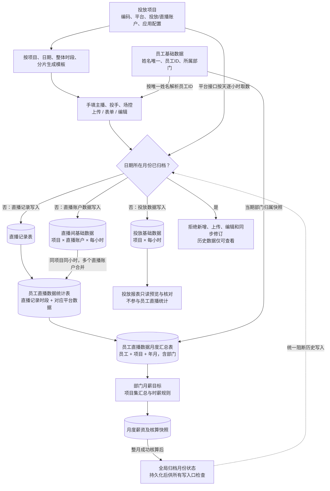

# 美魅网员工工作台业务流程调整规格

更新日期：2026 年 10 月 13 日  
状态：本轮业务口径已确认，作为新流程实施依据  
依据：本轮业务沟通；承接[原规格](./2026-10-09-staffhub-phase-one-design.md)。

本轮将员工工作数据的归属入口从「项目关联员工」改为「直播记录填写人员」。平台小时数据先落表，再与直播记录关联，形成固定直播明细和固定月度汇总。成功完成工资核算的月份归档，所有来源写入均检查归档状态。

员工档案、部门、账号密码主入口、辅助 SSO、管理员环境变量密码、角色权限及左侧导航顺序沿用原规格。员工字段不扩展，但增加员工姓名唯一性约束，支持直播记录中的姓名匹配。

本草案替换原规格中的项目员工关联、保费/主播排班/绩效评估录入、可配置运营数据集和员工工作统计数据集设计。本轮已确认三类人员汇总、直播间来源、班次及场次规则；实际薪资标准中的特殊奖励仍独立配置。

## 1. 页面和业务对象变化

| 位置 | 调整后的功能 |
| --- | --- |
| 投放项目 | 维护项目、三类平台、账户、应用凭据及授权码；取消员工关联和人员头像列表 |
| 数据录入 | 直播记录表、投放基础数据、直播间基础数据；不另设营销数据报表 |
| 直播记录表 | 项目及时段模板生成、上传、表单、筛选预览和编辑 |
| 两类基础数据 | 按项目及日期筛选物理表，查看小时取数覆盖及失败信息；由后台同步，不提供人工修改接口事实 |
| 运营数据集 | 员工直播数据统计表、员工直播数据月度汇总表；结构、字段和关联公式固定，只读，不提供字段配置或新增表 |
| 薪酬核算 | 从固定月度汇总读取数据，按目标部门核算；成功完成后归档月份，工资确认及发布继续独立控制 |

## 2. 新的数据流

员工统计仅采用直播间基础数据，投放基础数据独立保留供查询核对，不将两类消耗相加。所有统计仅读取已落表来源，不在清洗或工资计算时调用平台接口。

## 3. 投放项目

| 字段 | 约定 |
| --- | --- |
| 项目编码 | 唯一、必填；模板及统计关联使用编码解析内部项目 ID，引用后不随意改码 |
| 项目名称 | 必填；模板预填并按项目编码核对，名称不作为关联主键 |
| 关联平台 | 巨量引擎、磁力引擎、腾讯 ADQ；选择一个平台 |
| 投放账户 ID | 文本标识，避免数字精度损失；与应用 ID 区分 |
| 项目状态 | 启用或停用；正式取数仅针对启用且授权有效的项目 |
| 直播账户 ID | 多个文本标识，项目内去重；分别取数，再按明确口径关联 |
| 应用 ID | 对应所选平台的应用标识，不套用所有平台为同一种数字格式 |
| 应用密钥 | 首次配置输入，后续不回显；后端加密保管，留空保留已有密钥 |
| 授权码 | 平台授权流程取得的临时输入；后端完成交换后不将其作为长期访问令牌使用 |

DEMO 中已有来源记录的项目禁止直接更换平台、投放账户或直播账户集合，避免旧来源失去解释依据；名称、状态和应用凭据仍可修改，账户顺序可调整。新账户需以新项目承接。正式系统若需同项目账户迁移，应另行实现按日期生效的绑定和历史解释，不覆盖已有来源。

项目不保存员工列表、主播、投手、场控或项目员工有效期。人员归属由具体直播记录保存。取消当前 DEMO 中 `Project.employeeIds` 及所有依赖该列表的筛选与导入校验。

应用配置、账户授权及取数就绪状态分开展示。各平台由对应适配器处理，不因为填写应用 ID、密钥和授权码就假称真实授权成功。授权方式、有效期与字段可用性依接入平台权限确认。

正式系统不在列表、导出、工资快照或日志中显示原密钥、授权码及令牌。DEMO 仅使用虚构值，保存是否配置的标记，不持久化输入密钥或授权码。

## 4. 数据录入的三张物理表

第 6 项不再单独设置，以第 7、8 项为准，数据录入固定为以下三张表。

三张数据录入模型均保留「查看表结构」入口，展示固定业务字段、演示字段标识、类型/单位、来源和系统辅助字段，仅可读。归档月份也可查看结构，不允许新增、删除或配置字段。

### 4.1 直播记录表

业务字段固定为：**投放项目编码、投放项目名称、投放日期、开始时间、结束时间、主播、投手、场控**。

存储同时保存内部记录 ID、项目 ID、三类人员的员工 ID 及姓名快照、版本、来源批次、创建/修改人和时间。员工 ID 是写入时解析得到的稳定关联，不要求用户在模板中填写额外员工 ID 列。

每条记录表示项目在该日期上的一段实际直播时段及人员安排。时间使用北京时间和半开区间 `[开始时间, 结束时间)`，起止必须整小时对齐，结束必须晚于开始；不接受 06:30 等非整点边界。24:00 表示次日 00:00；跨日记录按日期拆分后保存，每一天均校验归档状态。

重复上传不能默默累加时长。系统识别项目、日期、开始及结束时间的重复和交叠，展示冲突；编辑通过内部记录 ID 更新有效版本。同项目时间区间不能重叠。同项目、同主播/投手/场控组合的连续区间合并为一场，包含午夜相连的区间；人员任一岗位变化或时间中断开始新场次。

### 4.2 直播记录模板

| 参数 | 默认值与行为 |
| --- | --- |
| 投放项目 | 支持单选、多选；至少选一个，预填编码与名称 |
| 日期 | 北京时间当天；生成该日期的模板行 |
| 整体时段 | 00:00–24:00，即全天 |
| 时段分片 | 默认 60 分钟；分片只能是正的整小时倍数，整体时段也必须整点对齐，最后一段到整体结束时间为止 |

每个选中项目分别生成分片行，不能把多个项目放进一行。例如选择两个项目、全天、按小时切分，生成 48 行；开始和结束时间连续，不重叠，也不漏掉最后一段。

主播、投手、场控三列留空，由用户手填。模板附员工姓名参考页和字段说明，不能默认填写首位员工或虚构人员。模板中未填写人员的行只是待填写行，不直接成为核算事实；DEMO 写入时要求三类人员都填写且匹配已有员工；同一员工兼岗允许，但个人统计不重复该记录。

### 4.3 员工姓名唯一与写入校验

- 员工姓名按统一规则规范化后全局唯一，不按部门分别唯一，离职员工也不自动释放名称。
- 新增、修改和导入员工时都检查重名；已有重名先人工确认，不自动加后缀或合并员工。
- 每个已填写姓名必须精确匹配唯一员工；去除首尾空白并统一文本规范，不做模糊匹配或拼音猜测。
- 上传、表单和编辑使用相同校验。项目编码须存在，项目名称须与编码一致；姓名不匹配、时间冲突或归档日期阻止提交。
- 写入后保存员工 ID 和姓名快照，之后的统计按 ID 关联。员工改名不重写已归档直播记录或工资。
- 项目不关联员工，因此不再校验“员工是否在项目员工名单内”；新录入或编辑记录的三岗位员工均须在职，明确入职日期不能晚于直播日期；日期格式及真实日历合法性统一检查。DEMO 档案入职日期为空时明确显示待维护并允许录入，已冻结历史统计仍按当时快照展示。

上传采用整批校验、整批写入。任何行涉及已归档月份或其他阻断错误，本批不部分写入。失败反馈行号、字段和原因。

### 4.4 投放基础数据

字段固定为：**投放项目、开始时间、结束时间、消耗、总支付金额、展示数、点击数、转化数、转化成本、转化率、支付订单数**。

内部存储平台、项目 ID、投放账户 ID、小时区间、平台响应依据、批次、有效版本及覆盖状态。投放项目是展示字段，内部关联使用稳定 ID。

### 4.5 直播间基础数据

字段固定为：**投放项目、直播账户 ID、开始时间、结束时间、消耗、营销成交金额、营销点击次数、营销点击率、营销点击单价、转化率、转化数、转化成本、营销 ROI、营销下单数、直播间观看人次、新增粉丝数、直播间打赏次数**。

每个直播账户分别保存小时记录。账户数量不固定，不能把多个账户的累计报表重复算入同一小时。

### 4.6 全天逐小时取数

按所有启用项目的所选平台、投放账户和直播账户，将指定日期划分为 24 个小时区间，逐区间请求并写入对应物理表。当前日期只处理已经结束的小时，未结束小时显示等待，不伪造全天完整数据。

业务键分别采用项目/投放账户/小时区间，以及项目/直播账户/小时区间；必要时加入平台接口维度。相同小时响应更新有效版本，不把重复请求累加。请求失败的小时保留缺口，不能标记该日完整。

后端请求与写入都检查归档月份。小时任务在核算归档前启动、归档后返回时，写入阶段仍需拒绝更新。平台不支持所需小时范围或必要字段时展示不支持/缺失，不按日值除以 24，不自动以其他指标填补。

## 5. 两张固定运营统计表

页面可切换表、按项目/日期/员工/部门筛选，查看结果及更新状态。两张表的字段、来源选择、关联逻辑和公式由系统固定，不提供字段映射配置、自由公式编辑或新增数据集。保留内部结构版本和计算版本用于追溯，结构升级通过应用版本完成。

### 5.1 员工直播数据统计表

字段固定为：**投放项目编码、投放项目名称、投放日期、开始时间、结束时间、主播、投手、场控、消耗、成交金额、点击次数、点击率、点击单价、转化率、转化数、转化成本、ROI、下单数、观看人次**。

每行对应一条有效直播记录，带内部直播记录 ID 及三类人员 ID。先按项目和时间范围汇总平台数据，再关联直播记录，不能把小时数据与所有人员或直播账户直接做多对多连接后求和。

统计仅使用直播间基础数据，按项目、日期和小时汇总所有已配置直播账户，再归属同一时段的直播记录。投放基础数据不参与员工直播统计。记录只能整小时对齐，因此不分摊小时数据；同项目直播记录不得时间重叠，缺少任何必要账户小时来源时阻止统计，不默认为零。

金额和数量按来源与归属口径聚合；率、单价和 ROI 不直接求和，也不简单平均。ROI 为营销成交金额÷消耗，点击单价为消耗÷营销点击次数，转化成本为消耗÷转化数；点击率、转化率按平台对应分母在相同范围重算，缺少必要分母时保留未定义状态。平台缺少字段不能显示为真实零值。平台点击率、转化率的必要分母由适配器明确提供；聚合多小时或多账户时缺少分母返回未定义，不能把观看人次自动当成营销点击率分母。单一来源可保留其原始平台率，点击单价或转化成本分母为零时同样未定义。模拟样例提供明确的虚构分母，用于验证聚合，不声称适用于所有平台。

### 5.2 员工直播数据月度汇总表

字段固定为：**员工 ID、员工名称、所属部门、投放项目编码、投放项目名称、年份、月份、主播、总直播时长、夜班直播时长、早班直播时长、总消耗、总保费、夜班消耗、早班消耗、ROI、时耗、ROI 排名、直播场次、夜班直播场次、早班直播场次**。

基础粒度为员工 + 项目 + 年月。主播、投手、场控分别按参与记录汇总；内部保留员工担任的角色集合，页面在员工名称下标识岗位。“主播”列展示该员工参与记录中的主播姓名集合。同一人兼任多个岗位时同一记录只累计一次。每个岗位获得其参与时段的完整业务贡献，非三人均分；各岗位的贡献不能合计为项目或公司总额，项目总额从去重后的直播统计明细计算。

所属部门沿用当期核算的确认部门及快照，不因当前部门变动增加重复月度行。月度金额、时长先汇总基础值，再计算 ROI 和时耗，薪酬匹配使用未舍入数值。

已确认的固定统计口径：

| 字段 | 固定定义 |
| --- | --- |
| 总保费 | 等于参与直播记录的营销成交金额合计，不采用投放基础数据总支付金额，不额外施加早班保费系数 |
| 总时长 / 总消耗 | 参与记录的小时合计 / 同范围直播间消耗合计 |
| 夜班 | 北京时间每天 [02:00,06:00)，按小时相交累计时长及消耗 |
| 早班 | 北京时间每天 [06:00,08:00)，按小时相交累计时长及消耗 |
| ROI | 总保费 ÷ 总消耗；使用未舍入值 |
| 时耗 | 总消耗 ÷ 总直播时长；使用未舍入值 |
| ROI 排名 | 同项目同年月全部参与员工排名，三类岗位均参与；采用并列竞争排名（1、1、3），无效 ROI 不取得有效排名 |
| 直播场次 | 连续同项目同人员组合合并；每位参与员工每场只计一次 |
| 早班 / 夜班场次 | 合并场次与对应班次有正时长交集计一次；同一场可同时计入早班及夜班，二者不要求相加等于总场次 |

跨日连续场次保留同一标识；跨月场次在其涉及的每个月按参与部分计一场，各月只归属本月时长及金额。

### 5.3 表结构查询与字段分类

两张运营数据集表均在当前表标题栏提供「查询表结构」入口。弹窗展示字段名称、演示字段标识、字段分类、指标子类型、数据类型、单位、来源及计算说明。数据录入的三张表也使用相同分类展示。查询为只读操作，归档后仍可使用，不改变源记录、计算结果、固定字段或工资快照。

| 字段分类 | 指标子类型 | 示例 | 含义 |
| --- | --- | --- | --- |
| 维度 | 不适用 | 员工 ID、员工名称、角色、部门、项目、日期、年份、月份、开始/结束时间 | 描述身份、归属和期间；数字年份月份仍是维度，不因数值类型变为指标 |
| 指标 | 时长指标 | 总直播时长、夜班直播时长、早班直播时长 | 表示时间跨度，统一以小时展示；起止时间本身不属于时长指标 |
| 指标 | 常规指标 | 消耗、保费、成交金额、点击/转化/订单/观看数量、比率、单价、ROI、时耗、排名、场次 | 表示金额、数量、比值或计算结果；时耗单位为元/小时，归为常规指标 |

时长指标与常规指标是固定指标字段的描述性分类，不建立独立可配置的维度或指标管理分区。比率、排名和单价不能因归为常规指标就直接相加或平均，继续采用各字段已明确的聚合方法；本次分类不自动启用新的薪酬规则或特殊奖励。

结构元数据记录 `field_kind`（dimension / metric）、`metric_type`（duration / regular，仅指标有值）、类型、单位、来源和口径，跟随系统固定结构版本维护；维度的 `metric_type` 为 NULL。指标类型必须与语义及单位一致，运营人员不能自行改分类。DEMO 将这些固定元数据保存在应用代码中，正式实现由固定结构元数据管理，不改变既有业务事实表字段。

## 6. 薪酬核算与月份归档

薪酬规则引用新的固定月度汇总表及稳定字段编号，月薪目标继续显式应用具体部门。项目集汇总基础消耗、保费和时长后重算比值，再匹配时薪规则；不能对多个项目 ROI 或时耗求平均。

本轮增加班次和排名字段，不等于已自动启用此前待配置的夜班、早班、排名或保薪条款；规则本身的变更需要单独确认。原六套明确 ROI + 时耗规则可在来源和人员口径明确后重新绑定。

### 6.1 全局归档状态

全局状态拟采用 `archivedMonths`，保存 `YYYY-MM` 月份集合和对应归档记录。按照已归档月份集合判断目标日期，不自行把所有更早月份当成已经核算；若业务要求连续截止月份，则改为归档截止日期，不能混用两种语义。

DEMO 在 Zustand 全局状态保存并持久化归档月份。正式系统以 MySQL 归档记录为依据，全局状态作为统一查询结果；应用重启、刷新或多实例不能使历史写入限制丢失。页面状态不能替代后端写入校验。

归档发生在该月整体工资核算成功后：所有目标员工结果及排除依据完整、无阻断异常，保存核算快照并在同一提交中登记月份归档。失败或仅部分成功不归档。工资确认、锁定和发布是后续结果管理，不能把“未发布”当作还可修改归档来源。

### 6.2 所有入口一致拦截

| 操作 | 归档限制 |
| --- | --- |
| 查看、筛选、导出历史记录 | 允许，不能改变数据 |
| 上传直播记录表格 | 任何行涉及归档月份则整批拒绝 |
| 表单新增 | 日期所在月份已归档则拒绝 |
| 编辑直播记录 | 原日期或修改后日期所在月份已归档均拒绝，防止移出历史月份绕过 |
| 跨日时段 | 涉及的每一天均检查，有归档日则拒绝 |
| 接口同步和自动回补 | 跳过归档月份；提交时再次检查，不能覆盖归档有效数据 |
| 来源确认、更正和其他记录写入口 | 执行相同归档约束，不能仅禁用界面编辑按钮 |
| 再次计算归档月份 | 可以读取原冻结依据查看/复核，不能解冻来源或覆盖原核算快照 |

本轮不新增自助取消归档。后续发现历史差错，继续保留原数据和工资，以补发补扣或另行批准的纠错流程处理。归档与数据写入按月份协调，避免同时发生时出现归档后的来源变更。

## 7. MySQL 存储调整

| 表或状态 | 新设计 |
| --- | --- |
| `employees` | 保留原字段；增加规范化姓名唯一约束；与用户名唯一约束分别处理 |
| `projects` | 内部 ID、项目编码/名称、关联平台、投放账户 ID、状态；移除员工关系 |
| `project_live_accounts` | 项目、直播账户 ID、状态，支持一个项目多个账户，项目内唯一 |
| `data_source_connections` | 项目、平台、应用 ID、密文凭据/引用、授权状态、令牌引用、凭据版本和修改信息；授权码作为交换输入处理 |
| 原项目员工关系 | 新流程不再写入或引用；旧工资依据中的关联快照保留，不直接删除历史 |
| `live_records` | 项目、业务日期、起止时间、主播/投手/场控员工 ID 及姓名快照、记录版本、批次、有效状态及审计 |
| `ad_delivery_hourly_records` | 投放基础数据的所有固定字段及项目/账户/小时区间、采集批次和有效版本 |
| `live_room_hourly_records` | 直播间基础数据的所有固定字段及项目/直播账户/小时区间、采集批次和有效版本 |
| `employee_live_statistics` | 固定员工直播明细字段、对应直播记录、来源小时版本及统计执行版本 |
| `employee_live_monthly_summaries` | 固定月度字段、员工/项目/年月业务键、部门快照、统计版本及归档引用 |
| `payroll_month_archives` | 唯一工资月份、成功批次、统计快照版本、归档人或任务、归档时间；作为全局归档状态的持久依据 |
| 旧保费、排班、绩效和可配置数据集表 | 新流程不再使用；已锁定/已发布历史工资的来源与版本保留，不直接抹除 |

金钱使用 DECIMAL，时间统一北京时间业务含义，账户和应用 ID 按平台要求以文本保存。统计表内部字段可包含稳定关联、版本及审计信息，但不向运营用户开放字段结构配置。

## 8. DEMO 的数据与改造范围

当前真实飞书资料只有月度员工项目汇总，缺少投放日期、小时区间、账户 ID、投手、场控及完整小时报表指标。不能从月度保费和时长倒推出真实小时记录。

旧实际数据与原工资试算保留为旧流程依据，不自动迁移为新流程实际明细。新流程 DEMO 采用明确标注的模拟时段和模拟平台小时数据，员工档案可沿用现有真实姓名及临时编号。新流程默认展示 2026 年 10 月模拟样例，旧流程资料独立保留，不冒充真实接口采集。

实施顺序为：固定新类型与旧数据隔离 → 项目字段及多直播账户 → 员工姓名唯一性 → 模板及直播记录上传/录入/编辑 → 两类小时数据只读预览 → 固定明细和月度汇总 → 薪酬规则绑定 → 成功核算归档与所有入口拦截 → 端到端验证。

关键验收包括：两个项目全天模板生成 48 行；重复员工姓名拒绝；项目无需员工关联；未知姓名或项目编码阻止整批上传；小时数据不重复相加；统计不因多个角色或账户放大金额；归档后刷新仍禁止历史新增和编辑；跨月改日期不能绕过归档；归档期间返回的小时任务不能改写来源；失败核算不归档；已归档工资及统计快照保持不变。

## 9. 已确认事项与演示边界

- 录入模型仅三张，不另设营销数据报表。
- 主播、投手、场控均分别形成月度员工行，兼岗不重复记录。
- 统计来源仅直播间基础数据；保费=营销成交金额。
- 夜班 02:00–06:00，早班 06:00–08:00；ROI 同项目同月排名。
- 记录只允许整小时对齐，连续相同人员组合合并为场次。
- 并列竞争排名、主播姓名集合、三岗位贡献不合计为项目总额、DEMO 三类人员必填作为本次明确实施约定，便于审阅及后续调整。
- DEMO 不连接真实平台，不实现其他岗位正式工资策略，也不自动启用原标准的班次系数和特殊奖励。

## 后续薪酬规则调整

本文件的直播录入与统计口径继续有效。旧三层薪酬方案、固定薪资和仅主播目标名单被后续部门规则设计替代，最终以主规格第九至十一章为准：规则按部门分类，指标定义和详情弹窗展示，常规指标支持精确/开放范围/关联字段档位并绑定时长，时长指标直接指定时薪；表达式项分别乘各自时长后相加。规则保存为草稿，发布冻结版本和参与员工并生成月度任务，同月全部任务原子核算成功后归档。
