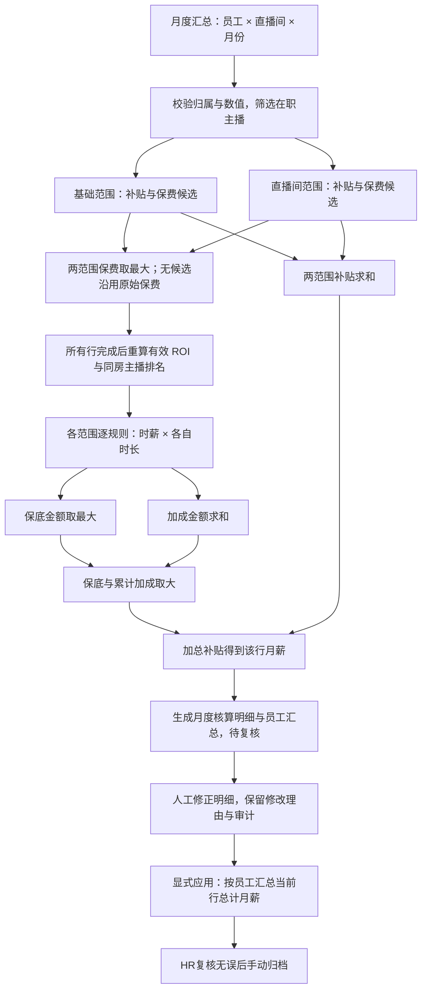

# 主播月度薪酬分层核算规格

状态：按 2026-10-16 已确认口径实施，当前仅全局与直播间两范围。金额单位为元，时长单位为小时。结果复核及手动归档以[月度任务与复核规格](2026-10-16-payroll-review-workflow.md)为准。

## 1. 目标与结算粒度

将员工直播数据月度汇总表导入薪资核算，保留 **员工 × 直播间 × 月份** 的粒度。每行分别计算基础核算（`global`）、直播间核算（`rooms`）两组指标，再形成该行月薪；同一员工跨直播间的行月薪相加得到员工当月工资。

只结算当月 `roles` 包含「主播」、员工在职、直播间启用且部门及产品归属有效的行。兼任场控或投手的主播行只结算一次；仅投手或仅场控行不进入主播薪资和主播排名。岗位名称不能代替月度行 `roles` 判断。

**用户已确认的最终公式：**

```text
总计补贴 = 基础补贴 + 直播间补贴
最终保底金额 = max(基础保底金额, 直播间保底金额)
累计加成金额 = 基础加成金额 + 直播间加成金额
该行总计月薪 = max(最终保底金额, 累计加成金额) + 总计补贴
员工当月工资 = sum(该员工各直播间的行月薪)
```

系数加成后的保费用于 ROI、排名与时薪规则，不直接加进工资。各组保底不能求和，保底与加成也不能相加。

## 2. 输入数据与字段契约

显示和导出的统计字段定义唯一来源是 `src/pages/LiveDatasetFields.ts` 的 `monthlyColumns`，其顺序固定为 13 个维度和 21 个统计指标，共 34 列。自动核算保留原始统计值及来源 ROI、排名，使用副本计算有效指标；复核编辑另存覆盖层，界面及导出展示该层当前值，原始依据不改写。

| 序号 | 字段 | 展示名称 | 处理要求 |
| --- | --- | --- | --- |
| 1 | employeeId | 员工ID | 粒度键，与员工实体关联 |
| 2 | employeeName | 员工名称 | 保留来源快照 |
| 3 | departmentId | 部门ID | 归属有效 |
| 4 | departmentName | 部门名称 | 保留来源快照 |
| 5 | employeeJoinedOn | 入职日期 | 来源统计展示；规则条件读取员工实体日期 |
| 6 | nonCompeteSigned | 是否签约竞业协议 | 展示是/否；规则条件读取员工实体 |
| 7 | productId | 产品ID | 必须与直播间关联一致 |
| 8 | productName | 产品名称 | 保留来源快照 |
| 9 | roomId | 直播间ID | 粒度键 |
| 10 | roomName | 直播间名称 | 保留来源快照 |
| 11 | roomOpenedOn | 直播间开播时间 | 来源统计展示；规则条件读取直播间实体 |
| 12 | year | 年份 | 整数年份 |
| 13 | month | 月份 | 数据为 YYYY-MM，表格显示月部分 |
| 14 | hours | 总直播时长 | 有限、非负 |
| 15 | nightHours | 夜班直播时长 | 有限、非负 |
| 16 | earlyHours | 早班直播时长 | 有限、非负 |
| 17 | regularHours | 正常直播时长 | 核算使用总时长减夜班、早班时长 |
| 18 | nightSessions | 夜班场次 | 补贴使用非负安全整数 |
| 19 | earlySessions | 早班场次 | 补贴使用非负安全整数 |
| 20 | spend | 总消耗 | 有限、非负 |
| 21 | nightSpend | 夜班消耗 | 有限、非负 |
| 22 | earlySpend | 早班消耗 | 有限、非负 |
| 23 | regularSpend | 正常消耗 | 核算使用总消耗减夜班、早班消耗 |
| 24 | premium | 总保费 | 原始保费，保持不变 |
| 25 | nightPremium | 夜班保费 | 有限、非负；不能猜测缺失拆分 |
| 26 | earlyPremium | 早班保费 | 有限、非负；不能猜测缺失拆分 |
| 27 | regularPremium | 正常保费 | 核算使用原始总保费减夜班、早班保费 |
| 28 | roi | ROI | 保留来源 ROI，区别于有效 ROI |
| 29 | hourlySpend | 时耗 | 总消耗 / 总时长 |
| 30 | adCost | AD成本 | 现有口径未定义，展示「待定义」 |
| 31 | policyCost | 保单成本 | 现有口径未定义，展示「待定义」 |
| 32 | roiRank | ROI排名 | 保留来源排名 |
| 33 | spendRank | 消耗排名 | 保留来源排名 |
| 34 | waitingSalaryDays | 等待薪资天数 | 人工填写的非负整数天数；可留空，不增加自动计算公式 |

`roles`、`hostNames`、`sessions` 是数据结构中的辅助字段，不擅自加入这 34 列。规则可使用已有指标契约支持的 `sessions`。缺失展示「未定义」，零仍展示为零；不能用缺失值替代零。等待薪资天数作为常规计数指标保存在员工×直播间×月份的数据行中，按整数展示和导出；旧记录或旧核算快照未保存该字段时保持未定义，不从当前运营数据补填。

## 3. 配置模型与适用范围

沿用 `CompensationRule`，只启用未删除且状态为「已发布」的规则，核算记录保留规则 ID 和版本。

| 范围 | 适用方式 | 配置与计算关系 |
| --- | --- | --- |
| global | 所有符合结算资格的行，无员工筛选条件 | 可有多条规则，分别聚合 |
| rooms | `roomIds` 包含当前行直播间 | **一个规则集可以绑定多个直播间**；一个直播间只能被一个未删除规则集占用，草稿也占用；组内补贴/时薪/保费系数每类至多一条 |

一个直播间规则集绑定 A、B 两个直播间时，各成员在 A 行和 B 行分别匹配、合并计算，不把两房时长拼成一个新结算行。`validateCompensationRoomOwnership` 以规则集为占用边界，允许同组不同类型共享直播间，禁止跨组占用。整组发布冻结成员列表，核算验证成员完整性与共同版本。

独立员工规则分类已取消。旧当前员工规则保留计算配置，移除 `employeeCondition` 并递增版本成为全局草稿，重新发布后才使用新范围；历史冻结任务及三范围结果保持原语义。条件保薪内部条件仍可引用员工字段，与已取消的范围条件区分。

分类来自配置，不从名称推断：

- `type=allowance`：补贴；场次指标乘每场金额。
- `type=premium`：系数加成后保费候选金额。
- `type=hourly` 且 `formula.mode=guarantee`：保底金额。
- `type=hourly` 且 `formula.mode=additions`：加成金额；一个规则可有多个被公式引用的加成项目，同一规则只有一个时长字段。

保底时薪与加成时薪必须先乘各自规则的时长，随后在金额层面比较或累加。若总时长保底为 50 元/小时 × 100 小时，夜班保底为 200 元/小时 × 20 小时，应取 5,000 元，不能因 200 更大而取 4,000 元。

### 3.1 保费配置兼容

旧式保费配置的候选公式为：

```text
候选保费 = 原始正常保费 + 原始早班保费 × 有效系数
有效系数 = 条件命中 ? 配置系数 : 1
```

该表达式沿用现有配置，不包含夜班保费。条件未命中仍产生系数为 1 的候选，不等于没有规则。因而有效保费可能低于原始总保费，例如原始总保费 30,000、夜班 2,000、所有系数条件未触发时，候选为 28,000。

新式 `premium.items` 按所列项目逐项计算「原始字段值 × 系数」后相加得到单条规则候选；字段及系数以配置为准。候选之间只比较金额，不把系数最大值当作候选选择依据。

所有保费规则均从同一行原始输入独立计算，不能把前一条规则的结果继续乘后一条系数。相同候选金额按规则 ID 字典序稳定择一，使规则排列顺序不改变后续有效字段。

条件式旧保费规则不能标成 `definitionVersion: 2`；v2 的 `premium.items` 没有旧式触发条件。旧式规则在编辑器转成 v2 时不是条件语义的等价迁移，样例保留合法旧式配置直接作为固定引擎输入。v2 时薪还遵守原有校验：保薪必须有条件，特殊时段只有一个项目，指标公式按列表顺序包含全部指标项。

## 4. 每行分层计算

设当前范围 `s ∈ {global, rooms}`，空类别初始化为零。

| 类别 | 单条规则计算 | 同范围合并 | 两范围合并 |
| --- | --- | --- | --- |
| 补贴 | 场次数 × 每场补贴 | 求和 | 求和 |
| 系数加成后保费 | 按保费配置求候选金额 | 取最大候选金额 | 取两个范围最大候选金额 |
| 保底 | 命中的保底时薪 × 该规则时长 | 取最大金额 | 取最大金额 |
| 加成 | 公式引用的加成时薪之和 × 该规则时长 | 所有规则金额求和 | 两范围金额求和 |

某范围没有保费规则时，该范围展示零。**两个范围都没有适用保费规则时**，有效总保费退回原始总保费；只要存在候选，即使候选为零，也采用候选最大值，不额外与原始总保费取大。

### 4.1 必须遵守的执行阶段

1. 校验月份、数据唯一粒度、员工/部门/直播间/产品关联与数值；筛选主播行及已发布规则。
2. 基于原始月度数据匹配适用范围，计算每条补贴和保费规则，保留条件与中间值。
3. 对每行两个范围分别聚合保费候选，再确定最终有效总保费。
4. 在所有主播行完成系数后，计算有效 `ROI = 有效总保费 / 原始总消耗`，并按同月、同直播间全部合格主播行计算有效 ROI 排名。不能边算一行边更新排名。
5. 使用有效指标副本匹配时薪条件和档位，逐条计算保底与加成金额，按范围聚合。
6. 合并两个范围，计算该行月薪；最后按员工求和。
7. 保存来源快照、规则版本、逐规则证据、范围汇总与结果，支持复核和归档。

同直播间排名采用竞争排名：`1 + 严格高于当前值的主播行数`，例如 1、1、3。零消耗的 ROI 未定义，不参与有效 ROI 排序。相同员工的不同直播间独立排名；同一月每个员工×直播间只有一行。

有效指标副本中 `premium`、`roi`、`roiRank` 使用系数后结果；正常保费仍使用原始正常贡献。若保费赢家含早班项目，`earlyPremium` 使用赢家早班项目计算金额之和；赢家不含早班项目时，保留原始早班字段。其他未参与的原始拆分不从有效总保费倒扣重建。



## 5. 金额、精度与异常

- 每条规则金额以十进制四舍五入到分，例如 1.005 → 1.01、10.075 → 10.08；随后进行范围聚合、跨范围聚合及行/月工资的两位小数归整，避免二进制浮点半分误差。使用未显示舍入的有效 ROI 判断档位和排名。
- 时长、金额、系数和时薪均须有限且非负；计算溢出、NaN、Infinity、负数必须阻断，不能静默归零。
- 补贴场次必须为非负安全整数；时长可以是非负小数。
- 正常时长/保费/消耗通过原始总数减夜班和早班重算，结果不能为负。不信任来源中的旧派生值。
- 无规则类别为零；未触发保底/特殊条件的金额为零。指标时薪若没有命中档位或同时命中多个档位，必须报错，不能随意选一档或默认零。
- 总消耗为零时有效 ROI 为未定义，总时长为零时时耗为未定义；没有规则引用该指标时可保留未定义，一旦条件/档位引用它就阻断。
- 被规则使用的字段缺失不能视为零；即使系数为零，所引用的字段也必须有效。AND/OR 条件的所有分支均检查缺失及类型错误。
- 规则依赖员工入职或直播间开播日期时，日期必须有效；相对月份判断以核算月最后一天为基准，月末日期按目标月份天数截断。
- 重复月度粒度、重复规则 ID、重复员工/部门/直播间 ID 或归属错误必须阻断。
- 两个范围均没有适用规则的主播行仍应保留零分类和零工资，以便复核来源行；无规则类别与缺失计算结果需要区分。

## 6. 页面和导出

新核算明细按 4 组二级表头展示，共 **45 列**（追加列另计）：

| 一级表头 | 列数 | 二级表头 |
| --- | ---: | --- |
| 直播数据统计 | 34 | 完整复用 monthlyColumns 的名称和顺序 |
| 基础核算指标 | 4 | 补贴金额、保底金额、加成金额、系数加成后保费 |
| 直播间核算指标 | 4 | 补贴金额、保底金额、加成金额、系数加成后保费 |
| 结果指标 | 3 | 总计补贴、系数加成后总计保费、总计月薪 |

自动核算的有效 ROI、有效排名、最终保底、累计加成放在可展开明细和逐规则证据里，不覆盖来源统计表 34 列。结果保费初值为本行最终有效总保费，复核层手动修正时另存覆盖值。

明细至少包括：范围、规则名称/版本、是否命中、输入字段、条件证据、时薪/系数、时长/场次数、规则金额、被选为保底或保费最大值的标识、范围合计、最终保底和累计加成比较。系数结果必须标明其流向为 ROI/排名/时薪。

月度任务列表只展示筛选栏和只读摘要（月份、规则数、人员数、状态），点击进入当前页详情并可返回列表。核算/重新核算须二次确认。详情提供基础信息以及“月度核算明细”“员工月薪汇总”两个可检索、导出页签。

仅明细支持追加文本/数字/金额表头及直接编辑统计值和核算结果；固定关联信息只读。修改不触发其他字段重算、不回写运营表、不立即更新员工汇总。显式执行“应用”后，按员工ID合计当前明细 `result.total` 更新只读员工汇总；追加字段不自动参与工资。所有修改保留理由、前后值、操作人、时间和版本。

XLSX 导出复用字段定义，首行合并一级分组表头，第二行显示字段名；金额数值保留两位小数、计数与名次为整数，并导出该任务的追加列及对应值。历史三范围结果仍按冻结依据保留员工核算指标，当前字段布局共 49 列；旧快照缺少的等待薪资天数展示「未定义」，不改写原始数据或金额。独立示例另附员工汇总、逐规则明细和口径说明，使用虚构数据，不写入业务 store。

## 7. 固定示例与手算验收

固定输入：`src/payroll-settlement-example.ts` 的 `payrollSettlementExample`。手算期望：`docs/examples/layered-payroll/expected.json`。详细讲解：`docs/examples/layered-payroll/README.md`。

共 3 位主播、4 行主播月度记录和 1 行非主播投手记录。陈雨兼任场控仍只结算一次；吴策只有投手角色，被排除。一个直播间规则绑定两个直播间，遵守房间独占约束。

| 输入行 | 总/夜/早/正常时长 | 夜/早场次 | 总消耗 | 总/夜/早/正常保费 | 原始 ROI / 排名 |
| --- | --- | --- | ---: | --- | --- |
| 林晓·一号房 | 100 / 20 / 30 / 50 | 10 / 10 | 10,000 | 24,000 / 4,000 / 10,000 / 10,000 | 2.4 / 3 |
| 周宁·一号房 | 80 / 20 / 10 / 50 | 5 / 2 | 10,000 | 30,000 / 2,000 / 4,000 / 24,000 | 3.0 / 1 |
| 陈雨·一号房 | 60 / 10 / 20 / 30 | 3 / 6 | 10,000 | 26,000 / 2,000 / 6,000 / 18,000 | 2.6 / 2 |
| 林晓·二号房 | 40 / 5 / 5 / 30 | 2 / 1 | 4,000 | 10,000 / 1,000 / 2,000 / 7,000 | 2.5 / 1 |

基础范围：夜班补贴20/场、早班补贴10/场、追加夜班补贴15/场；早班场次至少5时系数2、另一候选至少3时系数1.5、追加候选至少5时系数3；总时长保底50/小时、夜班保底200/小时、早班保底220/小时、总时长保底55/小时；有效ROI小于3时20/小时、至少3时45/小时；有效排名闭区间[1,1]为10/小时、至少2为5/小时，ROI及排名加成都乘总时长；另有早班加成10/小时。

直播间范围：一个单成员规则集绑定一号房和二号房，正常时长加成20/小时，其余三个类别为零。

原员工范围的补贴、系数、保底及加成均已合并到全局，不再以是否签署竞业协议筛选。示例中的旧式保费触发条件是计算配置的兼容输入，不是已取消的员工范围条件。

| 行 | 基础保费 | 直播间保费 | 有效总保费 | 有效 ROI / 排名 |
| --- | ---: | ---: | ---: | --- |
| 林晓·一号房 | 40,000 | 0 | 40,000 | 4.0 / 1 |
| 周宁·一号房 | 28,000 | 0 | 28,000 | 2.8 / 3 |
| 陈雨·一号房 | 36,000 | 0 | 36,000 | 3.6 / 2 |
| 林晓·二号房 | 9,000 | 0 | 9,000 | 2.25 / 1 |

| 行 | 总计补贴 | 最终保底 | 累计加成 | 总计月薪 |
| --- | ---: | ---: | ---: | ---: |
| 林晓·一号房 | 450 | 6,600 | 6,800 | **7,250** |
| 周宁·一号房 | 195 | 4,400 | 3,100 | **4,595** |
| 陈雨·一号房 | 165 | 4,400 | 3,800 | **4,565** |
| 林晓·二号房 | 80 | 2,200 | 1,850 | **2,280** |

林晓当月工资为7,250+2,280=**9,530**；周宁为**4,595**；陈雨为**4,565**；合计**18,690**。未签约的周宁也应用原员工范围移入的规则：补贴增加75、最大保底升至4,400、加成增加100，验证取消员工筛选后的行为。

必须补充自动化验收：无系数规则退回原始保费；空范围零值；真实零保费候选；系数条件未触发；不同duration的保底金额比较；同范围多加成求和；原始行不可变；规则重排不改变结果；并列排名；跨房间不重复计时长；非主播排除；已发布任务的参与人过滤；归档冻结与旧快照兼容；缺失/负数/溢出阻断。

## 8. 发布、复核、归档与历史兼容

发布冻结规则版本和符合主播资格的参与行；同月全部输入归属一条月度任务。计算前校验输入完整及版本有效，成功保存原始结果后进入待复核，不自动归档。人工修改保存为待应用复核层，显式应用只汇总当前明细行总计月薪，不重算其余结果。

具备“薪酬归档”权限的 HR 复核无误后二次确认归档，管理员演示身份可执行。待应用修改、来源或任务在核算后变化、结果不完整均阻止归档；来源变化须重新发布或重新核算，重新核算提示人工修正影响。归档事务冻结原始输入、规则证据、最终两表、自定义表头和单元格、编辑/应用审计、操作人及复核版本，再更新全局归档月份。归档后来源、结果与追加字段均只读，禁止重新核算。

已有历史任务、归档及三范围结果按原快照读取，不因当前员工规则迁移为全局而重算或删除员工范围金额。旧结果没有分层计算信息时仍使用原快照算法，不把缺失信息伪装为新算法的零值。旧归档锁定不变；新任务采用两范围 45 列，历史三范围的当前展示布局为 49 列，新增字段无历史值时保持未定义。
