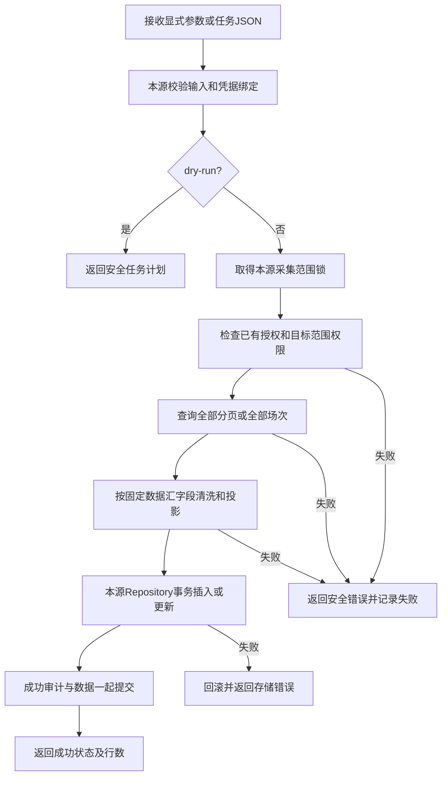
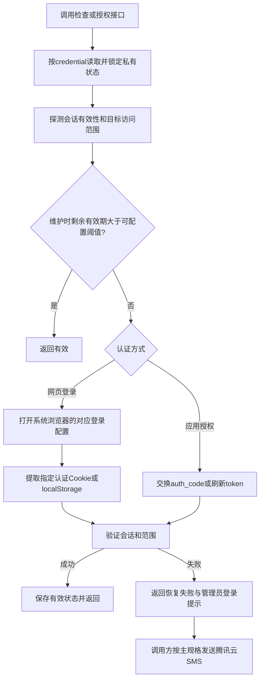

# 四类数据采集脚本独立规格 v1

状态：独立需求基线与接口约定。依据 [第一期直播数据管理 Page](https://chatgpt.com/space/page_1b6e05dc95ec81918416244f056f2cd4)、Page 指定的本地工作簿 `第一期试点直播间产品.xlsx`，以及用户关于来源模块独立维护的补充。

本文完整定义四类脚本的输入信息、参数、配置、授权、采集、六类数据汇格式、MySQL 写入责任和验收。阅读本文不需要先确定产品表、直播间表、账户表的物理结构，也不需要阅读主规格才能实现一个来源脚本。

## 1. 固定需求与设计边界

| 已确定的要求 | 本文处理方式 |
| --- | --- |
| 四类来源：巨量营销、巨量千川、平安保单、众安保单 | 每来源一个独立模块与可执行入口 |
| 单脚本处理：接收参数→校验权限→采集与清洗→插入或更新 MySQL→返回状态码 | 每个脚本负责完成整个单任务闭环 |
| 数据汇格式 | 保持 Page 六张来源字段字典的列名、含义和次序；完整清单见附录 A |
| 输入信息结构 | 产品/直播间归属、账户/后台范围、平台、授权应用或网页登录配置；与输入表的排版无关 |
| 授权维护 | 暴露检查与恢复授权能力，半小时阈值可配置；失败向调用方返回可用于通知管理员的信息 |
| 模块所有权 | 本源维护参数、协议、鉴权探测、清洗、字段与数据库操作；共用能力放 `scripts/utils/`；不依赖 `live_data` |

**尚未定稿的是物理数据模型，不是上述脚本需求。** 产品/直播间/账户的物理表名、主外键、来源配置导入格式、数据汇的物理表名/列类型/索引/存储方式，均不由本文提前冻结。现有代码中的目录表、三个 JSON 事实表和六个视图是当前实现方案，不能反过来限定 Page 的数据汇格式。

本文区分三种内容：Page 固定需求、为可执行性制定的接口约定、当前代码的实现状态。字段存在但映射未完成属于实现缺口，不能从需求中删除。原始响应保留、MySQL 视图或字段 JSON 都不能代替六类数据汇列的交付。

## 2. 来源与依据

| 模块 / 来源 | 采集形式与认证 | 旧工具参考 | 固定数据汇 |
| --- | --- | --- | --- |
| `scripts/marketing/` 巨量营销 | API；app_id、app_secret、auth_code 与刷新令牌 | `tools/data_report_tool` | [营销字段表](https://meimeiwangluo.feishu.cn/sheets/Chk0sVIOIh8OyjtOyiHceWxKnnb?sheet=LLrZfS)，42 列 |
| `scripts/qianchuan/` 巨量千川 | API；独立应用的 app_id、app_secret、auth_code 与刷新令牌 | `tools/data_report_tool` | [千川字段表](https://meimeiwangluo.feishu.cn/sheets/Chk0sVIOIh8OyjtOyiHceWxKnnb?sheet=nagTnM)，111 列 |
| `scripts/pingan/` 平安保单 | 网页登录态；经认证的后台接口采集 | `tools/pingan_crawler` | [统计指标](https://meimeiwangluo.feishu.cn/sheets/Chk0sVIOIh8OyjtOyiHceWxKnnb?sheet=Odg2IZ) 20 列、[订单](https://meimeiwangluo.feishu.cn/sheets/Chk0sVIOIh8OyjtOyiHceWxKnnb?sheet=CdhaN0) 12 列 |
| `scripts/zhongan/` 众安保单 | 网页登录态；经认证的后台接口采集 | `tools/zhongan_crawler` | [统计指标](https://meimeiwangluo.feishu.cn/sheets/Chk0sVIOIh8OyjtOyiHceWxKnnb?sheet=wxKX4N) 49 列、[订单](https://meimeiwangluo.feishu.cn/sheets/Chk0sVIOIh8OyjtOyiHceWxKnnb?sheet=svfN0A) 32 列 |

Page 指定可从本地工作簿检索以上文档。本版按该快照核对了六张字段表的 266 个字段名、所在行及顺序，没有声称实时校验了飞书在线表的最新内容。

输入依据是 Page 链接的[产品/账户信息](https://meimeiwangluo.feishu.cn/sheets/Chk0sVIOIh8OyjtOyiHceWxKnnb?sheet=b9be82)、[配置资料](https://meimeiwangluo.feishu.cn/sheets/Chk0sVIOIh8OyjtOyiHceWxKnnb?sheet=WxTx0b)，以及工作簿中的“产品账户信息”“巨量引擎应用信息”“产品统计后台信息”。其中横表、纵向分组和合并单元格只是当前资料布局，不构成脚本输入协议。

## 3. 输入信息怎样分配到参数与配置

### 3.1 信息映射

“参数”描述本次采集谁、采集什么范围；“配置”描述用什么环境、应用或登录身份执行。调用者可以从 Page 资料、文件、界面或后续数据库生成参数，来源脚本不自行遍历业务目录。

| Page / 工作簿信息 | 脚本语义 | 分配与约定 |
| --- | --- | --- |
| 保险产品、直播间 | 数据归属 | 参数 `product_id`、`room_id`；调用方提供稳定文本标识，不要求数据库外键已存在；名称可作为展示上下文 |
| 账户 ID、账户名称、账户类型 | 广告采集对象及展示信息 | `advertiser_id` 参数；名称/类型作为可选任务上下文，不能冒充 API 指标 |
| 账户平台 | 选择哪类脚本及报表版本 | 调用方选择营销或千川模块；营销 `version` 参数区分 smart/legacy |
| 应用 app_id | 预期授权应用 | 广告参数 `app_id` 用于校验绑定；私有环境 APP_ID 提供实际认证配置，两者必须一致 |
| 应用 secret | 应用密钥 | 映射为 APP_SECRET，放环境变量或受限 env 文件，不放任务参数或普通文档 |
| 授权码获取链接 | 取得首次/重新授权的 auth_code | 链接属应用配置资料；生成的 AUTH_CODE 属临时私有认证配置，不把链接字符串当授权码 |
| token 示例 | 认证材料结构参考 | 不将资料中的示例直接视为有效运行登录态；实际交换/刷新成功后存私有缓存 |
| 保费看板地址 / 看板地址 | 后台访问入口与查询范围 | 平安从 merchantChannel 得到 `channel`；众安从 dyNo/livePlatform 得到 `dy_no`/`platform`；入口属于本源配置/实现 |
| 看板账号、看板密码、登录手机号 | 网页登录身份与人工恢复信息 | 按后台分配独立私有登录配置；管理员在浏览器登录，不作为 collect 命令行参数 |
| 应用或后台与产品/直播间的关联 | 选择授权身份 | 用 `credential` 别名绑定私有配置；不能只凭名称猜测，也不能把一个后台会话覆盖成另一个 |
| 小时统计要求 | 本次时间范围 | `start`、`end` 参数；缺省上一完整小时 |
| MySQL 地址/库/用户/密码、超时、分页上限 | 运行环境 | 部署配置；Page 的业务资料不替代部署环境参数 |

Page 已提供的账号、应用和后台信息可供配置生成使用，不要求为了脚本再重新设计一套主数据表。真实密钥与登录值不复制到本文。Page 未给出的实际认证 Cookie 名称、运行机器路径、MySQL 连接等，应在环境接入时核实；不能从表格排版或示例 token 推断。

### 3.2 通用命令及参数约定

每来源支持 `collect`、`check-auth`、`authorize`。当前实现另提供 `init-db`，仅用于初始化当前仓储方案，最终 DDL 应随物理模型定稿调整。

| 输入 | 类型 / 必填性 | 语义与校验 |
| --- | --- | --- |
| `--config` | 文件路径；有默认路径 | 部署 TOML；默认本项目 `config/local.toml`，相对配置路径以 TOML 所在目录解析 |
| `--product-id` | 非空文本，必填 | 归属标识，不规定生成算法或数据库列类型 |
| `--room-id` | 非空文本，必填 | 直播间标识，需与 product_id 一起解释归属 |
| `--credential` | 非空文本，必填 | 配置中的认证别名，来源必须匹配当前脚本 |
| `--start` / `--end` | ISO 日期时间，collect 可选且必须成对 | Asia/Shanghai 整小时半开区间 `[start,end)`；默认上一完整小时；当前接口限制一次最多 7 天 |
| `--task-file` | JSON 文件，替代显式任务参数 | 含 source/product_id/room_id/credential/account_id/options；与显式任务字段互斥；拒绝未知字段和重复键 |
| `--dry-run` | collect 开关 | 只校验并输出任务计划，不连接 MySQL、不鉴权、不访问平台 |
| `--wait-seconds` | authorize，1–1800 秒 | 浏览器等待预算，默认 15 秒；与提前刷新阈值是两个不同配置 |

长 ID 按文本处理，广告 ID 必须为正整数文本。时间使用北京时间，结束时刻不包含在结果中。当前任务 JSON 上限 128 KiB，文本标识上限 128 字符；这些是接口保护约定，非 Page 的业务字段长度定义。

独立任务无需先执行主数据导入；collect 的数据库前提只涉及本源目标数据汇/仓储。check-auth、authorize 和 dry-run 不依赖业务目录或 MySQL。

### 3.3 运行配置约定

| 配置区域 | 内容 | 所有者 |
| --- | --- | --- |
| `mysql` | host/port/database/user/password_env；密码从指定环境变量读取 | 部署配置，供本源 Repository 使用 |
| `credentials.<alias>` | source；广告 env_prefix/env_file；后台 browser_channel 与实际认证键 | 来源模块解释，别名供任务选择 |
| `settings` | state_dir、timeout_seconds、max_pages、refresh_before_seconds | 通用运行能力；默认刷新阈值 1800 秒、超时 30 秒、分页上限 10000 |
| 私有凭据缓存 | source、应用 ID 或会话、token/Cookie、实际 expires_at | 脚本维护，原子更新并按凭据加锁 |
| 管理员通知配置 | 腾讯云 SMS、管理员号码、模板与冷却 | 外部授权维护/通知调用方；单次采集不自行发送短信 |

最低配置示例可只包含本次来源，不需要 `master_data`：

```toml
[settings]
state_dir = '../runtime'
refresh_before_seconds = 1800
timeout_seconds = 30
max_pages = 10000

[mysql]
host = '127.0.0.1'
port = 3306
database = 'live_data'
user = 'live_data'
password_env = 'LIVE_MYSQL_PASSWORD'

[credentials.marketing_app]
source = 'marketing'
env_prefix = 'LIVE_MARKETING_'
# env_file = 'private.env'

[credentials.qianchuan_app]
source = 'qianchuan'
env_prefix = 'LIVE_QIANCHUAN_'

[credentials.pingan_login]
source = 'pingan'
browser_channel = 'chrome'
token_storage = 'cookie'
token_key = 'REPLACE_WITH_VERIFIED_TOKEN_KEY'

[credentials.zhongan_login]
source = 'zhongan'
browser_channel = 'chrome'
auth_cookie_names = ['REPLACE_WITH_VERIFIED_AUTH_COOKIE_NAME']
```

广告分别使用其前缀下的 APP_ID、APP_SECRET、AUTH_CODE；进程环境优先于 env_file，两个应用不共用前缀。后台账号、密码、手机号按实际登录流程使用；当前代码不自动填写密码或绕过验证码。完整的当前配置示例见 [workbook.example.toml](config/workbook.example.toml)，其中主数据导入区域不是单脚本必需项。

## 4. 单任务与授权处理流程

### 4.1 采集闭环



不能先写入部分页再把分页失败报告为成功。空结果需要先确认请求完整且权限有效。collect 检查现有授权；需要登录交互时返回授权错误，由独立维护任务或人工 authorize 恢复。

### 4.2 授权能力



`check-auth` 仅检查当前登录态及本次目标的权限；它不主动打开浏览器。维护调用使用 `renew=True`：距到期大于阈值且探测通过则复用，小于或等于阈值则恢复授权。显式 `authorize` 可以强制尝试恢复。无有效期的网页会话必须实际探测；当前实现维护时会重新提取，不能虚构有效期。

OAuth 刷新成功后先持久化新 refresh_token，再校验账户权限，避免权限错误丢失已轮换令牌。缓存必须绑定来源及应用。网页状态按后台身份隔离；系统 Chrome 使用独立持久配置目录，管理员在该窗口完成登录。提取不到有效令牌时返回“请通知系统管理员在半小时内完成登录，并重新执行 authorize”。发送短信与后续任务选择由调用方负责。

## 5. 巨量营销脚本

### 5.1 输入与配置

入口：`python -m scripts.marketing` 或 `python scripts/marketing.py`。

| 参数 | 要求 |
| --- | --- |
| `--advertiser-id` | 必填，Page 账户 ID |
| `--app-id` | 必填，账户绑定应用的 ID；与实际 APP_ID 一致 |
| `--account-scope` 或 `--aweme-id` | 二选一；明确账户全量或手机端显示抖音号范围 |
| `--version` | smart / legacy，默认 smart |
| `--metrics` | collect 可选逗号分隔请求字段；正式固定汇表使用完整默认指标集 |

Page 工作簿明确以智擎版字段标准为准；旧版出现差异应单独建立标准（如 xxx-old），不能静默修改现有汇表列。现有代码支持 legacy 请求，并在账户/版本字段检查不通过时失败；这不等于旧版差异标准已经定义。

### 5.2 采集和输出

以广告账户和明确范围请求小时报表，检查当前账户、版本可请求的字段，拉完所有页并核对页数、总数和重复页。使用真实 `stat_time_hour`，保留完整维度组合；只写指定小时区间。

输出为附录 A.1 的 42 列：35 个默认请求指标与 7 个维度/上下文字段。账户名称、类型等由调用方提供，不能作为接口指标请求；指标缺失不补零。自定义 metrics 用于诊断或明确的子集采集，不能以少量指标的运行结果宣称完成全部汇表验收。

```bash
python -m scripts.marketing collect --config config/local.toml \
  --product-id demo-product --room-id demo-room --credential marketing_app \
  --advertiser-id 123 --app-id 456 --account-scope --version smart \
  --start 2026-10-20T09:00:00 --end 2026-10-20T10:00:00 --dry-run
```

## 6. 巨量千川脚本

### 6.1 输入与配置

入口：`python -m scripts.qianchuan` 或 `python scripts/qianchuan.py`。必填 advertiser-id、app-id；账户全量与 aweme-id 范围二选一；metrics 的使用边界与上一来源相同。千川使用独立授权应用，不能复用营销应用的缓存。

`--aweme-id` 表示手机端显示号。当前任务 JSON 也可用 `options.aweme_ids: [内部ID]`，只允许一个已核实内部 ID；两种标识不能同时配置，同一账户跨任务不能混用两种命名空间来声称范围互斥。

### 6.2 采集和输出

按日期请求小时粒度数据，必要时先解析 aweme 内部 ID。跨日逐日查询后，依据真实 `stat_datetime` 裁剪 `[start,end)`，不得把区间总量或日总量复制成每小时数据。完整拉取分页并验证总数。

输出附录 A.2 的 111 列，默认请求 96 项指标。查询日期、统计小时和账户上下文按字段字典生成；字典明确为空/不适用的维度不能伪造。`aweme_nick_name` 列保留，当前代码未接入已核实昵称数据，需列为映射缺口。

```bash
python -m scripts.qianchuan collect --config config/local.toml \
  --product-id demo-product --room-id demo-room --credential qianchuan_app \
  --advertiser-id 123 --app-id 789 --account-scope --dry-run
```

## 7. 平安保单脚本

### 7.1 输入与配置

入口：`python -m scripts.pingan` 或 `python scripts/pingan.py`。专有参数 `--channel` 必填，对应 Page 看板地址的 `merchantChannel`。不接受广告账户 ID，也不以广告账户数量重复查询相同渠道。

每个后台登录身份对应独立 credential 与浏览器配置；配置真实 `token_key` 和 `token_storage`（cookie 或 localStorage），由本模块提取并探测权限。当前后台入口为 `open.health.pingan.com/v2/home`，查询使用该渠道上下文。

### 7.2 采集和输出

采集渠道数据概况、实时指标、漏斗及全部订单分页。订单按来源支持的 `updatedDate` 查询，不仅取已支付状态；保留记录标识和更新信息，保证重复运行可更新已有订单。当前接口内部 `postId` 是来源记录 ID，未经证明不把它称作保单号。

输出附录 A.3 统计指标 20 列和 A.4 订单 12 列。按小时运行产生实际观察时刻的日累计快照，不代表“本小时新增”。统计日期、实际观察时刻与执行窗口分别记录。

原始金额按来源单位保留，派生比率使用明确分母：

| 字段 | 当前可核实公式（百分比） |
| --- | --- |
| calcBindCardRate | bindPolicyCnt / validPolicyCnt × 100 |
| calcSurrenderRate | surrenderPolicyCnt / validPolicyCnt × 100 |
| annualPolRate | annualPolicyCnt / validPolicyCnt × 100 |
| multiApplicantPolRate | multiApplicantCnt / allApplicantCnt × 100 |

计算层遇到缺失、非法、零分母返回 NULL；汇表呈现遵循第9.1节。概况不是唯一一条时不随意取第一条计算。本源负责该规则。gmvSimpleRoi、performanceRoi、adSpend、applicant_age_group 的现有映射未完整确认，列仍须保留，验收时单列缺口；内部 NULL 不表示这些字段需求已取消；字典已有明确显示占位符的列，应按约定呈现。

```bash
python -m scripts.pingan collect --config config/local.toml \
  --product-id demo-product --room-id demo-room --credential pingan_login \
  --channel DEMO_CHANNEL --dry-run

python -m scripts.pingan authorize --config config/local.toml \
  --product-id demo-product --room-id demo-room --credential pingan_login \
  --channel DEMO_CHANNEL --wait-seconds 1800
```

## 8. 众安保单脚本

### 8.1 输入与配置

入口：`python -m scripts.zhongan` 或 `python scripts/zhongan.py`。专有参数 `--dy-no` 必填，`--platform` 默认 DOUYIN，分别来自看板 URL 的 dyNo 与 livePlatform；不接受广告账户 ID。这个 dyNo 是后台查询范围，不能自动作为广告 aweme 筛选条件。

配置独立 credential、浏览器及核实的 `auth_cookie_names`。仅提取目标域的有效认证 Cookie/所需 localStorage，维护 Cookie 域与路径语义。当前后台入口为 `adagent.zhongan.com/app-live/liveStream/dashboard/`。

### 8.2 采集和输出

查询目标日期的直播场次，遍历全部匹配场次，取得场次归属/属性、聚合统计和订单。订单完整遍历 nextPage 游标，检测重复/不前进游标及分页未完成，不只读取首场或首批订单。保留场次上下文和来源字段路径，订单身份使用来源 orderNo。

输出附录 A.5 统计指标 49 列与 A.6 订单 32 列。统计是场次累计观察快照，不能重复相加当小时新增。数组/对象保留 JSON；字典未确认数据类型的 25 个字段不强转数值。

当天无任何场次时可以确认会话探测结果，但目标范围状态只能返回 `unobserved`；不能声称已经验证目标直播间权限。存在场次但目标不存在应明确报范围错误。

```bash
python -m scripts.zhongan collect --config config/local.toml \
  --product-id demo-product --room-id demo-room --credential zhongan_login \
  --dy-no DEMO_DY --platform DOUYIN --dry-run
```

## 9. 固定数据汇与可调整的 MySQL 落地

### 9.1 对外数据契约

六类数据汇的列名、顺序、类型说明、业务含义见附录 A，按原字典保留。原字典中“类型未提供”或“需确认”仍保持该事实，不能用数据库类型猜测业务含义。附录列出当前代码的映射状态，便于识别需求与实现差距。

每条结果还需要来源、产品/直播间归属、查询范围、源日期/小时/场次、实际 observed_at 等技术上下文。它们可放关联键、技术列或元数据中，**不得改变约定汇表的业务列含义或用技术列代替业务列**。内部缺失值保持 NULL，不能当成 0；原始层保留数组、对象、金额精度及来源单位。对外汇表若在字段字典中明确规定了占位符、百分号、精度或枚举显示，则必须按该格式呈现，不能直接以当前内部 JSON/SQL 投影替代。

**固定格式不仅是字段名。** 字典中的展示/导出说明也属于交付约定；原始存储与对外交付分开处理：

| 字典规定的格式 | 对外汇表要求 | 原始/计算层要求 |
| --- | --- | --- |
| 平安四个派生比率 | 百分比字符串，按字典保留2位小数；使用正文明确公式 | 保留未作展示舍入的计算值及分子分母，零分母不造值 |
| 平安 annualPremium、undwrtPremium | 字典记录的整数展示口径在汇表输出时实现 | 原始金额不先舍入，仍可用于复核和后续计算 |
| 平安 gmvSimpleRoi、performanceRoi、adSpend | 无确认值时按字典显示“-”，不构造数值；来源映射仍作为待核实项 | 缺失值保存NULL，不能将“-”用于数值计算 |
| 平安部分漏斗比率与 policyTransRate | 按各列说明处理空值“/”及百分号，不对已经是百分数的值再次乘100 | 原值及缺失状态保留，区分来源百分数与本地比率 |
| 平安 orderStatus | 导出使用字典枚举中文含义；未知编码保留可追溯原值 | 保留来源整数编码，不以中文显示值作为订单身份 |
| 平安 insurantList 及其他数组/对象 | 保持结构；文本/CSV交付时序列化为JSON，不丢子字段 | 原始JSON完整保存 |

附录的“原字典类型”可能描述接口原值，而说明列描述导出显示；两者不能混为数据库列类型。若原字典没有定义格式细节，不凭经验增加单位换算、四舍五入或业务计算。

**当前实现差距：** 现有代码主要提供原始JSON及保守类型投影，尚未据上述规则验收完整的展示/导出适配。字段有映射不等于固定汇表格式已全部实现；除5个未核实映射项外，还需验证这些格式规则。此次只编写规格，不宣称代码已补齐显示格式。

若通过视图、物理列或应用查询层交付，查询结果都必须能形成相同的六类字段集合。现有 raw JSON + 视图是可选落地方案，后续可以改成物理列；该变化只由来源 Repository/字段映射处理，调用参数和固定汇表契约不随主数据表重构改变。

### 9.2 写入语义

| 数据类别 | 必须保持的逻辑行为 | 当前实现参考，非冻结 DDL |
| --- | --- | --- |
| 广告小时数据 | 相同归属/来源/范围/小时/维度的重跑不重复累计；只替换完整查询成功的目标区间 | 源内按任务与时间区间事务删除再插入 |
| 保单统计 | 保留真实观察时间及源日期/场次，区分不同范围，不伪造历史观察值 | 观察小时内更新累计快照；保留原始指标 |
| 保单订单 | 按来源真实记录身份更新；保留首次见到与最近观察时间，不用展示列拼凑不可靠主键 | 来源记录 ID/订单号与任务范围联合识别 |
| 执行审计 | 成功状态与业务写入同事务；失败单独记录安全摘要，不能记录成功后再丢数据 | 公共审计接口，由各源仓储调用 |

逻辑去重范围已确定，具体数据库主键、表名、字段类型、约束与索引待物理设计确认。当前任务 ID 为来源、归属、账户及规范化查询范围的确定性摘要；凭据轮换、名称或指标选择不改变身份。后续若更改身份算法必须显式迁移，不能产生双份事实数据。

同范围并行采集需要互斥，鉴权和完整采集应处于范围锁内；凭据刷新另用凭据锁。任何页失败不写半批业务数据；写入或审计失败返回失败，不能以部分成功冒充完整成功。

## 10. 返回值与调用接口

stdout 为结构化 JSON，进程退出码与 `code` 一致。成功至少包含 source/task_id/status/rows；预览为 planned/dry_run，授权检查为 session_valid 并返回 scope_status。原始订单、令牌、密码及完整上游响应不进入异常消息。

```json
{"code":0,"source":"pingan","task_id":"task-<stable-id>","route_id":"task-<stable-id>","status":"success","rows":120}
```

`rows` 是本批写入记录数，不能解释为有效保单数；包含多个数据汇时由批次的各类记录合计。`route_id` 是当前兼容返回字段，与 task_id 相同，不代表存在 live_route 数据库表。无法构建任务的配置错误可返回空 task_id。

| code | 含义 | 调用方处理依据 |
| --- | --- | --- |
| 0 | 本命令成功 | 继续后续工作；结合授权 scope_status 判断范围是否已验证 |
| 2 | 参数/配置错误 | 修正输入或绑定 |
| 3 | 授权缺失、过期或需要恢复 | 调用独立授权流程；失败按主规格通知管理员 |
| 4 | 平台、分页、数据或未分类采集错误 | 依错误策略处理，不能宣称数据完整 |
| 5 | 数据库写入或审计失败 | 当前批次失败；批量调用方停止继续写入 |
| 6 | 任务/凭据锁被占用 | 本次未执行，交给调用方重试策略 |
| 7 | 通知发送失败 | 通知层返回；独立采集本身不发送短信 |
| 130 | 人工中止 | 本轮中止 |

现有代码公开下列同进程接口，外部调度也可用 CLI。它们是适配方式，业务表结构无需暴露给脚本：

```python
task.make_task(product_id, room_id, credential, account_id='', options=None) -> Route
task.validate(route) -> Scope
cli.collect_task(config, route, window) -> dict
cli.check_task(config, route, renew=False, force=False, wait_seconds=15) -> dict
```

`collect_task` 负责本源组件构建、连接关闭和状态返回；`check_task` 成功返回状态，失败抛出可分类领域异常，由来源 CLI 或调度器转换为结果。`Route` 是当前任务值对象名称，不要求关系表存在。

## 11. 模块职责与依赖

```text
scripts/
  marketing/            独立来源模块
  qianchuan/            独立来源模块
  pingan/               独立来源模块
  zhongan/              独立来源模块
    cli.py              本源命令、参数及组件组装
    task.py             本源范围规范化和校验
    auth.py             本源权限探测与认证材料提取
    collector.py        本源请求、分页、清洗
    repository.py       本源MySQL操作、去重与事务
    contracts.py        本源字段投影、派生规则
    fields.json         本源机器可读字段映射
    schema.sql          当前物理实现；后续按定稿模型调整
  utils/                通用网络、配置、锁、缓存、事务、CLI与结果处理
  registry.py           来源名到模块的查找，不实现采集逻辑
```

不统一调用 `live_data.script_cli`，也不把四来源分支整体搬到 utils。共享执行器只能接收本源已构造的 Auth、Collector、Repository 实例；URL、认证键提取、特殊字段计算和事实 SQL 由各源拥有。`live_data` 只作为调用者，scripts 不反向导入它；原表读取/业务关系适配不属于单次来源采集。

## 12. 使用及验收

在 `live_data_design` 目录安装依赖并按运行环境配置；代码不要求额外安装 Excel。示例采用虚构业务 ID、账户与后台选择器，不能直接当真实数据绑定。

```bash
uv sync --locked
# 本源初始化命令仅用于当前物理实现
python -m scripts.pingan init-db --config config/local.toml
# 同样业务参数下检查授权；不连接MySQL
python -m scripts.pingan check-auth --config config/local.toml \
  --product-id demo-product --room-id demo-room --credential pingan_login --channel DEMO_CHANNEL
```

命令需在已激活的环境运行，或用 `uv run python` 替换 `python`。JSON 任务示例：

```json
{
  "source": "pingan",
  "product_id": "demo-product",
  "room_id": "demo-room",
  "credential": "pingan_login",
  "account_id": "",
  "options": {"channel": "DEMO_CHANNEL"}
}
```

```bash
python -m scripts.pingan collect --config config/local.toml --task-file task.json --dry-run
```

| 验收项 | 合格判据 |
| --- | --- |
| 自治与输入独立 | 禁止导入 live_data 后四源仍可运行；不用主数据表即可构造任务 |
| 参数与配置映射 | Page 的账户、应用、后台信息能映射到本规格字段；更换来源资料排版不改变采集接口 |
| 六类汇表 | 逐列核对附录 A 的 266 列、顺序、含义与类型说明；未完成映射单列缺口，不删列 |
| 真实范围 | 营销版本/账户、千川小时和 aweme、平安渠道、众安平台/直播间/场次均正确 |
| 完整性 | 多页/多场次完整，重复页、游标循环、超上限和响应损坏明确失败 |
| 正确粒度 | 广告使用真实小时；保单使用实际累计观察，不伪造小时新增 |
| 授权 | 正常/即将过期/失效/无有效期/无场次分别处理；轮换令牌不因权限探测失败丢失 |
| 入库 | 相同范围重跑幂等；半批失败不覆盖成功数据；业务与成功审计同事务 |
| 恢复与安全 | 认证恢复失败返回管理员半小时登录提示；输出不泄露凭据；外部通知可据状态处理 |

当前已有离线测试与字段投影验证，结果见 [VERIFICATION.md](VERIFICATION.md)。真实平台权限、未确认字段映射、最终物理模型及真实 MySQL 写入仍需分别验收。本文规定需求，不用通过了模拟测试来替代这些验收。

## 附录 A：六类数据汇完整字段清单

以下按 Page 所指定本地工作簿的原始行序排列，合计 266 列。字段名、中文名、原字典类型、说明与单位来自工作簿；“当前映射”来自当前来源模块，仅表示实现状态，不修改字段需求。直取=来源字段映射；上下文=请求/归属补充；派生=明确公式；待核实=现有代码未完成来源映射。空值处理遵循正文。

类型“未提供”以及众安类型待确认均保持原意。表中不复制工作簿的独立“采集值/示例”列或账号密码、令牌；说明列内用于解释口径的数值随原文保留。物理 MySQL 类型由后续落地设计确定。

### A.1 【巨量营销】数据源表头字段（42 列）

本源映射参考：[fields.json](scripts/marketing/fields.json)。以下不包含物理表名或存储路径约束。

| 序号 | 字段名 | 中文名 | 原字典类型 | 单位 | 字段说明 / 口径 | 当前映射 |
| --- | --- | --- | --- | --- | --- | --- |
| 1 | `stat_time_hour` | 时间-小时 | 未提供 | — | 细分到每个小时的数据 | 直取 |
| 2 | `stat_time_day` | 时间-天 | 未提供 | — | 细分到自然天的数据 | 上下文 |
| 3 | `stat_time_month` | 时间-月 | 未提供 | — | 细分到自然月的数据，例如2022-3，表示是3月1日到3月31日 | 上下文 |
| 4 | `advertiser_id` | 账户ID | number | — | 账户维度。来源：请求参数 advertiser_id，随结果保存；不是返回指标。建议以字符串保存长ID，避免精度丢失。 | 上下文 |
| 5 | `account_name` | 账户名称 | string | — | 账户维度。来源：账户主数据，按 advertiser_id 关联。统一字段名沿用试点账户清单 account_name；不是本报表接口返回字段。 | 上下文 |
| 6 | `account_type` | 账户类型 | string | — | 账户维度。来源：试点账户清单/账户配置，如直投、短视频投放。为业务分类，按账户及生效时间关联，不按名称推断。 | 上下文 |
| 7 | `stat_platform` | 统计平台 | string | — | 账户维度。来源：账户配置/采集上下文。统计平台取值如巨量营销-智擎版、巨量营销-旧版、巨量千川；不是接口返回指标。 | 上下文 |
| 8 | `stat_cost` | 消耗(元) | 未提供 | — | 在投放期内的预估花费金额。当天数据可能会有波动，次日稳定 | 直取 |
| 9 | `show_cnt` | 展示数 | 未提供 | — | 营销内容展示给用户的次数。计算方式：经平台判定有效且被计费的展示次数。 | 直取 |
| 10 | `cpm_platform` | 平均千次展现费用(元) | 未提供 | — | 营销内容平均每一千次展现所付出的费用，计算公式是：消耗（元）/展示数*1000 | 直取 |
| 11 | `click_cnt` | 点击数 | 未提供 | — | 营销内容被用户点击的次数 | 直取 |
| 12 | `ctr` | 点击率 | 未提供 | — | 计算公式是：点击数/展示数量*100% | 直取 |
| 13 | `cpc_platform` | 平均点击单价(元) | 未提供 | — | 计算公式是：消耗（元）/点击数 | 直取 |
| 14 | `attribution_convert_cnt` | 转化数(计费时间) | 未提供 | — | 在转化行为发生（或回传）之后，将转化行为回记到过去30天内的扣费（消耗产生）时间上。 例如：营销内容在8月20日展示给用户，同时产生10元消耗，用户点击投放内容后于8月23日产生1笔购买，则8月23日这笔购买将会展示在8月20日，8月23日没有转化数。 | 直取 |
| 15 | `attribution_convert_cost` | 转化成本(计费时间) | 未提供 | — | 计算公式是：消耗(元) / 转化数(计费时间)。例如：营销内容在8月20日展示给用户，此时产生消耗10元，用户点击投放内容后，于8月23日产生2笔购买，则8月20日的转化成本（计费时间） = 5元（即10元除以2笔）。成本考核和系统赔付以该指标为准。 | 直取 |
| 16 | `attribution_conversion_rate` | 转化率(计费时间) | 未提供 | — | 所选时间范围内的点击产生转化的概率，归因到计费时间。  转化率(计费时间) = 转化数(计费时间) / 点击数 | 直取 |
| 17 | `convert_cnt` | 转化数 | 未提供 | — | 按转化事件发生时间统计的转化数。建议客户考核成本时参考“转化数据(计费时间)”，例如您投放的内容在早上8点进行了展示和点击，用户晚上19点发生了激活行为，我们会把激活数披露在晚上19点。在线索行业中， 表单提交、私信留资、留资咨询、智能电话-确认拨打所对应的事件都会计为转化数。 | 直取 |
| 18 | `conversion_cost` | 平均转化成本(元) | 未提供 | — | 计算公式是：消耗（元）/转化数。当天数据可能会有波动。 | 直取 |
| 19 | `conversion_rate` | 转化率 | 未提供 | — | 计算公式是：转化数/点击数*100% | 直取 |
| 20 | `form` | 表单提交 | 未提供 | — | 用户在门店落地页多线沟通提交表单的次数 | 直取 |
| 21 | `form_submit` | 附加创意表单提交 | 未提供 | — | 用户查看附加创意后，提交表单的次数 | 直取 |
| 22 | `consult_effective` | 有效咨询 | 未提供 | — | 用户在门店落地页多线沟通的在线咨询中有效咨询的次数 | 直取 |
| 23 | `attribution_form` | 表单提交(计费时间) | 未提供 | — | 表单提交是指用户在落地页多线沟通提交表单的次数。计费时间是指在行为发生（或回传）后，将对应的行为回记到过去30天内的扣费（消耗产生）时间上。例如：投放在10月1日发生消耗，用户提交表单时间为10月2日，则该表单提交会记为10月1日的表单提交数，而非10月2日。 | 直取 |
| 24 | `form_and_submit_count` | 表单提交数(包含附加创意表单数) | 未提供 | — | 表单提交和附加创意表单提交之和 | 直取 |
| 25 | `form_and_submit_cost` | 表单提交成本(包含附加创意表单数) | 未提供 | — | 消耗/表单提交数(包含附加创意表单数) | 直取 |
| 26 | `premium_payment_count` | 保险支付数 | 未提供 | — | 用户完成保险支付的总次数 | 直取 |
| 27 | `premium_payment_cost` | 保险支付成本(元) | 未提供 | — | 计算公式是：消耗（元）/保险支付总次数 | 直取 |
| 28 | `stat_insurance_payment_pay_amount` | 保费成交金额 | 未提供 | — | — | 直取 |
| 29 | `stat_insurance_payment_roi` | 保费成交ROI | 未提供 | — | 计算公式是：保费成交金额/消耗 | 直取 |
| 30 | `attribution_insurance_payment_pay_amount` | 保费成交金额（计费时间） | 未提供 | — | — | 直取 |
| 31 | `attribution_insurance_payment_roi` | 保费成交ROI（计费时间） | 未提供 | — | 计算口径是：保费成交金额（计费时间）/消耗 | 直取 |
| 32 | `luban_live_enter_cnt` | 直播间观看数 | 未提供 | — | 用户进入您直播间的次数 | 直取 |
| 33 | `live_watch_one_minute_count` | 直播间超过1分钟观看数 | 未提供 | — | 用户在您的直播间单次观看时长超过1分钟的次数，目前仅支持鲁班直播、内容营销直播、品牌Feeds Live直播和品牌TopLive直播 | 直取 |
| 34 | `luban_live_follow_cnt` | 直播间关注数 | 未提供 | — | 您的直播间新增的关注数，目前仅支持鲁班直播、内容营销直播、品牌Feeds Live直播和品牌TopLive直播 | 直取 |
| 35 | `luban_live_share_cnt` | 直播间分享数 | 未提供 | — | 用户在您的直播间点击分享到其他社交媒体的次数，目前仅支持鲁班直播、内容营销直播、品牌Feeds Live直播和品牌TopLive直播 | 直取 |
| 36 | `luban_live_comment_cnt` | 直播间评论数 | 未提供 | — | 用户在您的直播间输入评论并点击发送消息的次数，目前仅支持鲁班直播、内容营销直播、品牌Feeds Live直播和品牌TopLive直播 | 直取 |
| 37 | `live_component_click_count` | 组件点击数 | 未提供 | — | 用户点击小风车+卡片组件的总次数 | 直取 |
| 38 | `live_component_click_cost` | 组件点击成本 | 未提供 | — | 总花费/组件点击数 | 直取 |
| 39 | `live_component_click_rate` | 组件点击率 | 未提供 | — | 组件点击数/组件曝光数 | 直取 |
| 40 | `deep_convert_cnt` | 深度转化数 | 未提供 | — | 将深度转化数记录在转化事件发生的时间上。建议客户考核深度转化成本时参考“深度转化数（计费时间）”例如您投放的内容在早上8点进行了展示和点击，用户晚上19点发生了激活行为，我们会把激活数披露在晚上19点。 | 直取 |
| 41 | `deep_convert_cost` | 深度转化成本(元) | 未提供 | — | 计算公式是：消耗（元）/深度转化数。当天数据可能会有波动，次日早8点后稳定。 | 直取 |
| 42 | `deep_convert_rate` | 深度转化率 | 未提供 | — | 计算公式是：深度转化数/转化数*100%。当天数据可能会有波动，次日早8点后稳定。 | 直取 |

### A.2 【巨量千川】数据源表头字段（111 列）

本源映射参考：[fields.json](scripts/qianchuan/fields.json)。以下不包含物理表名或存储路径约束。

| 序号 | 字段名 | 中文名 | 原字典类型 | 单位 | 字段说明 / 口径 | 当前映射 |
| --- | --- | --- | --- | --- | --- | --- |
| 1 | `stat_datetime` | 数据起始时间 | string | — | 时间维度。原生返回 data.list[].stat_datetime；仅传入 time_granularity 时返回，格式 yyyy-MM-dd HH:mm:ss。不传粒度时是查询区间汇总，不伪造此字段。 | 直取 |
| 2 | `stat_time_day` | 统计日期 | string | — | 时间维度。派生字段：从请求 start_time 取 YYYY-MM-DD，表示本次查询的开播日期；不是接口返回的时间分组字段，不代表小时数据或单场数据。 | 上下文 |
| 3 | `stat_time_hour` | 统计小时 | string | — | 时间维度。派生：仅小时粒度时保留 stat_datetime 对应小时，格式 YYYY-MM-DD HH:00:00；日粒度和区间汇总时留空。 | 上下文 |
| 4 | `start_date` | 查询开始日期 | string | — | 时间维度。来源：必填请求参数 start_date，格式 YYYY-MM-DD；不得早于今日前180天。不是实际开播时间。 | 上下文 |
| 5 | `end_date` | 查询结束日期 | string | — | 时间维度。来源：必填请求参数 end_date。区间汇总跨度≤180天、按天≤30天、按小时≤7天；不是实际下播时间。 | 上下文 |
| 6 | `time_granularity` | 时间粒度 | string | — | 时间维度。请求参数：TIME_GRANULARITY_DAILY 按天；TIME_GRANULARITY_HOURLY 按小时；未传时记录为空并按查询区间汇总，不自造API枚举。 | 上下文 |
| 7 | `advertiser_id` | 账户ID | number | — | 账户维度。来源：请求参数 advertiser_id，随结果保存；不是返回指标。建议以字符串保存长ID，避免精度丢失。 | 上下文 |
| 8 | `account_name` | 账户名称 | string | — | 账户维度。来源：账户主数据，按 advertiser_id 关联。统一字段名沿用试点账户清单 account_name；不是本报表接口返回字段。 | 上下文 |
| 9 | `account_type` | 账户类型 | string | — | 账户维度。来源：试点账户清单/账户配置，如直投、短视频投放。为业务分类，按账户及生效时间关联，不按名称推断。 | 上下文 |
| 10 | `stat_platform` | 统计平台 | string | — | 账户维度。来源：账户配置/采集上下文。统计平台取值如巨量营销-智擎版、巨量营销-旧版、巨量千川；不是接口返回指标。 | 上下文 |
| 11 | `stats_authority` | 投放账户查询范围 | string | — | 账户维度。来源：请求参数；未传时记录 CURRENT（当前账户）。QUALIFICATION 为同主体账户，仅直客支持。不得将同主体汇总当作单账户数据叠加。 | 上下文 |
| 12 | `aweme_id` | 抖音号内部ID | number | — | 直播间维度。来源：必填请求参数 aweme_id，随结果保存。千川内部ID与手机端可见抖音号区分，按授权抖音号列表映射；不是直播场次 room_id。长ID建议字符串保存。 | 上下文 |
| 13 | `aweme_show_id` | 手机端可见抖音号 | string | — | 直播间维度。来源：授权抖音号列表/已核验的主播映射。项目现有工具按 aweme_show_id 匹配内部 aweme_id；不是本报表接口返回字段。 | 上下文 |
| 14 | `aweme_nick_name` | 抖音昵称 | string | — | 直播间维度。关联补充字段：从已核验的抖音号主数据映射昵称，本表统一命名 aweme_nick_name；不是本接口原生字段。昵称可变，不作为唯一标识。 | 待核实 |
| 15 | `room_name` | 业务直播间名称 | string | — | 直播间维度。来源：试点账户清单 room_name，按账户、抖音号及生效时间关联。不可用名称替代抖音号ID或直播场次ID；无法唯一归属时留空，不复制总量到多直播间。 | 上下文 |
| 16 | `stat_cost` | 消耗 | float | — | 消耗 | 直取 |
| 17 | `show_cnt` | 展示次数 | float | — | 展示次数 | 直取 |
| 18 | `ctr` | 点击率 | float | — | 点击率 | 直取 |
| 19 | `cpm_platform` | 平均千次展示费用 | float | — | 平均千次展示费用 | 直取 |
| 20 | `click_cnt` | 点击次数 | float | — | 点击次数 | 直取 |
| 21 | `pay_order_count` | 直接成交订单数 | float | — | 直接成交订单数 | 直取 |
| 22 | `create_order_amount` | 直接下单金额 | float | — | 直接下单金额 | 直取 |
| 23 | `create_order_count` | 直接下单订单数 | float | — | 直接下单订单数 | 直取 |
| 24 | `pay_order_amount` | 直接成交金额 | float | — | 直接成交金额 | 直取 |
| 25 | `create_order_roi` | 直接下单roi | float | — | 直接下单roi | 直取 |
| 26 | `dy_follow` | 新增粉丝数 | float | — | 新增粉丝数 | 直取 |
| 27 | `prepay_and_pay_order_roi` | 直接支付roi | float | — | 直接支付roi | 直取 |
| 28 | `prepay_order_count` | 直接预售订单数 | float | — | 直接预售订单数 | 直取 |
| 29 | `prepay_order_amount` | 直接预售金额 | float | — | 直接预售金额 | 直取 |
| 30 | `total_play` | 播放数 | float | — | 播放数 | 直取 |
| 31 | `play_duration_3s` | 3s播放数 | float | — | 3s播放数 | 直取 |
| 32 | `play_25_feed_break` | 25%进度播放数 | float | — | 25%进度播放数 | 直取 |
| 33 | `play_50_feed_break` | 50%进度播放数 | float | — | 50%进度播放数 | 直取 |
| 34 | `play_75_feed_break` | 75%进度播放数 | float | — | 75%进度播放数 | 直取 |
| 35 | `play_over` | 播放完成数 | float | — | 播放完成数 | 直取 |
| 36 | `play_over_rate` | 完播率 | float | — | 完播率 | 直取 |
| 37 | `convert_cnt` | 转化次数 （即将下线） | float | — | 转化次数 （即将下线） | 直取 |
| 38 | `convert_cost` | 转化成本（即将下线） | float | — | 转化成本（即将下线） | 直取 |
| 39 | `convert_rate` | 转化率（即将下线） | float | — | 转化率（即将下线） | 直取 |
| 40 | `luban_live_click_product_cnt` | 直播间商品点击次数 | float | — | 直播间商品点击次数 | 直取 |
| 41 | `luban_live_enter_cnt` | 直播间观看人次 | float | — | 直播间观看人次 | 直取 |
| 42 | `cpc_platform` | 平均点击单价 | float | — | 平均点击单价 | 直取 |
| 43 | `deep_convert_cnt` | 深度转化次数 | float | — | 深度转化次数 | 直取 |
| 44 | `deep_convert_cost` | 深度转化成本 | float | — | 深度转化成本 | 直取 |
| 45 | `deep_convert_rate` | 深度转化率 | float | — | 深度转化率 | 直取 |
| 46 | `attribution_convert_cnt` | 转化数（计费时间） | float | — | 转化数（计费时间） | 直取 |
| 47 | `attribution_convert_rate` | 转化率（计费时间） | float | — | 转化率（计费时间） | 直取 |
| 48 | `attribution_convert_cost` | 转化成本（计费时间） | float | — | 转化成本（计费时间） | 直取 |
| 49 | `attribution_deep_convert_cnt` | 深度转化次数（计费时间） | float | — | 深度转化次数（计费时间） | 直取 |
| 50 | `attribution_deep_convert_cost` | 深度转化成本（计费时间） | float | — | 深度转化成本（计费时间） | 直取 |
| 51 | `attribution_deep_convert_rate` | 深度转化率（计费时间） | float | — | 深度转化率（计费时间） | 直取 |
| 52 | `all_order_create_roi_7days` | 7日总下单ROI | float | — | 7日总下单ROI | 直取 |
| 53 | `all_order_pay_roi_7days` | 7日总支付ROI | float | — | 7日总支付ROI | 直取 |
| 54 | `all_order_pay_gmv_7days` | 7日总成交金额 | float | — | 7日总成交金额 | 直取 |
| 55 | `all_order_pay_count_7days` | 7日总成交订单 | float | — | 7日总成交订单 | 直取 |
| 56 | `pay_order_cost_per_order` | 直接成交客单价 | float | — | 直接成交客单价 | 直取 |
| 57 | `create_order_coupon_amount` | 下单智能优惠券金额 | float | — | 下单智能优惠券金额 | 直取 |
| 58 | `pay_order_coupon_amount` | 成交智能优惠券金额 | float | — | 成交智能优惠券金额 | 直取 |
| 59 | `indirect_order_create_count_7days` | 间接下单订单数 | float | — | 间接下单订单数 | 直取 |
| 60 | `indirect_order_create_gmv_7days` | 间接下单金额 | float | — | 间接下单金额 | 直取 |
| 61 | `indirect_order_pay_count_7days` | 间接成交订单数 | float | — | 间接成交订单数 | 直取 |
| 62 | `indirect_order_pay_gmv_7days` | 间接成交金额 | float | — | 间接成交金额 | 直取 |
| 63 | `indirect_order_prepay_count_7days` | 间接预售订单数 | float | — | 间接预售订单数 | 直取 |
| 64 | `indirect_order_prepay_gmv_7days` | 间接预售金额 | float | — | 间接预售金额 | 直取 |
| 65 | `qianchuan_first_order_cnt` | 店铺首单新客人数 | float | — | 店铺首单新客人数 | 直取 |
| 66 | `qianchuan_first_order_rate` | 店铺首单新客订单占比 | float | — | 店铺首单新客订单占比 | 直取 |
| 67 | `qianchuan_first_order_convert_cost` | 店铺首单新客转化成本 | float | — | 店铺首单新客转化成本 | 直取 |
| 68 | `qianchuan_first_order_direct_pay_gmv` | 店铺首单新客直接成交金额 | float | — | 店铺首单新客直接成交金额 | 直取 |
| 69 | `qianchuan_first_order_direct_pay_order_roi` | 店铺首单新客直接支付ROI | float | — | 店铺首单新客直接支付ROI | 直取 |
| 70 | `qianchuan_first_order_ltv30` | 店铺首单新客30天累计成交金额 | float | — | 店铺首单新客30天累计成交金额 | 直取 |
| 71 | `qianchuan_first_order_roi30` | 店铺首单新客30天累计支付ROI | float | — | 店铺首单新客30天累计支付ROI | 直取 |
| 72 | `live_pay_order_cost_per_order` | 成交客单价 | float | — | 成交客单价 | 直取 |
| 73 | `qianchuan_brand_first_order_rate` | 品牌首单新客订单占比 | float | — | 品牌首单新客订单占比 | 直取 |
| 74 | `qianchuan_brand_first_order_convert_cost` | 品牌首单新客转化成本 | float | — | 品牌首单新客转化成本 | 直取 |
| 75 | `qianchuan_brand_first_order_ltv30` | 品牌首单新客30天累计成交金额 | float | — | 品牌首单新客30天累计成交金额 | 直取 |
| 76 | `qianchuan_brand_first_order_direct_pay_order_roi` | 品牌首单新客直接支付roi | float | — | 品牌首单新客直接支付roi | 直取 |
| 77 | `qianchuan_brand_first_order_roi30` | 品牌首单新客30天累计支付roi | float | — | 品牌首单新客30天累计支付roi | 直取 |
| 78 | `qianchuan_brand_first_order_cnt` | 品牌首单新客数 | float | — | 品牌首单新客数 | 直取 |
| 79 | `qianchuan_brand_first_order_direct_pay_gmv` | 品牌首单新客直接成交金额 | float | — | 品牌首单新客直接成交金额 | 直取 |
| 80 | `qianchuan_author_first_order_rate` | 抖音号首单新客订单占比 | float | — | 抖音号首单新客订单占比 | 直取 |
| 81 | `qianchuan_author_first_order_roi30` | 抖音号首单新客30天累计支付roi | float | — | 抖音号首单新客30天累计支付roi | 直取 |
| 82 | `qianchuan_author_first_order_cnt` | 抖音号首单新客数 | float | — | 抖音号首单新客数 | 直取 |
| 83 | `qianchuan_author_first_order_convert_cost` | 抖音号首单新客转化成本 | float | — | 抖音号首单新客转化成本 | 直取 |
| 84 | `qianchuan_author_first_order_direct_pay_gmv` | 抖音号首单新客直接成交金额 | float | — | 抖音号首单新客直接成交金额 | 直取 |
| 85 | `qianchuan_author_first_order_direct_pay_order_roi` | 抖音号首单新客直接支付roi | float | — | 抖音号首单新客直接支付roi | 直取 |
| 86 | `qianchuan_author_first_order_ltv30` | 抖音号首单新客30天累计成交金额 | float | — | 抖音号首单新客30天累计成交金额 | 直取 |
| 87 | `ad_all_order_gmv_settle_rate_7d` | 直接成交金额结算率(7天) | float | — | 直接成交金额结算率(7天) | 直取 |
| 88 | `ad_all_order_gmv_settle_rate_14d` | 直接成交金额结算率(14天) | float | — | 直接成交金额结算率(14天) | 直取 |
| 89 | `unfinished_estimate_order_gmv` | 未完结直接预售订单预估金额 | number | — | 未完结直接预售订单预估金额 | 直取 |
| 90 | `indirect_order_unfinished_estimate_gmv_7days` | 未完结间接预售订单预估金额 | number | — | 未完结间接预售订单预估金额 | 直取 |
| 91 | `ad_all_order_settle_amount_7d` | 直接结算金额(7天) | float | — | 直接结算金额(7天) | 直取 |
| 92 | `ad_all_order_settle_count_7d` | 直接结算订单数(7天) | float | — | 直接结算订单数(7天) | 直取 |
| 93 | `ad_all_order_count_settle_rate_7d` | 直接订单结算率(7天) | float | — | 直接订单结算率(7天) | 直取 |
| 94 | `ad_all_order_settle_roi_7d` | 直接结算ROI(7天) | float | — | 直接结算ROI(7天) | 直取 |
| 95 | `ad_all_order_settle_cost_7d` | 直接结算成本(7天) | float | — | 直接结算成本(7天) | 直取 |
| 96 | `all_order_refund_count_7d` | 直接退款订单数(7天) | float | — | 直接退款订单数(7天) | 直取 |
| 97 | `all_order_refund_amount_7d` | 直接退款金额(7天) | float | — | 直接退款金额(7天) | 直取 |
| 98 | `ad_order_gmv_refund_rate_7d` | 直接退款率(7天) | float | — | 直接退款率(7天) | 直取 |
| 99 | `ad_order_refund_rate_7d` | 直接订单数退货率(7天) | float | — | 直接订单数退货率(7天) | 直取 |
| 100 | `ad_all_order_settle_amount_14d` | 直接结算金额(14天) | float | — | 直接结算金额(14天) | 直取 |
| 101 | `ad_all_order_settle_count_14d` | 直接结算订单数(14天) | float | — | 直接结算订单数(14天) | 直取 |
| 102 | `ad_all_order_count_settle_rate_14d` | 直接订单结算率(14天) | float | — | 直接订单结算率(14天) | 直取 |
| 103 | `ad_all_order_settle_roi_14d` | 直接结算ROI(14天) | float | — | 直接结算ROI(14天) | 直取 |
| 104 | `ad_all_order_settle_cost_14d` | 直接结算成本(14天) | float | — | 直接结算成本(14天) | 直取 |
| 105 | `all_order_refund_count_14d` | 直接退款订单数(14天) | float | — | 直接退款订单数(14天) | 直取 |
| 106 | `all_order_refund_amount_14d` | 直接退款金额(14天) | float | — | 直接退款金额(14天) | 直取 |
| 107 | `ad_order_gmv_refund_rate_14d` | 直接退款率(14天) | float | — | 直接退款率(14天) | 直取 |
| 108 | `ad_order_refund_rate_14d` | 直接订单数退货率(14天) | float | — | 直接订单数退货率(14天) | 直取 |
| 109 | `ecp_convert_cnt` | 转化数 | float | — | 转化数 | 直取 |
| 110 | `ecp_convert_rate` | 转化率 | float | — | 转化率 | 直取 |
| 111 | `ecp_cpa_platform` | 转化成本 | float | — | 转化成本 | 直取 |

### A.3 【平安保单】统计指标表头字段（20 列）

本源映射参考：[fields.json](scripts/pingan/fields.json)。以下不包含物理表名或存储路径约束。

| 序号 | 字段名 | 中文名 | 原字典类型 | 单位 | 字段说明 / 口径 | 当前映射 |
| --- | --- | --- | --- | --- | --- | --- |
| 1 | `startDate` | 统计日期 | string (datetime) | — | — | 上下文 |
| 2 | `gmvSimpleRoi` | GMV简易ROI | string | 倍 | 脚本固定显示“-”。本次接口值为空。 | 待核实 |
| 3 | `performanceRoi` | 业绩ROI | string | 倍 | 脚本固定显示“-”。本次接口值为空。 | 待核实 |
| 4 | `adSpend` | 投放消耗(元) | string | 元 | 脚本固定显示“-”，未读取对应接口字段。 adSpend为建议英文名，尚无已确认接口映射。 | 待核实 |
| 5 | `validPolicyCnt` | 保单数（件） | integer | 件 | 直接使用接口返回的保单数。 | 直取 |
| 6 | `annualPremium` | 年化保费（元） | number | 元 | 接口原值153260.28，脚本四舍五入为整数。 | 直取 |
| 7 | `orderCnt` | 订单数（件） | integer | 件 | 今日汇总接口返回值，不能直接等同于订单明细条数。 | 直取 |
| 8 | `calcBindCardRate` | 绑卡率（%） | string | % | 脚本派生字段，输出百分比字符串。bindPolicyCnt ÷ validPolicyCnt × 100%；保留2位小数。 | 派生 |
| 9 | `calcSurrenderRate` | 保单退保率（%） | string | % | 脚本派生字段，输出百分比字符串。surrenderPolicyCnt ÷ validPolicyCnt × 100%；保留2位小数。 | 派生 |
| 10 | `undwrtPremium` | 当日投保保费（元） | number | 元 | 接口原值18222.19，脚本四舍五入为整数。 | 直取 |
| 11 | `undwrtPremiumAnnual` | 当日投保保费-年缴（元） | number | 元 | 直接使用接口返回的年缴投保保费。 | 直取 |
| 12 | `undwrtPremiumMonthly` | 当日投保保费-月缴（元） | number | 元 | 直接使用接口返回的月缴投保保费。 | 直取 |
| 13 | `annualPolRate` | 年缴单占比（%） | string | % | 脚本派生字段，输出百分比字符串。annualPolicyCnt ÷ validPolicyCnt × 100%；保留2位小数。 | 派生 |
| 14 | `multiApplicantPolRate` | 多人单占比（%） | string | % | 脚本派生字段，输出百分比字符串。multiApplicantCnt ÷ allApplicantCnt × 100%；保留2位小数。 | 派生 |
| 15 | `bindPolicyCnt` | 绑卡保单数（件） | integer | 件 | 直接使用接口返回的绑卡保单数。 | 直取 |
| 16 | `ctr` | 外层点击率 | string | % | 接口直接返回百分数；本次为空，脚本显示“/”。 | 直取 |
| 17 | `liveDuration60sUCountToLiveWatchUCountRate` | 超一分钟观看率 | string | % | 接口直接返回百分数；本次为空，脚本显示“/”。 | 直取 |
| 18 | `liveComponentCtr` | 组件点击率 | string | % | 接口直接返回百分数；本次为空，脚本显示“/”。 | 直取 |
| 19 | `orderCommitRate` | 订单提交率 | string | % | 接口直接返回百分数；本次为空，脚本显示“/”。 | 直取 |
| 20 | `policyTransRate` | 保单转化率 | string | % | 接口返回25.84，脚本追加百分号；未在本地计算分母。 | 直取 |

### A.4 【平安保单】订单表头字段（12 列）

本源映射参考：[fields.json](scripts/pingan/fields.json)。以下不包含物理表名或存储路径约束。

| 序号 | 字段名 | 中文名 | 原字典类型 | 单位 | 字段说明 / 口径 | 当前映射 |
| --- | --- | --- | --- | --- | --- | --- |
| 1 | `startDate` | 统计日期 | string (datetime) | — | — | 上下文 |
| 2 | `applicant_name` | 投保人 | string | — | 投保人姓名，保留接口返回的脱敏形式。 | 直取 |
| 3 | `applicant_age` | 投保人年龄 | string (integer) | — | 取applicant对象内的age字段；空值导出为空。 接口为整数字符串，单位为岁。 | 直取 |
| 4 | `applicant_age_group` | 投保人年龄组 | string | — | 投保人年龄组 | 待核实 |
| 5 | `itemName` | 产品 | string | — | 订单对应的产品名称。 | 直取 |
| 6 | `actualAmount` | 保费 | string (decimal) | — | 接口返回金额，不是年化保费；需结合缴费方式理解。 接口为金额字符串。 | 直取 |
| 7 | `premType` | 缴费方式 | string | — | 字符串编码：2月缴；5年缴；1趸缴。未知值保留原值。 | 直取 |
| 8 | `insurantList` | 被保人 | array<object> | — | 一单可含多人。对象字段：name、age、ageGroup、socialSecurity、relationshipWithApplicant、planProduct。CSV中序列化为JSON文本。 | 直取 |
| 9 | `orderStatus` | 订单状态 | integer | — | 1新建；10审核中；20待支付；21已支付；30已确认；90已超时；99已关闭；100已完成。 接口为整数编码，导出为中文文本。 | 直取 |
| 10 | `orderTime` | 下单时间 | string (datetime) | — | 订单创建时间，CSV保留接口时间字符串。 | 直取 |
| 11 | `updatedDate` | 更新时间 | string (datetime) | — | 订单更新时间；查询区间依据此字段，按更新时间倒序。 | 直取 |
| 12 | `postId` | 接口标识（postId） | string | — | 接口返回的postId。业务唯一性尚未验证，不直接视为保单号。 | 直取 |

### A.5 【众安保单】统计指标表头字段（49 列）

本源映射参考：[fields.json](scripts/zhongan/fields.json)。以下不包含物理表名或存储路径约束。

| 序号 | 字段名 | 中文名 | 原字典类型 | 单位 | 字段说明 / 口径 | 当前映射 |
| --- | --- | --- | --- | --- | --- | --- |
| 1 | `livePlatform` | 直播平台 | 文本 | — | 采集上下文；标识符按文本保存 | 上下文 |
| 2 | `dyNo` | 直播间号码 | 文本 | — | 采集上下文；标识符按文本保存 | 上下文 |
| 3 | `anchorNick` | 直播间名称 | 文本 | — | 采集上下文；标识符按文本保存 | 上下文 |
| 4 | `agentLiveName` | 所属机构 | 文本 | — | 采集上下文；标识符按文本保存 | 上下文 |
| 5 | `startDate` | 统计日期 | 文本 | — | 按开播日期选择场次；统计为该场次整场快照 | 上下文 |
| 6 | `roomId` | 直播场次ID | 文本 | — | 采集上下文；标识符按文本保存 | 上下文 |
| 7 | `startTime` | 开播时间 | 文本 | — | 采集上下文；标识符按文本保存 | 上下文 |
| 8 | `collectedAt` | 采集时间（北京时间） | 文本 | — | 本轮分页全部完成时间，UTC+08:00 | 上下文 |
| 9 | `cost` | 消耗 | 数值 | — | 保留接口原值；空值为空白，未以0代替；金额不作元/分换算 | 直取 |
| 10 | `policyCnt` | 保单数 | 数值 | — | 保留接口原值；空值为空白，未以0代替；金额不作元/分换算 | 直取 |
| 11 | `orderCnt` | 订单数 | 数值 | — | 保留接口原值；空值为空白，未以0代替；金额不作元/分换算 | 直取 |
| 12 | `distinctOrder` | 去重订单数 | 数值 | — | 保留接口原值；空值为空白，未以0代替；金额不作元/分换算 | 直取 |
| 13 | `policyRate` | 保单率 | 数值 | — | 接口原值；本次140/240=58.33%，分母为去重订单数 | 直取 |
| 14 | `annualPremiumRate` | 年缴比 | 数值 | — | 保留接口原值；空值为空白，未以0代替；金额不作元/分换算 | 直取 |
| 15 | `multipleRate` | 投/被多单比 | 数值 | — | 保留接口原值；空值为空白，未以0代替；金额不作元/分换算 | 直取 |
| 16 | `totalPremium` | 总保费 | 数值 | — | 保留接口原值；中文按字段名释义，精确业务口径待确认 | 直取 |
| 17 | `totalAmount` | 总金额 | 数值 | — | 保留接口原值；中文按字段名释义，精确业务口径待确认 | 直取 |
| 18 | `liveLandingUV` | 落地页UV | 数值 | — | 保留接口原值；中文按字段名释义，精确业务口径待确认 | 直取 |
| 19 | `roi` | ROI | 本次全空，类型待确认 | — | 保留接口原值；中文按字段名释义，精确业务口径待确认 | 原值，类型待确认 |
| 20 | `policyCost` | 保单成本 | 数值 | — | 保留接口原值；中文按字段名释义，精确业务口径待确认 | 直取 |
| 21 | `premiumAvg` | 平均保费 | 本次全空，类型待确认 | — | 保留接口原值；中文按字段名释义，精确业务口径待确认 | 原值，类型待确认 |
| 22 | `emptyCostRate` | 空耗率 | 数值 | — | 保留接口原值；中文按字段名释义，精确业务口径待确认 | 直取 |
| 23 | `roomCreateTime` | 场次创建时间 | 文本 | — | 保留接口原值；中文按字段名释义，精确业务口径待确认 | 直取 |
| 24 | `roomFinishTime` | 场次结束时间 | 文本 | — | 本次2099-01-01为接口占位值；页面显示正在进行，非实际结束时间 | 直取 |
| 25 | `mayAmount` | mayAmount | 本次全空，类型待确认 | — | 保留接口原值；中文按字段名释义，精确业务口径待确认 | 原值，类型待确认 |
| 26 | `adLiveEstimatedRoi` | 预估ROI | 本次全空，类型待确认 | — | 保留接口原值；中文按字段名释义，精确业务口径待确认 | 原值，类型待确认 |
| 27 | `adInfoList` | 广告信息（JSON） | 本次全空，类型待确认 | — | 保留接口原值；中文按字段名释义，精确业务口径待确认 | 原值，类型待确认 |
| 28 | `otp` | OTP | 数值 | — | 保留接口原值；空值为空白，未以0代替；金额不作元/分换算 | 直取 |
| 29 | `mainRoi` | 主险ROI | 本次全空，类型待确认 | — | 保留接口原值；中文按字段名释义，精确业务口径待确认 | 原值，类型待确认 |
| 30 | `notMainRoi` | 非主险ROI | 本次全空，类型待确认 | — | 保留接口原值；中文按字段名释义，精确业务口径待确认 | 原值，类型待确认 |
| 31 | `lumpSumPaymentRate` | lumpSumPaymentRate | 本次全空，类型待确认 | — | 保留接口原值；中文按字段名释义，精确业务口径待确认 | 原值，类型待确认 |
| 32 | `lumpSumPaidRate` | lumpSumPaidRate | 本次全空，类型待确认 | — | 保留接口原值；中文按字段名释义，精确业务口径待确认 | 原值，类型待确认 |
| 33 | `wlPaidRate` | wlPaidRate | 本次全空，类型待确认 | — | 保留接口原值；中文按字段名释义，精确业务口径待确认 | 原值，类型待确认 |
| 34 | `packageRate` | 套餐率 | 数值 | — | 保留接口原值；中文按字段名释义，精确业务口径待确认 | 直取 |
| 35 | `adLiveFunnelPlot` | 漏斗数据（JSON） | 本次全空，类型待确认 | — | 保留接口原值；中文按字段名释义，精确业务口径待确认 | 原值，类型待确认 |
| 36 | `showCnt` | 曝光次数 | 数值 | — | 保留接口原值；中文按字段名释义，精确业务口径待确认 | 直取 |
| 37 | `liveWatchCount` | 直播观看次数 | 数值 | — | 保留接口原值；中文按字段名释义，精确业务口径待确认 | 直取 |
| 38 | `liveCardIconComponentClickCount` | 直播组件点击次数 | 数值 | — | 保留接口原值；中文按字段名释义，精确业务口径待确认 | 直取 |
| 39 | `upgradeRate` | 升级率 | 数值 | — | 保留接口原值；中文按字段名释义，精确业务口径待确认 | 直取 |
| 40 | `cancelZeroCnt` | 零元退保数 | 数值 | — | 保留接口原值；中文按字段名释义，精确业务口径待确认 | 直取 |
| 41 | `cancelZeroRate` | 零元退保率 | 数值 | — | 保留接口原值；中文按字段名释义，精确业务口径待确认 | 直取 |
| 42 | `firstYearRecyclingMain` | firstYearRecyclingMain | 本次全空，类型待确认 | — | 保留接口原值；中文按字段名释义，精确业务口径待确认 | 原值，类型待确认 |
| 43 | `uvValue` | UV价值 | 本次全空，类型待确认 | — | 保留接口原值；中文按字段名释义，精确业务口径待确认 | 原值，类型待确认 |
| 44 | `averageOrderValue` | 平均订单金额 | 本次全空，类型待确认 | — | 保留接口原值；中文按字段名释义，精确业务口径待确认 | 原值，类型待确认 |
| 45 | `averageInsuranceNum` | 平均投保件数 | 本次全空，类型待确认 | — | 保留接口原值；中文按字段名释义，精确业务口径待确认 | 原值，类型待确认 |
| 46 | `sixtyPolicyPercentage` | sixtyPolicyPercentage | 本次全空，类型待确认 | — | 保留接口原值；中文按字段名释义，精确业务口径待确认 | 原值，类型待确认 |
| 47 | `timeSharingConsumption` | 分时消耗 | 本次全空，类型待确认 | — | 保留接口原值；中文按字段名释义，精确业务口径待确认 | 原值，类型待确认 |
| 48 | `inboundCnt` | inboundCnt | 数值 | — | 保留接口原值；中文按字段名释义，精确业务口径待确认 | 直取 |
| 49 | `inboundSpeakRate` | inboundSpeakRate | 数值 | — | 保留接口原值；中文按字段名释义，精确业务口径待确认 | 直取 |

### A.6 【众安保单】订单表头字段（32 列）

本源映射参考：[fields.json](scripts/zhongan/fields.json)。以下不包含物理表名或存储路径约束。

| 序号 | 字段名 | 中文名 | 原字典类型 | 单位 | 字段说明 / 口径 | 当前映射 |
| --- | --- | --- | --- | --- | --- | --- |
| 1 | `livePlatform` | 直播平台 | 文本 | — | 采集上下文；标识符按文本保存 | 上下文 |
| 2 | `dyNo` | 直播间号码 | 文本 | — | 采集上下文；标识符按文本保存 | 上下文 |
| 3 | `anchorNick` | 直播间名称 | 文本 | — | 采集上下文；标识符按文本保存 | 上下文 |
| 4 | `agentLiveName` | 所属机构 | 文本 | — | 采集上下文；标识符按文本保存 | 上下文 |
| 5 | `startDate` | 统计日期 | 文本 | — | 按开播日期选择场次；统计为该场次整场快照 | 上下文 |
| 6 | `roomId` | 直播场次ID | 文本 | — | 采集上下文；标识符按文本保存 | 上下文 |
| 7 | `startTime` | 开播时间 | 文本 | — | 采集上下文；标识符按文本保存 | 上下文 |
| 8 | `collectedAt` | 采集时间（北京时间） | 文本 | — | 本轮分页全部完成时间，UTC+08:00 | 上下文 |
| 9 | `orderNo` | 订单号 | 文本 | — | 保留接口原值；空值为空白，未以0代替；金额不作元/分换算 | 直取 |
| 10 | `productName` | 产品名称 | 文本 | — | 保留接口原值；空值为空白，未以0代替；金额不作元/分换算 | 直取 |
| 11 | `bizDate` | 订单日期 | 文本 | — | 保留接口原值；空值为空白，未以0代替；金额不作元/分换算 | 直取 |
| 12 | `bizTime` | 订单时间 | 文本 | — | 保留接口原值；空值为空白，未以0代替；金额不作元/分换算 | 直取 |
| 13 | `orderAmount` | 订单金额 | 数值 | — | 保留接口原值；空值为空白，未以0代替；金额不作元/分换算 | 直取 |
| 14 | `orderStatus` | 订单状态码 | 文本 | — | 保留原始状态码；本次包含1、2、10，不推断全部状态枚举 | 直取 |
| 15 | `holderInfo.name` | 投保人姓名 | 文本 | — | 保留接口原值；空值为空白，未以0代替；金额不作元/分换算 | 直取 |
| 16 | `holderInfo.age` | 投保人年龄区间 | 文本 | — | 保留接口原值；空值为空白，未以0代替；金额不作元/分换算 | 直取 |
| 17 | `payMethod` | 缴费方式 | 文本 | — | 保留接口原值；空值为空白，未以0代替；金额不作元/分换算 | 直取 |
| 18 | `holderInfo.hasSi` | 投保人社保标记 | 本次全空，类型待确认 | — | 保留接口原值；中文按字段名释义，精确业务口径待确认 | 原值，类型待确认 |
| 19 | `holderInfo.relation` | 投保人关系标记 | 本次全空，类型待确认 | — | 保留接口原值；中文按字段名释义，精确业务口径待确认 | 原值，类型待确认 |
| 20 | `holderInfo.uwStatus` | 投保人核保状态码 | 本次全空，类型待确认 | — | 保留接口原值；中文按字段名释义，精确业务口径待确认 | 原值，类型待确认 |
| 21 | `insuredInfoList` | 被保人信息（JSON） | 数组 | — | 完整JSON数组；元素含name、age、hasSi、relation、uwStatus，保留页面脱敏信息 | 直取 |
| 22 | `paymentMethod` | 支付方式码 | 本次全空，类型待确认 | — | 保留接口原值；中文按字段名释义，精确业务口径待确认 | 原值，类型待确认 |
| 23 | `orderCnt` | 订单数 | 数值 | — | 订单卡片购险记录中的下单次数；不能求和作为本场订单总数 | 直取 |
| 24 | `paidCnt` | 支付次数 | 数值 | — | 订单卡片购险记录中的支付次数；不能求和作为本场保单总数 | 直取 |
| 25 | `upgradeFlag` | 升级标记 | 文本 | — | 保留接口原值；中文按字段名释义，精确业务口径待确认 | 直取 |
| 26 | `accountId` | 账户ID | 本次全空，类型待确认 | — | 保留接口原值；中文按字段名释义，精确业务口径待确认 | 原值，类型待确认 |
| 27 | `nextPage` | 分页游标 | 数值 | — | 技术分页游标；仅各页末条可能有值，不是业务指标 | 直取 |
| 28 | `orderDetailList` | 关联订单明细（JSON） | 数组 | — | 完整关联订单JSON数组；不展开成多行，避免主订单重复计数 | 直取 |
| 29 | `moreDetailFlag` | 更多明细标记 | 文本 | — | 保留接口原值；中文按字段名释义，精确业务口径待确认 | 直取 |
| 30 | `media` | 媒体标记 | 本次全空，类型待确认 | — | 保留接口原值；中文按字段名释义，精确业务口径待确认 | 原值，类型待确认 |
| 31 | `payBlockInfo` | 支付阻断信息 | 本次全空，类型待确认 | — | 保留接口原值；中文按字段名释义，精确业务口径待确认 | 原值，类型待确认 |
| 32 | `hasSendReachSms` | 触达短信发送标记 | 本次全空，类型待确认 | — | 保留接口原值；中文按字段名释义，精确业务口径待确认 | 原值，类型待确认 |

