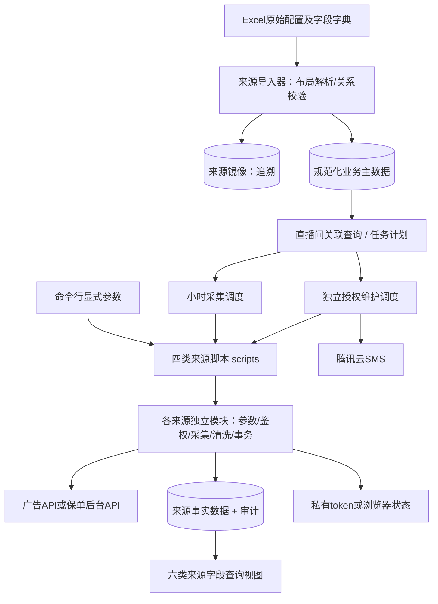
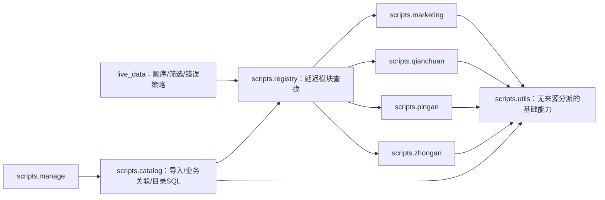
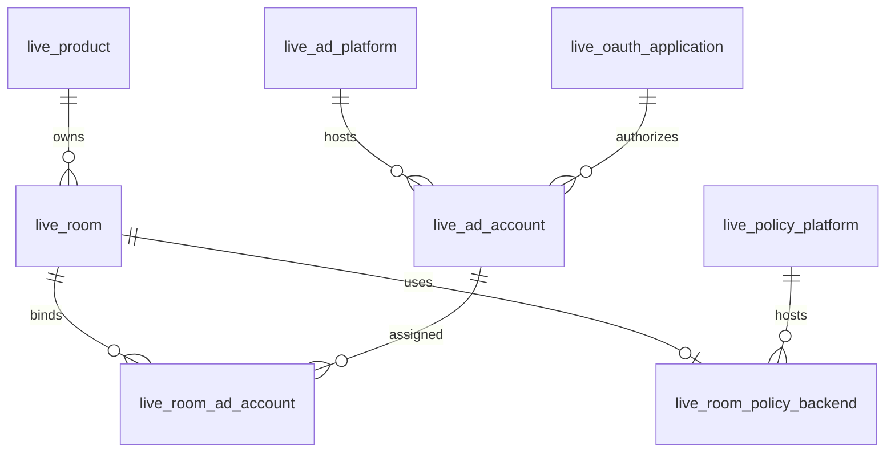
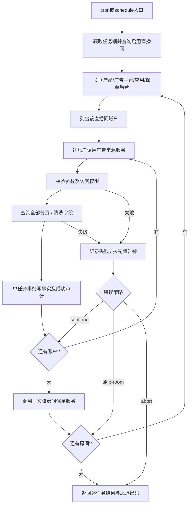
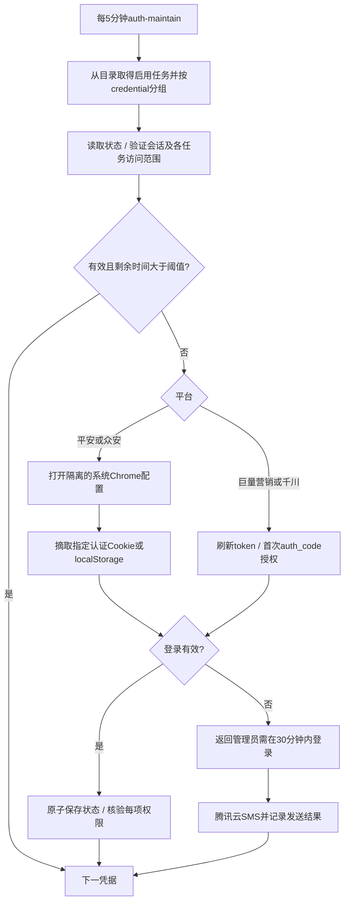

# 第一期直播数据管理技术规格 v3

版本：2026-10-22。需求依据：更新后的 [Page](https://chatgpt.com/space/page_1b6e05dc95ec81918416244f056f2cd4) 与本目录 `第一期试点直播间产品.xlsx`。本版落实用户关于采集器自治的修订：每源独立维护完整逻辑和数据库操作，共用能力放scripts/utils，live_data只调度。保留原表同步MySQL后关联查询的业务模型。

## 1. 系统要解决什么问题

以直播间为业务入口，找到它所属的产品、投放账户及广告平台、保单后台，按小时调用对应来源脚本，把完整结果写入 MySQL。独立的授权任务定期检查/刷新登录状态，失败时通过腾讯云 SMS 提醒管理员。技术规格写好后直接开发；四个脚本统一放在 `scripts/`，其余交付也只放在本目录。

本期实现来源采集与入库，不把累计保单看板伪装成小时新增，不额外建设前端、统一时报/日报业务计算或直播排班系统。Excel 中这些表作为后续消费方的字段依据保留；本期不猜测其计算规则。

### 1.1 已核实的数据事实

提供的 Excel 有 12 个工作表：3 张基础配置、6 张来源字段字典、统一时报、统一日报、直播排班。基础配置包含 3 个产品、4 个直播间、16 个广告账户、2 个巨量应用和 4 个保单后台绑定。

- 产品账户表是横向账户清单。产品、直播间、看板地址通过真实合并单元格表示多行共用关系。
- 应用表及后台表是纵向“分组/字段名/值”格式，不是此前假设的普通字段表头。
- 看板 URL 含平安 merchantChannel 或众安 dyNo、livePlatform，可据此精确关联，不用名称模糊匹配。
- Excel 的排版不决定数据库结构。原文件保持不变；仅展开已有 merge 范围，不对普通空白猜测填充。
- 应用密钥、token示例、后台密码、登录手机号不进入文档、业务主数据或测试快照；凭据由部署环境及私有认证状态管理。

## 2. 总体架构与边界



| 层次 | 职责 | 明确不承担 |
| --- | --- | --- |
| 来源导入 | 理解 Excel 布局，校验关联，事务发布主数据 | 不采集业务接口，不自动消费Excel中的token示例 |
| 业务目录 | 产品/直播间/账户/平台/应用的关系和查询 | 不把飞书行号当业务主键，不维护实体live_route |
| 调度 | 列直播间，列账户，派发来源任务，执行失败策略 | 不包含平台HTTP协议和字段清洗逻辑 |
| 来源应用服务 | 一个任务从校验到入库的完整生命周期 | 不扫描其他直播间、不决定下一个任务 |
| 来源适配器 | 一个来源的请求、分页、清洗和权限探测 | 不连接主数据，不控制全局调度 |
| 存储与通知 | 事务、幂等、审计、SMS限频 | 不推导业务归属，不把HTTP成功等同完整成功 |

实现采用两个职责明确的 Python 包：`scripts` 包含各采集器和数据管理；`live_data` 只做批量调度。四个来源独立拥有入口、任务参数、认证探测、HTTP协议、清洗、字段契约及入库SQL。每个来源既可被外部调度器单独启动，也向本项目调度器暴露相同的任务执行接口。

`utils` 共享 HTTP 重试、凭据锁与缓存、OAuth token轮换、浏览器生命周期、MySQL连接/事务/锁/公共审计、JSON输出和执行生命周期。它接收已经确定的具体组件，不根据source选择采集器、平台接口或写入SQL。系统cron负责唤醒，每次执行有限的一轮；同进程分派不需要额外队列或微服务。



依赖只向下：来源模块不依赖`live_data`或其他来源；utils不依赖registry或来源模块。catalog通过各源`task.make_task/validate`构造业务任务、检测范围重叠，不接管平台查询或事实写入。

## 3. 业务主数据模型



| 表 | 主键及重要列 | 含义 |
| --- | --- | --- |
| live_product | product_id，name，enabled | 产品独立实体 |
| live_room | room_id，product_id，name，enabled | 直播间属于一个产品；不同产品可有同名房间 |
| live_ad_platform | platform_id，source，version | marketing的smart/legacy及qianchuan |
| live_policy_platform | platform_id，source | pingan / zhongan |
| live_oauth_application | app_key，app_id，source，credential，enabled | 应用和部署凭据别名，绝不存secret |
| live_ad_account | account_key，advertiser_id，name，account_type，platform_id，app_key，enabled | 平台上的账户及授权应用 |
| live_room_ad_account | room_id + account_key，scope_json，enabled | 房间使用账户的范围；多对多关系显式表达 |
| live_room_policy_backend | room_id，platform_id，selector，platform，credential，enabled | 每房间一个保单查询范围；不随广告账户重复 |

产品关联账户、广告平台和保单平台通过其直播间关联取得，不再维护另一套会相互矛盾的产品绑定。`v_live_room_sources` 展示 Page 中“产品/直播间/账户/广告平台/保单平台”的关系；视图一行代表一个房间账户，保单任务须按房间去重。

调度分别读取 `v_live_ad_task` 和 `v_live_policy_task`：前者一行一个房间账户，后者一行一个房间后台；不从横向展示视图逐行触发保单。

来源三张镜像 `live_source_*` 只用于输入追溯，和上述业务表在同一事务发布。运行时从业务表关联生成内存 `Route`（采集任务值对象），没有实体 `live_route`。已有旧版镜像需重新同步后生成业务目录，旧业务历史不自动删除。

主键由业务自然键确定性生成：产品名、产品+房间名、来源+应用ID、来源+账户ID。无稳定源ID的名称变化会产生新实体，部署前应完成名称确认；以后改名需显式迁移，不能按行号自动追随。

### 3.1 导入规则

1. 读取整个本地文件；记录文件摘要，拒绝解析前后文件变化。只按真实Excel合并区域展开分组。
2. 从纵向应用组提取来源与app_id，从后台组提取看板URL。URL严格匹配已支持的主机及查询参数。
3. 账户行按产品和房间分组；用看板选择器匹配后台，用来源及显式app_id或唯一应用匹配应用。未知平台、空外键、歧义或缺少后台全部拒绝。
4. 本试点清单每账户仅绑定一个房间；按用户“统计每个账户”要求，默认取账户全量。这是本版的导入约定。若同账户出现在多个房间，必须提供每房间明确且互斥的广告aweme筛选，否则拒绝同步。众安保单dyNo不自动成为广告筛选条件。
5. 所有关系验证通过后，在MySQL事务内替换来源镜像和业务主数据；任一失败全部回滚。移除的关系停止未来任务，已采集历史保留。

## 4. 四类脚本契约

入口：`scripts/marketing.py`、`scripts/qianchuan.py`、`scripts/pingan.py`、`scripts/zhongan.py`。均支持 `collect`、`check-auth`、`authorize`、`init-db`，也可用 `python -m scripts.<来源>` 运行。

init-db只读取配置，初始化本来源事实表、视图及公共审计，不需要任务参数或业务目录。其他命令接受一个明确任务，独立运行不需要先同步业务目录；collect只需要事实数据表及有效凭据。参数模式与 `--task-file` JSON模式二选一。调度器在进程内传递等价的Route对象，不在命令行传secret/token。

| 参数 | 适用 | 约束 |
| --- | --- | --- |
| --config | 全部 | 部署TOML，包含MySQL、凭据别名和运行配置；独立脚本不要求master_data |
| --product-id、--room-id、--credential | 全部 | 非空业务标识与部署凭据别名 |
| --advertiser-id | 营销/千川 | 正整数文本 |
| --app-id | 营销/千川 | 预期授权应用ID，与环境APP_ID核对 |
| --account-scope 或 --aweme-id | 营销/千川 | 二选一；后者是手机显示抖音号，千川内部ID由适配器解析 |
| --version | 营销 | smart（默认）/ legacy |
| --channel | 平安 | merchantChannel |
| --dy-no、--platform | 众安 | dyNo；platform默认DOUYIN |
| --start、--end | collect | 成对北京时间整小时半开区间，默认上一完整小时，最多7天 |
| --metrics | 营销/千川collect | 可选逗号分隔字段；默认使用已核对的来源字段契约，不静默退为3项指标 |
| --task-file | 全部 | 单任务JSON，包含product_id/room_id/source/credential/account_id/options；与显式任务字段互斥 |
| --dry-run | collect | 校验参数、打印安全任务计划；不鉴权、不联网、不连接数据库 |
| --wait-seconds | authorize | 1–1800，默认15秒 |

任务标识由同一业务范围算法生成，显式脚本与目录调度的ID一致；字段选择、凭据轮换不改变业务范围ID。check-auth/authorize不需要MySQL。collect中任何分页失败都不写业务数据。

标准输出为一个JSON对象，包含code、task_id、source、status、rows或message。进程退出码与code一致。0成功；2配置/参数；3授权；4来源或数据；5存储；6锁占用；7短信；130人工中止。原始凭据、响应正文和订单个人字段不进入错误输出。

## 5. 来源采集与事实数据

| 来源 | 请求单位 | 清洗与完整性 | 存储粒度 |
| --- | --- | --- | --- |
| 巨量营销 | advertiser_id、smart/legacy、小时区间 | stat_time_hour，全部分页，源字段校验，金额Decimal | 账户/范围/小时/维度 |
| 巨量千川 | advertiser_id、按日请求小时粒度 | stat_datetime，必要时解析aweme内部ID，裁剪目标小时 | 账户/范围/小时/维度 |
| 平安 | merchantChannel | 日概况+漏斗；订单以updatedDate查询，全状态全分页 | 观察时刻累计快照；postId标识的来源订单 |
| 众安 | livePlatform、dyNo、日期及全部场次 | 场次看板、订单游标全分页；保存源路径 | 场次累计快照；orderNo来源订单 |

事实存储使用三个公共物理表：`live_ad_hourly`、`live_policy_snapshot`、`live_policy_order`，通过source和任务ID隔离来源；`live_run`记录每次任务审计。来源字段保留原始JSON，并按工作簿的6张字段字典提供六类SQL查询视图，应用无需把不同平台字段强行混成一张宽表。字段契约文件同时记录来源字段名、路径、类型和未实现/不适用说明。

广告默认指标从本地工作簿的字段契约生成；平台拒绝字段即报告失败，不静默省略。账户名称/类型来自主数据，不能当成广告API指标请求。来源没有的字段保持NULL，不填0。平安派生比率保留明确分母、零分母为NULL；不把展示四舍五入后的保费替代接口原金额。众安保留统计字段的完整层级和缺失值。

快照observed_at是实际观察时间；source_date是查询的日期。回补只能得到“现在看到的历史日期累计”，不能重建过去逐小时累计。postId仅作为当前接口订单记录标识，未证明它等同保单号。统一时报/日报的指标合并及归因另属消费层，不在本期脚本内隐式计算。

## 6. 小时采集流程



continue继续下一任务；skip-room跳过同产品同房间剩余任务；abort停止本轮。数据库失败总是中止；部分成功总退出码仍非零。广告先执行，保单每房间一次；不能按账户数重复累加保单。

导入使用catalog-import锁，调度使用scheduler锁，单任务服务使用来源+账户/保单选择器范围锁，授权维护只使用凭据文件锁。目录在一次一致性读取中取得快照后提交读事务；随后长采集不阻塞配置发布或独立授权。失败窗口记录在审计中，由明确start/end回补，本期不引入自动队列。每小时第5分钟可先同步、成功后采集；也可单独同步，让采集仅使用最后一次成功发布的目录。

## 7. 独立授权维护流程



默认阈值1800秒，等于阈值也刷新。OAuth各应用独立环境前缀及缓存；先保存轮换refresh token再验证账户权限，避免后一步失败丢失新token。浏览器使用系统Chrome隔离持久目录，不读取用户日常密码库。每个平安后台使用独立登录别名/浏览器目录；众安也可分别维护。

有效期未知的浏览器状态通过实际接口探测，不虚构过期时间。众安当日没有场次只能证明会话有效，不能证明目标范围。维护默认等待15秒，失败发短信提示半小时内登录；人工authorize可等待1800秒。采集只检查授权，不擅自打开登录窗口。

SMS使用官方Python SDK、逐个检查SendStatusSet。成功后才进入冷却；模板参数仅包含安全的来源/状态/时间提示。没有启用SMS时明确返回disabled。单执行节点部署，避免不同机器独立轮换同一个refresh token。

## 8. 模块归属与公开接口

```text
live_data/
  cli.py              批量参数和目录任务筛选
  dispatch.py         调用来源公开接口，不组装来源组件
  runner.py           房间/账户顺序、失败策略、授权维护分组
scripts/
  registry.py         延迟查找来源模块，转发task.make_task
  manage.py           init-db / inspect-sources / sync-sources / validate-config
  catalog/
    entities.py       八张业务表的模型与关联任务构建
    validation.py     汇总本源Scope，拒绝重复或重叠范围
    master_data.py     来源映射和校验
    xlsx_sources.py    本工作簿布局解析
    repository.py     镜像/目录事务发布与一致读取
    schema.sql        三张镜像、八张业务表、三个目录视图
  marketing/          营销完整模块
  qianchuan/          千川完整模块
  pingan/             平安完整模块
  zhongan/            众安完整模块
    cli.py            本源参数、check_task / collect_task与组件组装
    task.py           本源范围语义、校验和任务构建
    auth.py           本源权限探测、浏览器会话提取或OAuth配置
    collector.py      本源URL、请求、分页、清洗
    repository.py     本源事实写入SQL、原子性及范围锁定义
    contracts.py      本源投影、默认指标、派生字段和视图渲染
    fields.json       本源字段字典
    schema.sql        本源事实表与视图
  utils/
    model.py          通用值对象、时间窗口、错误码
    config.py         通用部署配置读取
    cli.py            参数公共项、安全JSON任务读取/输出
    tasks.py          文本和ID基础校验、身份散列
    auth.py           通用缓存、凭据锁、OAuth轮换生命周期
    browser.py        浏览器生命周期，接收URL/提取/探测回调
    transport.py      HTTP及重试
    database.py       连接/事务/命名锁/公共审计
    runtime.py        锁→授权→采集→写入→安全结果
    fields.py         接收显式契约的Decimal与投影/SQL渲染
    notify.py         SMS及冷却
```

四个来源公开相同的接口，具体实现位于各自模块：

| 接口 | 所有者与职责 |
| --- | --- |
| task.make_task(...) → Route | 本源规范化参数；共用身份函数只散列传入的已确定范围 |
| task.validate(route) → Scope | 本源解释账户、抖音号、channel、dyNo/platform；目录只比较Scope |
| cli.collect_task(config, route, window) → result | 本源管理HTTP/数据库连接，组装Auth、Collector、Repository |
| cli.check_task(config, route, renew, force, wait_seconds) → state | 本源管理HTTP连接并检查/恢复授权，不连接MySQL |
| Collector.collect(route, window, state) → Batch | 本源分页和字段清洗 |
| Auth.ensure(route, ...) → state | 通用凭据生命周期调用本源探测/浏览器提取 |
| Repository.write(route, window, batch) | 本源事实SQL及成功审计同事务提交 |
| Repository.init_schema() | 初始化本源事实表、视图和公共审计 |

`CollectionService(repository, auth, collector)`只使用调用者传入的对象，不接受source factory，也没有平台选择分支。公共物理事实表可以被多个来源使用，每源仍独立维护自己的SQL；共享表结构修改需一起核对各源DDL兼容性。

## 9. 验收边界

验收同时检查行为和依赖：屏蔽整个live_data包后四源仍可独立运行；scripts不存在对live_data的导入；live_data仅剩调度模块；utils没有来源分派；四源各自拥有事实写入。旧中央script_cli、AdsCollector/PolicyCollector、Store和全来源字段契约已拆除，不保留转发到旧实现的兼容层。

回归覆盖真实Excel只读解析（不输出秘密）、独立授权无需数据库、目录与显式任务ID一致、广告先于单次保单、全量分页/回滚、来源字段投影及缺失值、按凭据仅刷新一次后检查全部范围。MySQL真实实例与外部生产API验证单独列出；模拟测试不能代替它们。
