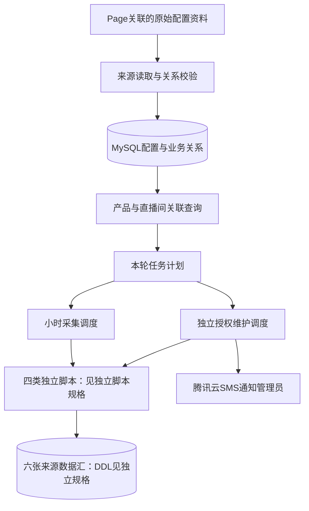
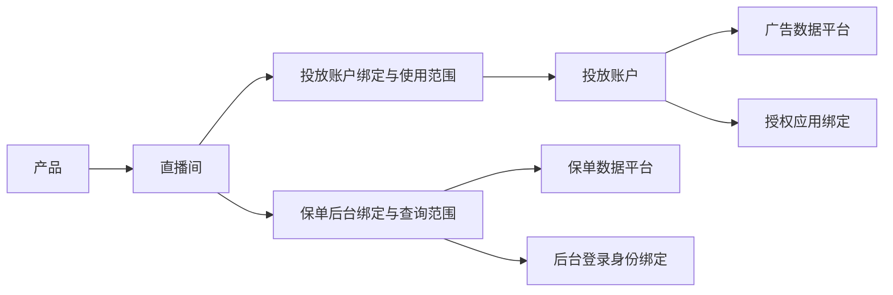
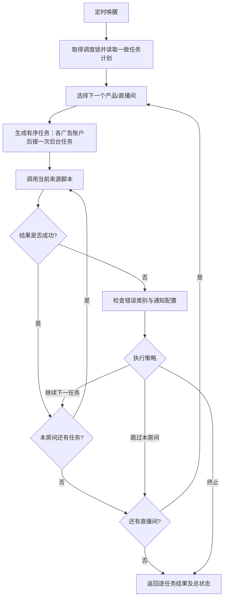
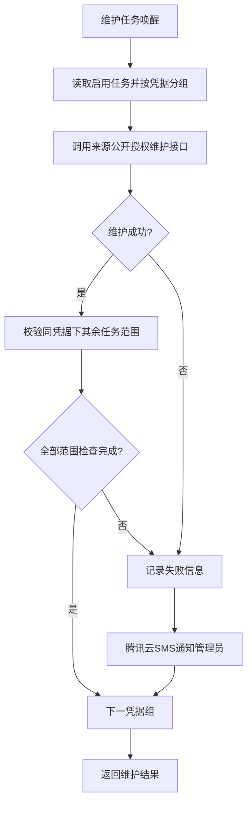

# 第一期直播数据管理主规格 v5

状态：整体架构方向；业务主数据与物理表结构尚未定稿。依据 [第一期直播数据管理 Page](https://chatgpt.com/space/page_1b6e05dc95ec81918416244f056f2cd4) 及用户补充。

本文件只描述业务关系、原表同步、任务计划、调度、授权维护编排与系统边界。**四类采集脚本的全部独立规格见 [../scripts/SPEC.md](../scripts/SPEC.md)**，包括固定数据汇格式、参数/配置映射、来源处理、授权行为、入库责任、返回码、模块划分与验收。本文件不再重复维护这些内容。

## 1. 文档分工与确定性

| 文档 | 范围 | 状态 |
| --- | --- | --- |
| [四类脚本独立规格](../scripts/SPEC.md) | 单来源任务闭环与六类固定数据汇 | 脚本需求已确定；区分接口约定和现有实现缺口 |
| 本主规格 | 产品/直播间/账户/平台关系、原表同步和批量编排 | 架构方向；业务主数据物理表设计待定 |
| [主数据实现说明](MASTER_DATA.md) | 当前工作簿适配与候选目录落地 | 实现参考，不作为最终表结构承诺 |
| [运行说明](README.md) | 当前代码安装、配置和执行命令 | 操作指引 |
| [验证记录](VERIFICATION.md) | 已运行检查与尚未验证项 | 实现证据，不替代需求验收 |

原表同步到 MySQL 后关联查询的方向保持不变。Page 中关系视图仅表达信息关系，`live_route` 只是此前的抽象名称，不要求存在同名实体表。原始资料的排版不决定实体、字段或主外键。

六类数据汇的输出格式不等待主数据表定稿，来源脚本可凭调用方提供的参数和配置独立实现、执行与验收。主数据或配置读取方式变化，应在任务构建适配层消化。

## 2. 总体架构

| 组件 | 系统职责 |
| --- | --- |
| 原表适配 | 读取资料、解释布局并形成稳定信息结构，不把源表行号当业务身份 |
| 业务关系管理 | 管理产品、直播间、账户、平台与认证绑定，提供一致的启用任务查询 |
| 任务构建 | 将关系查询结果转换为脚本规格规定的输入，检查遗漏、歧义和范围冲突 |
| `live_data` | 任务筛选、顺序、结果检查、失败策略与授权维护编排 |
| 来源执行 | 按[独立规格](../scripts/SPEC.md)实现；调度层不持有来源协议或写入细节 |
| 通知 | 根据维护/采集结果通知管理员，记录发送结果并控制重复通知 |

当前实现采用同进程调用；外部调度也可以直接运行各脚本。系统 cron 唤醒有限的一轮任务，不要求建设队列或微服务。调度只依赖来源公开接口，来源模块不反向依赖调度包。

## 3. 业务关系方向

以下是概念实体和关系，不是已批准的数据库 ER 设计：

需要表达的关系包括：直播间属于哪个产品；使用哪些投放账户及平台；广告账户由哪个应用授权；直播间对应哪个保单后台与查询范围。产品的账户/平台可通过直播间关系取得；不能维护多套相互矛盾的归属。

展示视图可以把一个直播间的账户和后台放在同一行，但执行计划必须区分账户任务与后台任务。不能因为一个房间有多个账户而重复采集、重复累计同一后台数据。

物理设计定稿时还需确认：

- 实体是否拆表、表名与字段名、主外键和索引。
- 产品与直播间的稳定 ID 来源、改名规则及历史迁移。
- 跨房间共享账户/后台的实际业务范围及防重复归属规则。
- 配置版本、停用/删除语义，以及历史任务的追溯方式。
- 原表镜像与规范关系数据的保留范围、更新策略和权限。

当前代码实现的八张目录表、三个目录视图及名称散列 ID 属于候选方案，详见 [MASTER_DATA.md](MASTER_DATA.md)。本主规格不将这些名称和算法冻结为最终要求。

## 4. 原表同步与任务计划

用户已确定先同步原表到 MySQL，再进行关联查询。原表可以是 Page 所链接的资料，也可以是 Page 指定的本地工作簿；布局适配与脚本采集分开。

1. 读取同一版本的配置资料，提取产品、直播间、账户、平台、应用/后台绑定等信息。
2. 校验关联完整性、来源支持、标识歧义、重复/重叠范围及认证绑定。敏感认证值由私有配置管理，普通关系数据只引用别名。
3. 校验通过后发布一个完整的 MySQL 配置版本；失败保留上次可用版本，不暴露半套关系。
4. 调度在一致快照中取得本轮启用任务，完成计划后释放读取事务。采集中产生的新配置供下一轮使用。
5. 每项计划转换为[脚本输入契约](../scripts/SPEC.md)，不把业务表结构传入脚本。

现有工作簿包含横向账户表、纵向配置分组与真实合并区域，适配器只按已知布局解释。布局改变需要更新输入适配器，不改变来源脚本或固定数据汇契约。当前样本中的实体和任务数量是接入样本，不作为系统容量或业务数量限制。

## 5. 小时采集调度

每房间先处理广告账户，再处理该后台范围一次。全局计划须先去除重复或互相覆盖的绑定。

支持 continue、skip-room、abort：分别继续下一任务、跳过同产品同房间剩余任务、终止本轮。存储/审计故障始终停止继续写入，部分失败不得把整轮结果报告为成功。错误码及单脚本结果格式只在[独立规格返回契约](../scripts/SPEC.md)维护。

调度锁保护同一执行轮次；来源执行内部互斥遵循独立规格。导入与授权维护不长期占用采集调度锁，避免长采集阻塞配置发布或登录恢复。补采由调用方明确选择失败窗口，自动重试队列尚非本期既定要求。

## 6. 独立授权维护编排

同一凭据的一轮恢复只执行一次，随后检查各任务范围，不能因一个账户能访问就认定所有账户有权限。提前刷新阈值、浏览器恢复及管理员登录提示由[脚本授权契约](../scripts/SPEC.md)定义，本文件不复制平台内部流程。

通知层按已审核模板将安全错误发送给管理员，检查逐个号码的发送结果，成功后才进入冷却；发送失败必须保留可见失败状态。短信签名、模板、号码和腾讯云认证属于部署配置，不写入采集参数。

采集按小时唤醒；授权维护应独立、足够频繁地检查。现有 cron 模板采用每小时第5分钟采集、每5分钟维护，这是部署建议，不是 Page 固定业务字段。时区为 Asia/Shanghai，实际 cron 能力与运行桌面环境需部署确认。

## 7. 接入与整体验收

- 原表信息可完整同步并生成无歧义计划；失败不会发布不完整版本。
- 改变来源资料布局或候选物理主数据结构，只调整导入/关系查询/任务适配，不改变脚本公开输入和汇表契约。
- 调度依据正确来源分派，遵守顺序、去重、失败策略及独立授权维护。
- 每个来源先按 [../scripts/SPEC.md](../scripts/SPEC.md) 独立验收，再验证批量组合。
- 数据库实体/字段/约束定稿与脚本功能验收分别记录，不以现有代码或离线测试代替模型审批与真实环境验证。

来源项目已移至仓库根目录 scripts/；来源汇表 DDL 已明确，业务主数据物理模型仍待定。运行命令见 [README.md](README.md)，当前实现验证与待验证项见 [VERIFICATION.md](VERIFICATION.md)。
