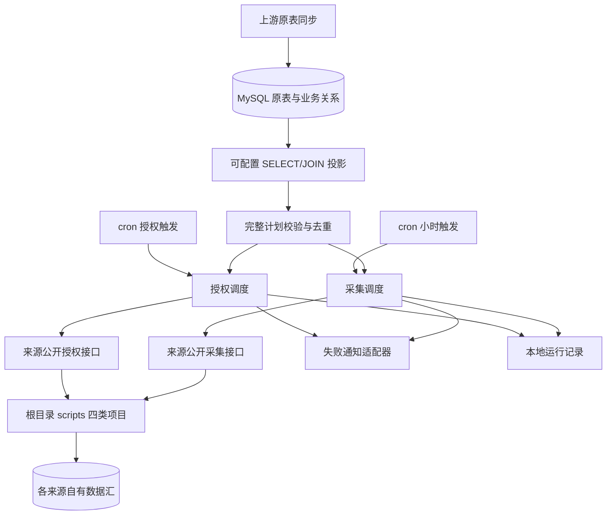
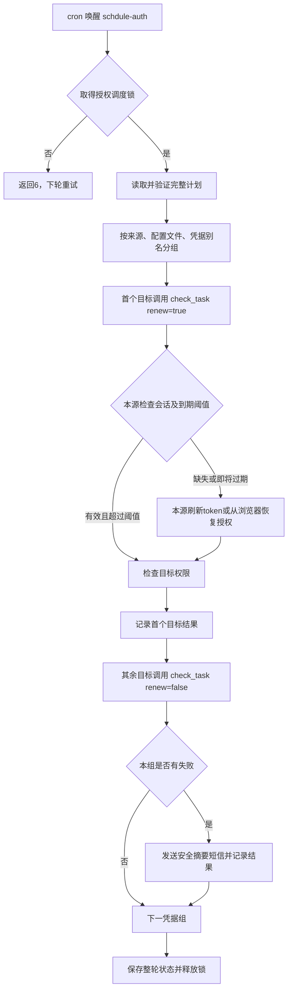
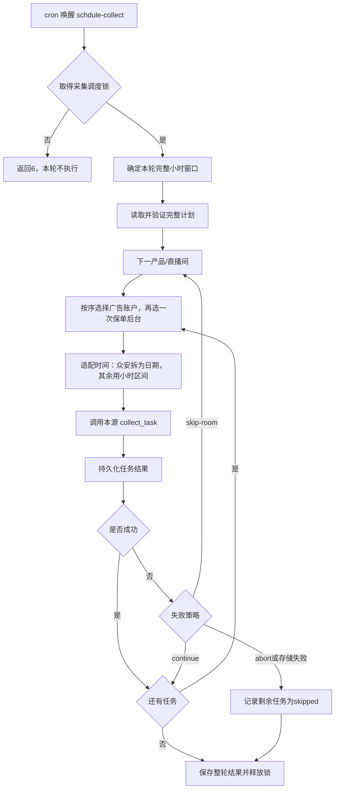

# 调度层规格

版本：2026-10-22。项目目录按用户命名为 `schdule/`。本版重新实现授权调度和定时采集调度，替代旧调度目录。来源脚本的参数、授权实现、数据清洗及 MySQL DDL 统一引用 [四类独立脚本规格](../scripts/SPEC.md)。

## 1. 范围与架构决定

本项目只回答三个问题：本轮执行哪些来源任务、以什么顺序执行、失败后怎样处理。原表先同步至 MySQL，再关联查询的方向保持不变；原表同步及最终业务表建模属于上游，不在调度进程内执行。

业务表结构尚未定稿，因此调度只定义 SQL 查询结果的稳定投影，不创建产品/直播间/账户表，也不要求存在 live_route 实体。实际表名和 JOIN 关系由部署方放入 `config/plan.sql`。不能以演示 JSON 替代正式 MySQL 输入。

采用两个有限执行入口，由系统 cron 唤醒：

- `schdule-auth`：执行一轮授权维护与目标范围检查。
- `schdule-collect`：执行一轮采集；默认上一完整小时，可明确指定回补窗口。

选择此方案是因为当前为单节点小时采集，两个进程各有独立锁，易于独立运行和排查。暂不引入队列、常驻调度服务或自动补偿队列。代价是漏跑窗口需要按日志明确回补；跨节点执行需要另行建设共享调度状态。



## 2. 模块边界

```text
schdule/
├── pyproject.toml / uv.lock
├── src/schdule/
│   ├── cli.py                 # 两个入口、参数与运行组装
│   ├── config.py              # 只解释调度设置
│   ├── models.py              # 关联绑定与已准备任务
│   ├── plan.py                # MySQL只读查询、完整校验、去重排序
│   ├── collectors.py          # 来源公开API的唯一适配层
│   ├── authorization.py       # 按凭据维护、逐目标检查
│   ├── collection.py          # 房间顺序、时间适配、失败策略
│   ├── runtime.py             # 独立任务锁、原子运行记录
│   ├── notify.py              # 腾讯云SMS及冷却
│   └── errors.py              # 安全错误与退出码
├── config/                    # 调度模板、SQL投影及离线示例
├── tests/                     # 新调度回归测试
├── data/                      # 原始Excel输入，私有且不提交
├── cron.example
├── README.md / SPEC.md
└── VERIFICATION.md
```

| 归属 | 负责 | 不负责 |
| --- | --- | --- |
| 上游原表同步 | 将原始产品、房间、账户、后台和授权绑定信息同步 MySQL | 不在采集循环里重建业务关系 |
| plan.py | 一次读取全部启用绑定，校验后冻结本轮计划 | 不创建最终业务表模型 |
| collectors.py | 调用本源 make_task、validate、check_task、collect_task | 不访问平台端点，不拼接来源入库 SQL |
| 授权/采集调度 | 顺序、凭据分组、时间窗口、失败策略 | 不实现 token/Cookie 提取与来源分页 |
| scripts/<type> | 本类型配置、参数、授权、采集、清洗、事务入库 | 不依赖 schdule |
| runtime / notify | 执行记录、进程互斥、通知和发送冷却 | 不保存来源 token/Cookie |

调度环境显式依赖四个来源发行包及 utils，通过 Python 公开接口调用；各来源仍可在自己的锁文件和虚拟环境独立运行。采用同进程调用以复用来源已有的授权维护接口，不增加一套通用 script_cli。调度只加载各来源自己的 TOML，不合并维护一份平台凭据文件。

## 3. MySQL 计划输入契约

### 3.1 查询结果

`plan.query_file` 指向只读 SELECT 或 WITH 查询。它可关联任意已同步原表；调度仅要求以下别名：

| 列 | 类型 | 语义 |
| --- | --- | --- |
| product_id | 非空字符串，最多128字符 | 调度归属与失败分组 |
| room_id | 非空字符串，最多128字符 | 与 product_id 联合定义一个业务直播间 |
| source | marketing/qianchuan/pingan/zhongan | 选择来源公开接口 |
| credential | 非空字符串 | 对应本来源配置中的凭据别名 |
| advertise_id | 字符串；保单为空或 NULL | 广告账户；SQL 使用 CAST 保证不会以数值返回 |
| options | JSON对象或对象文本 | 本类型真正使用的查询条件和汇表上下文；可省略为 {} |

广告 options 可含营销 version、千川主播范围及固定输出元数据；平安使用 channel；众安使用 dy_no/platform。完整白名单由来源 task.py 校验，调度不复制来源参数规格。产品/业务房间只保留在 Binding 和运行记录中，不传入来源 Task。

SQL 应过滤停用的产品、房间、账户和后台绑定。推荐账户投影与后台投影使用 UNION ALL，每个后台范围返回一次，避免账户数量放大后台任务。SQL 模板 [plan.example.sql](config/plan.example.sql) 只展示列形状，故意返回空结果；它不是已完成的业务关联 SQL。

### 3.2 一致性与校验

1. 使用独立只读 MySQL 用户，在 READ ONLY 事务中执行一次关联查询。
2. 最多读取 max_rows＋1 行；超限报错，不截断后执行。空计划同样报错，避免错误 JOIN 被误认为成功空跑。
3. 释放查询连接，再构造四类来源 Task。所有绑定与来源配置必须先验证完，才开始任何授权或采集动作。
4. 同房间、同来源范围、同凭据和同参数的重复行合并，特别是宽表关联产生的重复后台行。
5. 相同范围跨房间、同范围不同凭据/参数、账户全量与主播子集重叠、不可比较的主播 ID 类型都拒绝执行。
6. 一个业务房间最多一个不同保单后台范围。广告任务先于该房间的保单任务，之后再进入下一个房间。

task_id 由来源查询范围决定；产品/房间归属变化不制造另一份来源事实。调度每轮重新读取 MySQL，执行期间不再次读取，更新后的上游配置在下一轮生效。

## 4. 授权调度



- 每凭据组本轮最多触发一次维护；其余账户仍逐个检查，不能用第一个账户成功代替整组权限成功。
- 首个目标失败后仍检查其余目标，避免一个账户无权限掩盖其他账户的状态。OAuth 已轮换但目标探测失败时，由来源脚本保存轮换凭据，调度不回滚它。
- refresh_before_seconds 默认 1800。调度将阈值传入来源配置副本，源 TOML 不被改写；阈值判断、刷新和浏览器提取均在本源实现。
- wait_seconds 默认 15，范围1–1800秒，用于后台浏览器恢复等待。首次人工登录可直接执行本源 authorize，使用较长等待预算。
- 当前无直播时众安可能返回 session_valid 且 scope_status=unobserved_no_live_rooms；必须保留“目标范围尚未证实”的含义。
- 授权或目标失败按凭据组发送一次通知；锁占用 code 6 留待下轮，不发送重复故障短信。关闭通知时明确记录 notification_disabled。

## 5. 定时采集调度



默认窗口为北京时间上一完整小时 `[start,end)`；显式回补必须同时提供 start/end，整小时、结束不晚于当前整点，单轮最多7天。营销、千川和平安使用来源 Window 接口；众安按窗口实际涉及的日期逐日调用 DayWindow。

例如 00:05 唤醒时，默认窗口为前一天23:00至今天00:00；众安采集前一天，而不是误采今天。23:00至次日01:00的显式回补会产生两个众安日期调用。众安收集到的是执行当时的累计快照，不是回补出的历史小时状态。

| 策略/情况 | 行为 |
| --- | --- |
| continue（默认） | 记录失败，继续下一账户/日期/房间 |
| skip-room | 跳过相同 product_id＋room_id 剩余任务，继续下一房间 |
| abort | 跳过所有剩余任务，整轮失败 |
| 来源存储或审计 code 5 | 无论策略如何都停止后续采集 |
| 调度日志不可写 | 立即停止，返回5，防止继续执行却丢失运行证据 |
| 部分任务失败 | 整轮非零；每项结果独立保留 |

采集前的授权有效性检查由本源 collect_task 完成；采集调度不自动打开登录窗口或代替授权调度维护会话。来源写入幂等性由来源实现，本调度允许同窗口明确重跑，不承诺恰好一次执行。

## 6. 配置、并发与运行记录

| 配置 | 默认 / 用途 |
| --- | --- |
| runtime.directory | ../runtime；两个调度应使用同一个部署运行目录 |
| plan.query_file / max_rows | 业务关联 SQL / 10000 |
| mysql.* | 只读计划库连接；password_env 默认 SCHDULE_MYSQL_PASSWORD |
| sources.<source>.config | 对应独立脚本的 TOML 路径；仍使用本源 env_file、状态目录和数据库配置 |
| authorization.refresh_before_seconds / wait_seconds | 1800 / 15 |
| collection.on_error / notify_on_error | continue / false |
| sms.enabled / cooldown_seconds | false / 1800；实际环境配置腾讯云应用、签名、模板和号码 |

TOML 中路径相对该 TOML；CLI --config、--plan-file 相对当前工作目录。平台密钥放来源配置引用的私有环境；调度 MySQL 密码和腾讯云密钥由进程环境提供。

授权锁 auth.lock 和采集锁 collect.lock 分开，两类作业可以同时运行；同类不可重入。来源自有范围锁和凭据文件锁继续保护源写入与 token 轮换；冲突返回6，由下一轮或人工重跑处理。单机文件锁不是跨机器调度锁。

每次正式运行生成独立 run_id，写入 `runtime/runs/<run_id>.json`：开始时建立记录，完成每项立即原子更新，结束时写入 finished_at 和总状态。文件权限0600；不写 token、Cookie、数据库密码或原始 SDK 异常。采集器返回值仅允许 code/status/rows/scope_status 进入记录，其余来源信息由已经验证的计划生成。

进程遭 SIGKILL/断电时，最后一份记录可能仍为 running；它表示未确认完成，不是后台仍在执行的证明。锁随进程退出释放；排查后可明确重跑对应窗口。日志暂不自动删除，应由部署配置保留周期和清理策略。

## 7. 通知与退出码

腾讯云 SMS 仅在配置启用且作业实际失败时调用。模板参数支持 source、reason、credential，错误文字由固定安全摘要生成。检查每个接收号码的返回 Code，全部成功才保存冷却状态；部分失败、SDK异常和状态写入失败都返回7。

冷却按来源配置/凭据、故障类别和号码集区分，共用凭据下多个账户失败不会连发多条。短信失败不会把原采集/授权失败覆盖为成功；每个结果仍保留在运行记录。

| code | 含义 |
| --- | --- |
| 0 | 全轮成功；仍需查看未验证范围状态 |
| 2 | 配置、参数、空计划或范围冲突 |
| 3 | 来源授权或目标权限失败 |
| 4 | 来源/数据或调用结果异常 |
| 5 | MySQL计划读取、来源存储、调度审计故障 |
| 6 | 同类调度或来源范围/凭据锁占用 |
| 7 | 通知发送或通知状态故障 |
| 130 | 人工中止 |

总退出码为本轮已记录非零 code 的最大值，逐任务结果用于定位实际原因。stdout 输出最后一条 JSON；cron 应同时保留进程日志。未能建立运行记录的错误直接通过 stdout/退出码返回。

## 8. 接口、验收和部署边界

终端入口及 cron 模板见 [README.md](README.md)。`--dry-run --plan-file` 只做离线预览；正式执行必须读 MySQL。`--dry-run` 不带文件会读取 MySQL，但不鉴权、不采集、不写运行目录。

验收覆盖：查询连接关闭与只读事务、空/超限计划拒绝、后台去重、来源范围冲突、账户先于保单、同凭据仅维护一次、每账户权限检查、三种失败策略、存储失败停止、跨零点众安日期、锁独立与互斥、运行记录原子写入、短信结果与冷却、秘密不进入输出、来源无反向依赖。

当前上游真实表结构和部署连接未提供，因此 `plan.sql` 需根据真实同步表完成 JOIN；代码与查询投影适配层已经实现，不能把空 SQL 模板称为生产接入完成。真实授权、真实 MySQL、真实短信及 cron 安装不属于离线测试的证明范围，详见 [VERIFICATION.md](VERIFICATION.md)。
