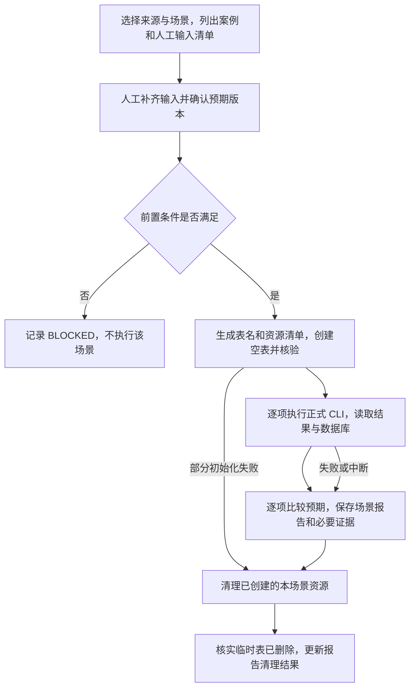

# 四类脚本场景案例测试规格

版本：v0.1，2026-10-23。状态：**待用户审核，尚未开发、尚未执行真实案例**。

本文是 [四类独立采集脚本规格](SPEC.md) 的专项验收规格，定义巨量营销、巨量千川、平安保单、众安保单的真实场景测试。字段、接口参数和正式脚本行为以主规格为准；本文定义测试输入、执行步骤、预期、报告和清理规则。

本轮仅提交本文供审核。用户审核通过后才开发测试类；开发完成且人工输入齐备后，才具备执行真实案例的条件。当前离线测试结果不能替代本文的真实接口和 MySQL 验收结果。

## 1. 测试目标与边界

按“场景 → 案例项 → 人工准备 → 空表初始化 → 执行与断言 → 报告 → 删除临时表”的流程验证三个正式功能：check-auth、authorize、collect。

测试使用真实平台授权、真实采集接口和真实 MySQL。正式调用使用各来源自己的虚拟环境和 CLI，测试类不重写采集请求、字段映射或业务入库逻辑。schdule 的计划关联、定时触发、短信通知不属于本测试套件。

关键业务字段使用**执行前由人工确认的独立预期值**强校验；其余字段不逐项强校验，但仍检查表结构、唯一键、行数、时间范围和结果完整性。不以“命令返回0”或“有数据写入”单独判定通过。

测试管理器负责建表和删表。四类正式脚本仍只使用配置中的已有表，不恢复 init-db，不获得自动建表职责。

## 2. 执行流程与测试单位



- **测试批次 test_run_id**：一次人工发起的测试，包含选定来源及场景，记录代码版本、配置版本、预期版本和执行时间。
- **场景组 scenario_id**：共享明确前置条件和一套临时表的案例集合，例如“营销未授权”或“千川小时/天粒度共存”。每组从空表开始；后续案例如需保留前一步数据，必须在案例定义中声明依赖。
- **案例项 case_id**：一次或一组有固定顺序的命令与断言。实际实例使用 `<source>.<case_id>`，避免四类脚本之间重号。
- **步骤 step_id**：保留命令、开始/结束时间、进程退出码、结果 JSON、数据库变化及断言结果。重采集案例的两次 collect 是不同步骤。

默认按来源、场景顺序串行执行。同一来源始终只有一套测试授权状态，不并发刷新、不在不同案例目录保存可竞争刷新的多份 Token。不同场景组不复用业务表；同一组内是否保留数据由案例步骤决定。

全量测试需要四类来源的必选案例全部满足。也允许只选择某一来源或场景，但报告必须明确本次覆盖范围，不能称为“四类全部通过”。

## 3. 按场景列出的案例

表中“必选”是该来源完整验收所需项目；“条件选测”必须在执行清单中说明适用性，选中后缺少输入记为 BLOCKED，不能当作通过。负向案例出现预期的非零退出码属于案例通过。

### 3.1 四类共用：授权状态与基础采集

| 案例 | 场景与适用性 | 人工准备 / 执行步骤 | 强制预期 |
| --- | --- | --- | --- |
| A01 | 已授权；四类必选 | 有效测试缓存、可访问目标；执行 check-auth | 进程及结果 code=0、status=session_valid、scope_status=verified；业务表和审计表仍为空；缓存内容不被刷新 |
| A02 | 未授权检查；四类必选 | 本类型配置完整，测试 auth.json 不存在；执行 check-auth | code=3、status=failed；不创建有效授权缓存；业务表和审计表仍为空。浏览器已登录也不能被当作已有状态缓存 |
| A03 | 未授权收集；四类必选 | 延续 A02，临时表可正常读写；执行 collect | code=3；业务表0行；审计新增1条 failed，exit_code=3、row_count=0；不得自动弹出登录或刷新授权 |
| A04 | 本地缓存已过期；四类必选 | 在测试状态中设置过去的 expires_at，保留合法结构；执行 check-auth，再执行 collect | 两步 code 均为3；业务表不变；仅 collect 新增1条失败审计。报告标注“本地到期判断”，不声称证明服务端已吊销授权 |
| A05 | 缓存可用，正常收集；四类必选 | 已确认的正向数据目标、固定日期和关键字段预期；执行 collect | code=0、status=success；目标表行数、业务键和关键字段符合第5节；成功审计1条，row_count 与本次返回 rows 一致 |
| A06 | 查询参数错误；四类必选 | 使用正确配置和授权；营销无效账户 ID、千川无效粒度/日期、平安空 channel、众安未来日期，至少各1项 | code=2；业务表、审计表和授权缓存均不变；错误说明不包含秘密 |

A02/A03 必须与其他授权案例隔离；先检查状态文件确实不存在，再运行。不能只凭操作者口头描述“未登录”推断脚本未授权。

A04 的测试状态修改仅用于本地期限判断。案例结束后只恢复被修改的期限元数据；如果中途发生真实授权轮换，必须保留最新状态，禁止还原旧 refresh_token。

### 3.2 巨量营销 / 巨量千川：OAuth 授权

| 案例 | 场景与适用性 | 人工准备 / 执行步骤 | 强制预期 |
| --- | --- | --- | --- |
| O01 | 首次授权；两个广告来源必选 | 本应用 APP_ID/APP_SECRET、新鲜且未使用的 AUTH_CODE、测试账户；缓存不存在；执行 authorize，再 check-auth | 两步 code=0；缓存 source/app_id 正确，access_token/refresh_token 非空、expires_at 在未来；检查阶段不再次交换授权码；目标权限 verified |
| O02 | 刷新已有授权；两个广告来源必选 | 同一测试授权的有效 refresh_token；清除测试进程和私有 env_file 中的 AUTH_CODE；执行 authorize，再 check-auth，再 collect | 刷新无需 AUTH_CODE；后两步使用最新缓存成功；关键数据仍符合预期。只断言有效刷新结果，不要求平台必定返回不同字符串的 refresh_token |
| O03 | 账户权限不足；条件选测 | 人工提供本应用确实无权访问、但允许用于测试的账户及平台错误依据；执行 check-auth / collect | 执行前固定预期错误分类和退出码；不接受任意非零都算通过；业务表不变，collect 的失败审计匹配实际阶段 |

O01 消耗真实一次性授权码，O02 可能轮换真实 Token。每类只使用人工指定的一套测试授权；若使用现有应用，人工需提供独占的授权维护时段及最新缓存。测试不会从旧备份恢复已轮换的 Token，也不会隐式改写正式运行配置。

### 3.3 平安 / 众安：浏览器授权

这里的“浏览器”专指测试配置对应的持久目录 `state_dir/<source>/browser`。日常 Chrome 的登录状态不能作为案例前提。准备阶段可以打开该目录供人工操作，确认后关闭窗口，再执行正式 authorize，避免目录被占用。

| 案例 | 场景与适用性 | 人工准备 / 执行步骤 | 强制预期 |
| --- | --- | --- | --- |
| B01 | 浏览器已登录、缓存缺失；两个保单来源必选 | 人工在指定测试浏览器登录并确认能访问目标；auth.json 不存在；执行 authorize，再 check-auth | 从该浏览器提取本源 Cookie/认证状态；缓存写入后两步 code=0；A05 可继续采集；不要求额外输入 Token 字符串 |
| B02 | 浏览器已退出、缓存缺失，未完成登录；两个保单来源必选 | 人工在指定测试目录退出登录并确认登录页；缓存不存在；在约定 wait_seconds 内不登录，保持窗口正常打开 | authorize 等待到期后 code=3；无有效缓存、无业务写入、无审计写入；不能把浏览器空状态视为授权成功 |
| B03 | 浏览器已退出，人工完成登录；两个保单来源必选 | 延续 B02 或重新准备；执行 authorize，人工在等待期内完成登录/验证码；再 check-auth 和 collect | 授权、检查和收集成功；只提取配置指定的认证状态；收集数据满足关键字段断言 |
| B04 | 已有缓存，浏览器窗口关闭；两个保单来源必选 | 有效缓存，关闭测试浏览器窗口；执行 collect | 使用缓存成功采集，不要求持续打开浏览器；关键字段匹配；不会因窗口关闭而重新登录 |
| B05 | 众安当日无可见直播间；众安条件选测 | 人工确认当日列表为空、会话确实可用；执行 check-auth | code=0 且 scope_status=unobserved_no_live_rooms；报告明确“未验证目标权限”，不得替代 A01 的 verified 验收 |

B02 不通过服务器撤销其他正在使用的会话来制造失败。人工登出动作只在指定测试浏览器/测试身份下执行；若站点登出会影响同账号其他会话，人工需为该案例安排可独占测试的身份或时段。

B02 还需确认失败原因是等待登录到期。浏览器无法启动、窗口被提前关闭、配置错误等即使返回同样退出码，也不算该案例通过。

### 3.4 数据场景：来源特有案例

| 案例 | 来源 / 场景 | 输入与执行说明 | 关键预期 |
| --- | --- | --- | --- |
| M01 | 营销，账户小时数据；必选 | 指定账户、smart/legacy 版本及过去整小时半开区间；按实际启用版本执行 | 仅按账户采集；账户＋统计小时唯一；stat_cost/show_cnt/click_cnt 及范围行数匹配预期 |
| M02 | 营销，接口版本；条件选测 | 如部署同时使用 smart、legacy，分别提供各版本可用字段及预期，在独立场景组执行 | 分别对照相同版本的口径；不能未经确认要求两版本所有指标数值相同 |
| Q01 | 千川，小时；必选 | advertiser_id、start_date/end_date、HOURLY；可选一个内部 aweme_id | 粒度、业务键、关键指标正确；stat_time_hour 为对应整小时；账户全量 aweme_id='' |
| Q02 | 千川，按天；必选 | 同源账户、日期、DAILY；预期来自按天口径 | stat_datetime 为日期零点，stat_time_hour 为 NULL；天指标与天基线匹配，不用小时指标之和替代所有日指标 |
| Q03 | 千川，小时/天共存；必选 | 同一场景组先写小时，再写同日期天数据，再重采其中一种粒度 | 两种粒度可同时存在；更新/清理仅影响目标粒度；业务唯一键无重复；另一粒度行内容不变 |
| Q04 | 千川，主播与账户全量；条件选测 | 可核实的一个内部主播 ID；同组分别收集全量与该主播 | aweme_id 分别为''和规范化内部 ID；各自匹配独立预期；重采主播不修改账户全量行 |
| P01 | 平安，统计＋订单；必选 | channel、小时起止；日统计/漏斗口径证据、按 updatedDate 筛选的订单样本 | stats 按日期累计口径验证；orders 按订单更新范围验证；不得将统计当成该小时新增量 |
| Z01 | 众安，场次＋订单；必选 | dy_no/platform/date；明确当天 roomId 集合、场次统计及订单样本 | 每个场次统计分别匹配；订单归属与业务键正确；不只验证第一场 |
| Z02 | 众安，同日多场次；条件选测 | 人工提供至少两个实际场次及对应预期 | 当前场次及历史场次均覆盖，无漏场、重复订单或跨场归属冲突 |

M01、Q01、P01、Z01 可以作为各来源 A05 的具体执行实例，不重复请求同一验收步骤。Q02、Q03 是额外必选的千川验收。

### 3.5 重采、空数据和异常

| 案例 | 场景与适用性 | 执行步骤 | 强制预期 |
| --- | --- | --- | --- |
| D01 | 同范围重复采集；四类必选 | 同一组连续执行两次 collect，保留第一次数据；使用已确认稳定的范围 | 广告行按业务键替换，不新增重复行；订单业务键唯一，first_seen_at 不变；成功审计增加2条。保单快照遵守下述观察小时规则 |
| D02 | 广告合法空结果；条件选测 | 人工确认某范围实际为0行；在已初始化临时表中放入同范围与其他范围的可识别测试记录，再 collect | code=0、rows=0；仅目标账户/主播/粒度/时间范围被清理，其他记录保留；审计成功、row_count=0 |
| D03 | 保单有统计但零订单；条件选测 | 平安有效统计或众安有效场次，人工确认订单列表为空 | stats 仍有对应记录，orders 为0行；返回 rows 等于实际统计记录数，不能把无订单误报为整次无数据 |
| D04 | 平安无统计 / 众安无场次；条件选测 | 人工提供真实满足条件的渠道/日期；授权前提须先满足 | code=4、业务表不变、失败审计1条；不以全零统计伪造成功。若先在授权检查阶段失败，记前置条件不满足，不能冒充本案例通过 |
| F01 | 数据写入后审计失败；条件选测，真实接口＋测试库故障注入 | 在本组临时表写入可识别哨兵记录并保存行快照；删除本组临时 audit 表；执行会返回真实非空数据的 collect | code=5；业务写入回滚，表内容与哨兵快照完全一致；审计表缺失为预设故障，不再要求写入失败审计；仅删除本组资源 |
| F02 | 缺页、重复页、网络中断等；离线补充验证 | 使用已有离线测试及后续明确的模拟输入，不伪装成真实平台响应 | 单独列出测试类型及结果，不计入真实接口通过数；需要真实故障环境时另加明确案例 |

D01 的保单 stats 唯一键含 observed_hour。同一观察小时重采覆盖原快照；跨观察小时合法新增快照。测试按每次采集实际观察小时检查唯一性和数量，不能强制跨小时行数不变。业务指标仍与事先确认的稳定基线比较；时间字段只做执行区间及派生关系校验。

F01 的哨兵只存在于测试表，选用与真实预期不同、类型合法的值，以便证明失败后没有被新结果覆盖。哨兵不是平台预期数据，不参与正向业务指标验收。

### 3.6 默认顺序与覆盖关系

| 来源 | 完整验收的建议顺序 | 授权状态衔接 |
| --- | --- | --- |
| 营销、千川 | A02/A03 → O01 → A01 → A04 → O02 → 来源数据案例 → D01 → A06 → 已选择的条件案例 | 从空测试缓存开始，首次授权仅消费一次授权码；A04 后恢复未被轮换的期限元数据，再以同一最新缓存执行 O02；后续采集沿用刷新后的缓存 |
| 平安、众安 | A02/A03 → B02 → B03 → A01 → A04 → B04 → B01 → 来源数据案例 → D01 → A06 → 已选择的条件案例 | 从已退出的测试浏览器和空缓存开始；B03 完成登录，A04 后恢复期限；B04 验证关闭窗口不影响缓存；B01 前只移除本源测试 auth.json，保留已登录浏览器目录，再提取缓存 |

上表只规定依赖顺序，不要求所有步骤共用一套业务表。每个场景组仍重新创建空表，仅 D01、Q03、Q04 等显式多步案例共享该组数据。

A05 与 M01/Q01/P01/Z01 可引用同一次正式 collect 的证据；B03、O02 内的成功 collect 也可在输入、表组和冻结预期完全相同时复用该证据。报告分开统计“案例覆盖”与“实际命令次数”，不重复计为多次真实执行。

仅选择已授权场景时，可从人工提供的有效缓存开始，不要求执行首次授权或登出；未选择的授权场景必须在覆盖报告中明确列出。

## 4. 人工输入与准备清单

### 4.1 每批通用输入

| 输入 | 要求 | 缺少时处理 |
| --- | --- | --- |
| 来源、场景及案例选择 | 列出必选和选测案例，选测说明适用性 | 不开始该批次 |
| MySQL 连接 | host、port、database、user、password，密码直接放私有 TOML；数据库已存在 | BLOCKED，不建表 |
| 测试表管理权限 | 对目标测试库具备创建/删除本次测试表及采集所需读写权限；已有正式表不作为测试目标 | BLOCKED，不用正式表替代 |
| 运行环境 | 各来源可执行程序/虚拟环境路径，浏览器来源需图形桌面和对应浏览器 | BLOCKED，不在真实环境中临时猜测替代程序 |
| 测试范围 | 广告账户、渠道/主播、日期、粒度等，见4.2 | BLOCKED |
| 关键字段基线 | 每个数据案例的预期行数、业务键、关键字段值、比较精度及证据来源 | 不降级为“仅检查非空”，记 BLOCKED |
| 基线确认 | 确认人、确认时间、证据获取时间、平台筛选口径、有效期/稳定性说明 | 未确认基线不能执行正式数据验收 |
| 超时 | 每命令最长执行时间；浏览器人工等待时间，须满足正式脚本1–1800秒范围 | 使用测试配置显式值，报告记录，不无限等待 |

连接失败、权限不足或缺少预期值是准备失败，不是“脚本采集失败”或“案例通过”。准备清单只要求所选场景实际用到的信息；例如只执行营销已授权采集，不要求浏览器或新的 AUTH_CODE。

### 4.2 各来源专用输入

| 类型 | 授权 / 浏览器输入 | 业务查询输入 | 预期数据输入 |
| --- | --- | --- | --- |
| 营销 | 自有应用信息；有效缓存或首次授权码；OAuth 配置仍沿用本脚本私有 env_file/env_prefix | advertiser_id、version、start/end；不提供产品、业务直播间或主播筛选 | 明确版本、账户和小时范围的统计导出或人工核实值 |
| 千川 | 千川自己的应用信息、缓存/授权码 | advertiser_id、start_date/end_date、time_granularity；筛选时提供一个已核实的内部 aweme_id | 对应账户/主播、粒度、LIVE_PROM_GOODS/QIANCHUAN 口径的预期 |
| 平安 | token_key、token_storage、浏览器目录；已登录/已退出状态；需登录时人工提供登录资料和验证码 | channel、start/end；按天统计与订单更新时间范围分别确认 | 统计关键值，以及按 postId 选择的订单关键值 |
| 众安 | auth_cookie_names、浏览器目录及登录状态；人工登录资料 | dy_no、platform、date；当日可见目标和预期 roomId 列表 | 每场次关键统计、按 orderNo 选择的订单关键值 |

测试日期必须显式填写，不使用“昨天”“默认上一小时”等随运行变化的默认值。日期采用 Asia/Shanghai；千川须满足小时最多7个日期、天最多30个日期和最近180天的规则。营销/平安遵守过去整小时区间；众安按日选择。

### 4.3 准备授权状态

| 状态 | 人工动作 | 测试准备校验 |
| --- | --- | --- |
| 已授权 | 指定本类型当前有效的测试缓存，或先完成对应授权案例 | source/app_id 等身份一致；仅检查元信息，不输出 Token/Cookie |
| 未授权 | 确认使用独立测试状态目录，缓存不存在 | 检查指定路径，不删除或搬动正式缓存 |
| 浏览器预登录 | 在指定测试持久目录中打开目标站点，人工登录并核实目标可见，关闭窗口 | 记录确认时间与目标；不能拿日常浏览器窗口截图替代目录确认 |
| 浏览器已退出 | 在同一测试目录中退出并确认登录页，测试缓存不存在 | 记录退出确认；等待期内是否登录由 B02/B03 明确规定 |
| 本地过期 | 允许测试准备步骤修改本类型测试缓存的 expires_at | 记录修改前后期限和原因；不变更 app_id/source 或输出秘密 |

启动正式命令前，如需准备浏览器或确认操作者可提供验证码，执行器停在人工准备步骤；未回应保持 BLOCKED/待输入，不把超时当作默认同意。正式 authorize 一旦开始，按声明的等待期执行；B03 未在等待期内完成登录属于执行未达到预期，不回改为“未准备”。B02 的“不登录直到超时”则是明确的预期负向步骤。

## 5. 强校验字段与预期格式

### 5.1 每类默认强校验集合

业务定位键全部精确比较；指标只强校验下表选定部分，不逐项断言266个字段。若平台无法提供某个指标的可靠基线，必须在执行前确认替换字段及原因，不能运行后为通过测试而删掉失败字段。

| 数据集 | 定位键 / 范围 | 默认强校验指标或内容 |
| --- | --- | --- |
| marketing_stats | advertiser_id、stat_time_hour；范围内行数及完整键集合 | stat_cost、show_cnt、click_cnt |
| qianchuan_stats | advertiser_id、time_granularity、stat_datetime、aweme_id；范围内行数及完整键集合 | stat_cost、show_cnt、click_cnt、pay_order_count；DAILY 的 stat_time_hour 必须为 NULL |
| pingan_stats | channel、startDate、实际 observed_hour | validPolicyCnt、bindPolicyCnt、calcBindCardRate；统计行数 |
| pingan_orders | channel、postId；范围内订单总行数 | 至少1个已知订单的 actualAmount、orderStatus、updatedDate；有数据时必须提供样本 |
| zhongan_stats | livePlatform、dyNo、roomId、startDate、实际 observed_hour；完整场次集合 | policyCnt、orderCnt、totalAmount |
| zhongan_orders | livePlatform、dyNo、orderNo；范围内订单总行数 | 至少1个已知订单的 roomId、orderAmount、orderStatus；有数据时必须提供样本 |

正向数据案例必须有真实非空记录和非空关键指标基线。合法空结果使用 D02/D03 单独验收。订单只抽取关键样本逐字段比较，其余订单至少验证总数、业务键唯一性和归属；报告明确“抽样字段强校验”，不声称全部订单金额逐条验证。

对千川小时和天指标分别提供预期。对平安，summary 为日期累计、漏斗截至查询结束、订单按更新时间筛选，基线必须分别采用同口径。对众安，以具体场次累计快照为基线，不把订单卡片中的 orderCnt/paidCnt 求和后充当场次订单/保单总数。

### 5.2 比较规则

| 数据类型 | 规则 |
| --- | --- |
| 账户、主播、订单、场次 ID | 按规范化字符串精确比较；不转浮点数 |
| 计数 | 精确比较，不允许误差；DECIMAL 存储的整数计数仍按数值等价比较 |
| 金额 | Decimal 比较，不使用二进制 float；默认误差0；若基线来自四舍五入的界面值，执行前明确 abs_tolerance 和单位，不自动猜测元/分 |
| NULL、零、空字符串 | 三者独立；NULL 不转换为0，缺字段不是 NULL 通过 |
| 百分比 / 展示占位 | 按正式字段契约比较，如 calcBindCardRate 的两位百分号文本；不能把“/”“-”当0 |
| 时间 | 查询日期/统计时间按北京时间精确比较；observed_at/collectedAt/审计时间按执行时间范围及已核实的数据库时间转换检查，不写死为基线时间 |
| 范围完整性 | 广告匹配范围内全部业务键；保单匹配预期日期/场次集合和订单总数；样本定位必须恰好1行 |
| 幂等性 | 按源业务唯一键检查，无重复；订单 first_seen_at 保留；保单快照按实际观察小时计数 |

金额只允许预先声明的绝对误差，禁止失败后扩大阈值。接口会回补或持续变化的数据，应选择稳定历史范围并在执行前确认；如果执行后发现基线失效，保留原差异，标为“基线待复核”，不能直接用本次采集结果覆盖预期再重判通过。

### 5.3 人工预期文件示意

下面仅说明结构，**数值为示例，confirmed=false，不能直接作为真实预期执行**。后续开发提供各来源的可填写模板；业务基线与含密码的配置分开保存。

```json
{
  "schema_version": 1,
  "source": "qianchuan",
  "case_id": "Q02",
  "confirmed": false,
  "confirmed_by": "待填写",
  "evidence": {"path": "人工导出文件路径", "captured_at": "待填写", "sha256": "确认时计算"},
  "query": {"advertiser_id": "456", "start_date": "2026-10-20", "end_date": "2026-10-20", "time_granularity": "TIME_GRANULARITY_DAILY"},
  "expected": {
    "exit_code": 0,
    "status": "success",
    "stats": {
      "row_count": 1,
      "rows": [{
        "key": {"advertiser_id": "456", "time_granularity": "TIME_GRANULARITY_DAILY", "stat_datetime": "2026-10-20 00:00:00", "aweme_id": ""},
        "checks": {
          "stat_cost": {"value": "12.34", "type": "decimal", "abs_tolerance": "0"},
          "show_cnt": {"value": "100", "type": "count"},
          "click_cnt": {"value": "3", "type": "count"},
          "pay_order_count": {"value": "1", "type": "count"},
          "stat_time_hour": {"value": null, "type": "null"}
        }
      }]
    },
    "audit": {"new_rows": 1, "status": "success", "exit_code": 0, "row_count": 1}
  }
}
```

每个可执行案例实例必须有：前置状态、具体命令参数、期望退出码/状态、每表行数或变化量、样本与字段断言、审计预期。查询范围和预期文件范围不一致时直接 BLOCKED。正式执行前冻结文件版本和哈希；不得从被测脚本当前输出自动生成“预期”。

## 6. 临时空表初始化

### 6.1 表的性质与数量

这里的“临时表”指**测试专用、结束后删除的普通 InnoDB 表**，不是 MySQL CREATE TEMPORARY TABLE。正式脚本使用独立连接/子进程，无法共享另一连接的会话临时表。

每个场景组创建独立的一套表，授权检查组也使用空表作为“无业务写入”的观察对象：

| 来源 | 每组创建的角色 | 数量 |
| --- | --- | --- |
| 营销、千川 | stats、audit | 2 |
| 平安、众安 | stats、orders、audit | 3 |

数据汇结构使用各来源 schema.sql；audit 使用 utils/audit.sql。保留列、类型、唯一键、默认值、索引和引擎；只替换受控的建表目标名称，并加入测试属主标记。不能从正式业务表复制数据，也不能用 CREATE TABLE LIKE 正式表来掩盖规格与实际结构的差异。

### 6.2 命名、创建与映射

1. 生成人工不可误认成正式表的名称，例如 `ct_<run短标识>_<来源缩写>_<场景短标识>_<角色>`，含随机成分，满足正式脚本1–64字符表名规则。
2. 在执行 DDL 前持久化资源清单 manifest：数据库目标、test_run_id、scenario_id、预定表名、DDL哈希、属主标记、创建状态。清单不保存密码。
3. 检查名称未占用；使用会在重名时报错的 CREATE TABLE，不使用 IF NOT EXISTS 接管旧表。通过表注释记录 run/scenario 属主标记。
4. 每建成一张立即更新清单。全部创建后检查列/唯一键/引擎符合预期，所有表 COUNT(*)=0，再进入案例步骤。
5. 生成本场景的私有来源配置，mysql.tables 全部映射到本组表，数据库连接来自人工配置。重新读取生成配置核对映射；不覆盖原 config/local.toml。
6. DDL中途失败时不执行正式采集，仍进入清理，删除已确认属于本组的已创建表。

初始化为空表；D01、D02、F01 等需要已有数据的案例，在初始化之后通过明确的 setup 步骤写入真实前次结果或标记为 fixture 的测试数据。报告区分初始化、fixture 和正式采集写入。

## 7. 正式执行与结果对比

### 7.1 调用规则

- 执行各来源真实 CLI：`<source> check-auth|authorize|collect --config <本场景配置> ...`。测试驱动不传 SQL/密码/Token/Cookie 作为命令行参数。
- 每一步同时采集进程退出码和最终结果 JSON；两者不一致、缺少 JSON、结果类型错误，均记执行失败，不能只解析 stdout 中任意一个 code=0。
- 使用真实 collect，不以 dry-run 作为数据验收。dry-run 只可在准备阶段核对参数和表映射。
- authorize 需要人工操作时在可见桌面运行；案例超时先停止并等待子进程退出，再读取最终状态和清理表，避免后台仍在写入。
- 配置、缓存和浏览器目录沿用每来源单套测试授权；仅表映射按场景切换。授权类步骤不触发 MySQL 业务写入。

### 7.2 断言顺序

1. 比较退出码、status、scope_status（适用时），确认正向/负向案例结果类型。
2. 查询本组实际表，核对行数变化、完整键集合/唯一性、日期/场次归属。
3. 按预期业务键定位数据，逐字段输出 expected、actual、比较规则、差值和是否通过。
4. 核对审计新增记录：task_id/source/窗口/status/exit_code/row_count。每次 collect 单独记录；check-auth/authorize 不应产生审计。
5. 对重采/回滚案例比较步骤前后的已选行和必要完整行摘要，确认应保留范围和 first_seen_at。
6. 保存足够复核的断言与差异后清理表；最终报告补上清理结果。

CLI rows 是本次处理记录数，不等于数据库新增行数。例如第二次 UPSERT 可处理同样数量的订单，净新增行为0。只有空表上的第一次成功收集，才能按具体来源将 rows 与各业务表本次记录数之和比较；审计行不计入 rows。

数据库、网络或平台错误必须记录失败阶段和可复核的安全说明。某步骤依赖前一步授权成功时，前一步失败后将依赖步骤记为 SKIPPED_DEPENDENCY，不执行已不满足前提的采集。

## 8. 场景测试报告

每批输出 Markdown 阅读报告与结构化 JSON，均为未来实现的正式交付物。建议目录：`scripts/case_tests/runtime/<test_run_id>/reports/`；此目录以及私有输入/缓存不提交版本库。

### 8.1 报告内容

| 部分 | 必须记录 |
| --- | --- |
| 批次信息 | run ID、代码提交/工作区差异标识、来源、场景清单、时区、开始/结束、预期文件版本和哈希 |
| 人工准备 | 每项输入是否齐全、谁在何时确认、所选浏览器登录状态；仅记录“已提供”与必要脱敏标识 |
| 场景汇总 | 案例编号、说明、前置条件、PASS/FAIL/BLOCKED/SKIPPED_DEPENDENCY/NOT_SELECTED、耗时、原因 |
| 执行步骤 | 命令模板、退出码、结果状态、数据行数及审计变化；秘密不进入日志 |
| 强校验明细 | 数据集、样本标识、字段、预期值、实际值、误差限、差值、结果、证据引用 |
| 资源生命周期 | 创建的表、初始化空表证明、创建/删除状态、属主校验、清理后不存在证明 |
| 结论 | 必选覆盖情况、未覆盖项、失败归因、复测条件；分别列出案例结论和 cleanup_status |

所有强校验字段均有明细，不能只列失败项而无法复核通过项。不导出完整111列报表或整份订单原始响应。账户/订单等使用可定位的脱敏样本标签；私有基线保留标签映射，不在阅读报告中扩散姓名、Cookie、Token、应用密钥或数据库密码。

示例报告行仅作格式说明，不代表已经执行：

| 案例 | 断言 | 预期 | 实际 | 结果 |
| --- | --- | --- | --- | --- |
| qianchuan.Q02 | stats/样本01/stat_cost | 12.34，误差0 | 待执行 | NOT_RUN |
| qianchuan.Q02 | stats/样本01/stat_time_hour | NULL | 待执行 | NOT_RUN |
| qianchuan.Q02 | audit新增数 | 1 | 待执行 | NOT_RUN |
| 场景清理 | 本组所有临时表不存在 | true | 待执行 | NOT_RUN |

### 8.2 判定规则

- PASS：该案例所有强制断言都通过。负向案例预期 code=3/4/5 且数据副作用正确，也可 PASS。
- FAIL：已执行但与冻结预期不一致，包括缺行、多行、字段错误、意外授权成功或失败、事务副作用错误。基线待复核保留差异，不改写为 PASS。
- BLOCKED：输入、权限、浏览器准备或可靠预期缺失，无法建立前置条件。
- SKIPPED_DEPENDENCY：依赖案例失败导致未执行。NOT_SELECTED 只用于明确未选的可选案例。
- 批次全部通过须所有已选择案例（含选测）全部 PASS，且所有创建资源 cleanup_status=SUCCESS；已选案例中的 BLOCKED 或跳过均表示未完成。缺少完整验收必需的来源/案例时，只能报告已选范围通过，不能称为四类完整验收通过。
- 清理失败单独记 cleanup_status=FAILED，即使业务断言全通过，批次也不得标记完成成功；报告列出待清理资源。

报告成功率必须展示分母及未执行数量，不排除 BLOCKED 后再宣称100%。进程中止、执行超时和报告写入失败均单独标明，不能归入预期授权失败。

## 9. 删除临时表与中断恢复

1. 正常、断言失败、异常、人工中止都通过 finally 进入清理。先停止并确认所有本场景子进程退出，再清理，避免删除仍在使用的表。
2. 删除前读取持久化 manifest，逐一验证数据库目标、完整表名、run/scenario 属主标记；只删除清单内确认属于本次测试的对象。禁止按前缀模糊扫描后批量删除，禁止 DROP DATABASE，禁止触碰正式配置中的原表。
3. 逐表 DROP 并记录结果；已经不存在的表视为已清理。F01 主动删除的 audit 表按此规则处理。
4. 删除后使用独立查询确认清单中表均不存在；删除命令没有报错不等于清理已完成。
5. 某表删除失败时继续清理其他属于本次测试的表，将剩余对象及错误写入报告，并提供按 manifest 重试清理的入口。
6. SIGKILL、掉电等无法执行 finally 时，下次允许只执行 cleanup：读取原 manifest 校验后处理，不能重新采集、不能重建同名表。属主不一致时保留并报告，不擅自删除。
7. 默认不因测试失败而保留临时业务表；复核依靠删除前保存的断言和必要证据。报告写入失败也必须尝试清理，并通过进程错误输出说明报告未保存。

临时表清理不删除报告、人工预期文件，也不回滚已轮换的授权状态。测试授权缓存继续作为该来源唯一测试状态保存；私有输入、浏览器目录的后续销毁策略与表清理分开处理，不在后台自动删除人工维护资料。

## 10. 审核后测试类的开发范围

拟新增独立测试项目 `scripts/case_tests/`，以下为设计职责，**本次不创建实现文件**：

| 组件 | 职责 |
| --- | --- |
| CollectorScenarioTest 基类 / 批次运行器 | 加载案例、检查输入、控制阶段和依赖、调用来源 CLI、收集断言与报告、finally 清理 |
| 四个来源案例类 | 维护本类型场景、实际参数、人工准备清单、关键字段和预期规则；不实现平台接口请求 |
| 临时表管理器 | 读取现有 DDL、生成映射、空表核验、资源清单、删除和中断后恢复 |
| 预期比较器 | 业务键定位、Decimal/NULL/时间断言、范围和幂等检查；读取独立人工基线 |
| 报告输出器 | Markdown/JSON、逐字段差异、覆盖范围及清理状态 |
| 私有运行配置与模板 | 数据库 password 直接配置；应用信息沿用来源配置；提供各场景输入和预期模板 |

测试项目维护自己的依赖和入口，通过配置定位四类脚本的独立可执行程序。真实场景不加入默认离线单元测试发现路径，普通 unittest 不应意外触发平台授权、浏览器或真实数据库。

开发验收包括：能先列出所选场景的准备清单；缺输入不执行；创建的表确实为空；只改写测试表映射；执行三个正式功能；给出逐项预期对比；失败及中断路径也可清理；能独立从 manifest 恢复清理。覆盖所有必选场景，并明确条件选测及离线补充测试的边界。

## 11. 本次审核交付状态

| 项目 | 当前状态 |
| --- | --- |
| 场景、案例项和说明 | 已在本文定义，待审核 |
| 人工输入和关键字段基线规则 | 已定义，尚未收集真实输入 |
| 临时表初始化、报告与删除设计 | 已定义，尚未操作数据库 |
| 测试类 / 测试执行入口 | 未开发，等待规格审核通过 |
| 真实案例结果 | 未执行，不使用现有离线测试结果代替 |
